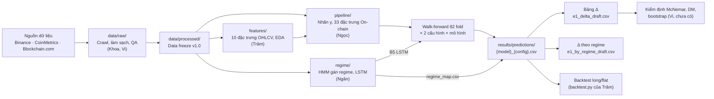

# Tổng quan đề tài: dữ liệu, pipeline, EDA và kết quả thực nghiệm

**Đề tài C1:** Dự báo giá và biến động Bitcoin theo chế độ thị trường bằng dữ liệu On-chain
**Môn:** IS6105 Công nghệ Blockchain · **Nhóm 1:** BLOCK&ROLL · **Cập nhật:** 30/10/2026 (chạy lại toàn bộ E1 với 7 mô hình, có B5 LSTM và regime HMM)

Tài liệu tóm tắt cả luồng làm việc của đề tài, từ dữ liệu thô tới bảng kết quả. Chi tiết của từng phần nằm trong README của thư mục tương ứng (có link ở mỗi mục).

---

## 1. Câu hỏi nghiên cứu

Đề tài đo xem thêm dữ liệu On-chain có giúp dự báo **hướng giá BTC ngày t+1** (tăng hay giảm) tốt hơn khi chỉ dùng dữ liệu giá (OHLCV) không:

```
Δ = M(OHLCV + On-chain) − M(OHLCV-only)
```

Hai vế dùng cùng mô hình, cùng các fold walk-forward và cùng ngân sách tuning; chỉ khác bộ đặc trưng. `M` là một metric (DA, log-loss, Brier, AUC).

| | Câu hỏi | Giả thuyết | Thí nghiệm |
|---|---|---|---|
| RQ1 | OHLCV + On-chain có dự báo tốt hơn OHLCV-only không, và chênh lệch có ý nghĩa thống kê không? | H1: Δ > 0 nhưng nhỏ | E1 |
| RQ2 | Mỗi nhóm On-chain (Activity, Flows, Mining, Valuation) đóng góp bao nhiêu? Xếp hạng theo ablation có khớp SHAP không? | H2: đóng góp không đều; hai xếp hạng không trùng hoàn toàn | E2 |
| RQ3 | Δ có khác nhau giữa Bull, Bear và Sideways không? | H3: có; Δ ở Bull lớn hơn ở Bear | E3 |

Quy tắc chấp nhận H1 (ghi sẵn trong proposal): ΔDA > 0 với p < 0,05 ở mô hình tốt nhất. Mô hình tốt nhất được chọn theo **log-loss của cấu hình OHLCV + On-chain**, trước khi xem Δ.

---

## 2. Luồng tổng thể



Mọi bảng kết quả đều tính từ các file predictions có chung định dạng (`date, fold, y_true, p_hat, regime`). Vì vậy module kiểm định và backtest dùng được cho mọi mô hình mà không phải sửa code.

| Bước | Thư mục | Người | Trạng thái |
|---|---|---|---|
| Crawl, làm sạch, QA | `data/raw/` | Khoa, Vi | ✅ |
| Data freeze v1.0 | `data/processed/`, `src/data_freeze.py` | Khoa, Vi | ✅ |
| Đặc trưng OHLCV, EDA, backtest | `features/` | Trâm | ✅ |
| Walk-forward, đặc trưng On-chain, mô hình, chạy E1 | `pipeline/` | Ngọc | ✅ bản nháp |
| HMM gán regime, B5 LSTM | `regime/` | Ngân | ✅ (regime chưa tái lập được từ repo, xem mục 8) |
| Kiểm định thống kê | | Vi | ⏳ |

---

## 3. Dữ liệu

Chi tiết: [`data/processed/README.md`](data/processed/README.md).

### 3.1 Nguồn

| Nguồn | Dữ liệu | Cột trong master |
|---|---|---|
| Binance Data Vision, nến 1h BTCUSDT | Giá mở, cao, thấp, đóng, volume | `ohlcv_*` |
| CoinMetrics Community API (CC BY-NC 4.0) | Chỉ số On-chain | `cm_*` |
| Blockchain.com Charts API | Transaction volume, difficulty | `bc_*` |
| Tự tính | Puell Multiple, NVT, Netflow | `puell_multiple`, `nvt_ratio_bc`, `cm_NetflowExNtv` |

### 3.2 Data freeze v1.0 (28/10/2026)

Mọi đặc trưng và thí nghiệm **chỉ đọc** `data/processed/`. Mỗi lần chạy, code so sha256 của file với `MANIFEST.json`; lệch thì dừng.

| File | Nội dung |
|---|---|
| `master_daily.csv` | Bảng chính: 3.896 ngày (2016-01-01 → 2026-08-31) × 24 cột |
| `ohlcv_1h_clean.csv` | Giá theo giờ, 78.761 nến; chỉ dùng để tính realized volatility |
| `data_dictionary_{A,B}.csv` | Mô tả từng cột, cột nào được đưa vào mô hình, theo phương án Flows A hoặc B |
| `MANIFEST.json` | sha256 của từng file |

### 3.3 Chỉ số On-chain (phương án Flows A, đang dùng)

| Nhóm | Chỉ số |
|---|---|
| Activity | `cm_AdrActCnt` (địa chỉ hoạt động), `cm_TxCnt` (số giao dịch), `bc_est_tx_vol_usd` (giá trị giao dịch) |
| Flows | `cm_NetflowExNtv` (BTC vào sàn − ra sàn), `cm_SplyExNtv` (BTC nằm trên sàn) |
| Mining | `cm_HashRate`, `cm_FeeTotNtv` (tổng phí), `bc_difficulty` |
| Valuation | `cm_CapMVRVCur` (MVRV), `puell_multiple`, `nvt_ratio_bc` |

Phương án B thay Netflow bằng hai cột FlowIn và FlowOut. Nhóm chốt A hay B ở họp 1.19; code nhận `flows_set: A | B` nên đổi phương án không phải sửa code.

### 3.4 Quy tắc bắt buộc

- **On-chain công bố trễ:** CoinMetrics công bố số liệu ngày d sau 00:00 UTC ngày d+1. Khi dự báo ngày t+1, OHLCV dùng được đến hết ngày t, còn On-chain chỉ dùng đến ngày t−1.
- **Không chuẩn hoá trong data freeze:** mọi biến đổi (scaler, z-score) phải fit trong cửa sổ train của từng fold.
- **Không xem tương quan giữa On-chain và nhãn** trước khi chạy thí nghiệm (chống data snooping).

---

## 4. Đặc trưng

### 4.1 Nhãn

`y_t = 1` nếu `close_{t+1} > close_t`, ngược lại `y_t = 0`.

### 4.2 OHLCV: 10 đặc trưng

Code: `features/src/features_ohlcv.py` (Trâm, task 1.13). Dòng ngày t chỉ dùng dữ liệu đến hết ngày t.

| Đặc trưng | Công thức |
|---|---|
| `logret_lag1` … `logret_lag5` | Log return của ngày t, t−1, …, t−4 |
| `hl_range` | (High − Low) / Close |
| `dlog_volume` | ln V_t − ln V_{t−1} |
| `rsi_14` | RSI 14 ngày kiểu Wilder |
| `rv_7d`, `rv_30d` | Realized volatility từ return 1h trong 7 / 30 ngày gần nhất |

### 4.3 On-chain: 33 đặc trưng

Code: `pipeline/src/features.py` (Ngọc, task 1.16). Mỗi chỉ số cho 3 đặc trưng, rồi dịch 1 ngày (`shift_days: 1`) để tôn trọng độ trễ công bố:

| Loại cột | Đặc trưng |
|---|---|
| Cột dương | `logdiff` = log x_t − log x_{t−1}; `ma7_30` = MA7 / MA30; `z90` = z-score 90 ngày của log x |
| Cột có dấu (Netflow, âm ở khoảng 48% số ngày) | `diff` = x_t − x_{t−1}; `ma7m30` = MA7 − MA30; `z90` = z-score 90 ngày của x |

Ngày nguồn không công bố được điền bằng giá trị trước đó, tối đa 3 ngày. Từ ngày train đầu tiên (2017-12-31), không còn ô trống nào.

---

## 5. EDA

Notebook: `features/notebooks/eda.ipynb` (Trâm, task 1.14). Hình: `features/reports/figures/`.

| Hình | Nội dung | Điều rút ra |
|---|---|---|
| [`eda_01_price.png`](features/reports/figures/eda_01_price.png) | Giá BTC 2018 – 08/2026 (thang log), 2 lần halving, 28 ngày thiếu nến 1h | Giai đoạn nghiên cứu có đủ chu kỳ tăng mạnh (2020–2021, 2023–2025) và giảm mạnh (2018, 2022) |
| [`eda_02_onchain_groups.png`](features/reports/figures/eda_02_onchain_groups.png) | Chuỗi 11 chỉ số On-chain theo 4 nhóm | HashRate, difficulty tăng gần như đơn điệu; MVRV và Puell dao động theo chu kỳ giá; Netflow quanh 0 |
| [`eda_03_missing_map.png`](features/reports/figures/eda_03_missing_map.png) | Bản đồ ô trống 2016–2026 | Từ 2018 gần như không thiếu dữ liệu; chỉ vài ngày lẻ của Blockchain.com |
| [`eda_04_feature_corr.png`](features/reports/figures/eda_04_feature_corr.png) | Tương quan Spearman giữa các đặc trưng | Có đặc trưng trùng thông tin (xem dưới) |
| [`eda_05_label_balance.png`](features/reports/figures/eda_05_label_balance.png) | Tỷ lệ ngày giá tăng theo năm | Dao động từ khoảng 46% (2022) đến 58% (2020) |

Các phát hiện ảnh hưởng tới kết quả:
- **MVRV gần như trùng return của ngày t** (ρ = 0,98). Nhóm Valuation có thể chỉ lặp lại thông tin giá.
- **NVT và giá trị giao dịch** có ρ = −1,00, vì NVT được tính bằng cách chia cho chính giá trị giao dịch đó. **HashRate và Puell** có ρ = 0,95.
- **`rv_7d`, `rv_30d` và `hl_range`** tương quan mạnh với nhau, nên 3 đặc trưng OHLCV mới chỉ thêm ít thông tin.
- **Tỷ lệ ngày tăng thay đổi theo năm**, nên DA của từng giai đoạn nên so với tỷ lệ tăng của chính giai đoạn đó, không so với 50%.

---

## 6. Pipeline thực nghiệm

Code và hướng dẫn chạy: [`pipeline/README.md`](pipeline/README.md).

### 6.1 Walk-forward

| Tham số | Giá trị |
|---|---|
| Cửa sổ train | 730 ngày, trượt |
| Gap giữa train và test | 1 ngày (nhãn ngày train cuối dùng giá ngày test đầu) |
| Cửa sổ test | 30 ngày, bước 30 ngày |
| Giai đoạn test | 2020-01-01 → 2026-08-30: 82 fold, 2.434 ngày |
| Tuning | GridSearchCV trên TimeSeriesSplit(5, gap 1), tiêu chí log-loss, tune lại mỗi 6 fold |
| Chuẩn hoá | StandardScaler nằm trong sklearn Pipeline, fit lại trong từng cửa sổ train |

Mỗi lần chạy đều chạy test trước. Các test kiểm: đặc trưng không nhìn tương lai, có gap giữa train và test, scaler không thấy dữ liệu test, dữ liệu đúng phiên bản freeze. Nhóm đã thử cố tình cài 4 lỗi rò rỉ vào một bản sao và test bắt được cả 4.

### 6.2 Mô hình

| Mã | Mô hình | Người sở hữu | Trạng thái |
|---|---|---|---|
| `b0maj` | B0 majority: p̂ = tỷ lệ ngày tăng trong train | Ngọc | ✅ |
| `b0pers` | B0 persistence: ngày mai cùng hướng hôm nay | Ngọc | ✅ |
| `lr` | B1 Logistic Regression | Trâm | ✅ bản tạm của Ngọc |
| `b2` | B2 Random Forest | Trâm | ✅ bản chạy thử của Ngọc |
| `b3` | B3 SVM RBF, xác suất hiệu chỉnh sigmoid | Ngọc | ✅ |
| `b4` | B4 XGBoost, early stopping trên 20% cuối cửa sổ train | Khoa | ✅ bản chạy thử của Ngọc |
| `b5` | B5 LSTM: 1 lớp, hidden 32, cửa sổ 30 ngày; trung bình 3 seed (42, 43, 44) | Ngân | ✅ code của Ngân, tích hợp vào `run_all.py` |

Hai mô hình B0 không dùng đặc trưng nên luôn có Δ = 0; chúng là mức sàn để so sánh.

### 6.3 Regime

Regime (Bull, Sideways, Bear) do HMM 3 trạng thái của Ngân gán cho từng ngày test, theo cùng lịch walk-forward (`regime/regime_hmm.py`). HMM fit lại trong mỗi fold, dùng forward filtering nên không nhìn tương lai. Pipeline đọc `regime_map.csv` và ghép vào cột `regime` của mọi file dự báo theo `date` + `fold`.

| Regime | Số ngày test | Tỷ lệ ngày tăng |
|---|---|---|
| Bull | 1.250 | 51,6% |
| Sideways | 902 | 49,7% |
| Bear | 282 | 51,8% |

### 6.4 Chạy lại

```bash
source .venv/bin/activate        # Python 3.14; macOS cần brew install libomp cho xgboost; b5 cần torch
python pipeline/src/run_all.py --stage data
python pipeline/src/run_all.py --stage e1 --models lr b0pers b0maj b2 b3 b4 b5    # khoảng 10 phút
python features/src/backtest.py                                          # backtest
```

Kết quả tái lập được: chạy lại cho file dự báo giống hệt nhau (Python 3.11 và 3.14), trừ `b2` lệch khoảng 1e-15 do cộng song song trong Random Forest.

---

## 7. Kết quả E1 (bản nháp, chạy lại 30/10/2026)

Phương án Flows A, 10 đặc trưng OHLCV + 33 đặc trưng On-chain, 82 fold, 2.434 ngày test. Bảng đầy đủ: [`pipeline/results/tables/e1_delta_draft.csv`](pipeline/results/tables/e1_delta_draft.csv).

### 7.1 Độ chính xác và xác suất

DA (tỷ lệ đoán đúng hướng) và AUC: cao hơn là tốt hơn. Log-loss: thấp hơn là tốt hơn.

| Mô hình | DA: OHLCV → +On-chain | ΔDA | Log-loss: OHLCV → +On-chain | Δlog-loss | ΔAUC |
|---|---|---|---|---|---|
| `b0maj` | 0,5008 | 0 | 0,6938 | 0 | 0 |
| `b0pers` | 0,4651 | 0 | không dùng | 0 | 0 |
| `lr` | 0,5111 → 0,5189 | +0,0078 | 0,6953 → 0,7006 | +0,0054 | +0,0034 |
| `b2` | 0,5123 → 0,5140 | +0,0016 | 0,6961 → 0,6957 | −0,0005 | +0,0007 |
| `b3` | 0,5062 → 0,5029 | −0,0033 | 0,7009 → 0,6959 | −0,0050 | −0,0045 |
| `b4` | 0,5045 → 0,4897 | −0,0148 | 0,6973 → 0,6958 | −0,0015 | −0,0030 |
| `b5` | 0,5074 → 0,5058 | −0,0016 | 0,6950 → 0,6959 | +0,0009 | +0,0092 |

### 7.2 Backtest

Chiến lược long/flat: giữ BTC ngày t+1 nếu p̂ > 0,5, phí 0,1% mỗi lần đổi vị thế, 2020-01-02 → 2026-08-31.

| Mô hình | Lợi nhuận tích luỹ: OHLCV → +On-chain | Sharpe | MDD | % ngày giữ BTC |
|---|---|---|---|---|
| Buy-and-hold | +990% | 0,90 | −77% | 100% |
| `b0maj` | +72% | 0,43 | −82% | 63% |
| `b0pers` | −71% | −0,23 | −79% | 51% |
| `lr` | +19% → +245% | 0,31 → 0,63 | −87% → −65% | 56% → 55% |
| `b2` | +241% → +14% | 0,62 → 0,29 | −80% → −76% | 55% → 54% |
| `b3` | +286% → +63% | 0,65 → 0,41 | −72% → −80% | 73% → 65% |
| `b4` | −43% → −65% | 0,11 → −0,05 | −86% → −93% | 63% → 58% |
| `b5` | +99% → +192% | 0,46 → 0,61 | −85% → −56% | 58% → 33% |

### 7.3 Theo regime (sơ bộ cho E3, chưa có khoảng tin cậy)

Bảng đầy đủ (DA, log-loss từng regime): [`pipeline/results/tables/e1_by_regime_draft.csv`](pipeline/results/tables/e1_by_regime_draft.csv).

| Mô hình | ΔDA Bull (1.250 ngày) | ΔDA Sideways (902 ngày) | ΔDA Bear (282 ngày) |
|---|---|---|---|
| `lr` | +0,0008 | +0,0166 | +0,0106 |
| `b2` | −0,0120 | +0,0166 | +0,0142 |
| `b3` | −0,0064 | −0,0089 | +0,0284 |
| `b4` | −0,0112 | −0,0288 | +0,0142 |
| `b5` | −0,0208 | +0,0155 | +0,0284 |

### 7.4 Nhận xét

1. **Mọi mô hình chỉ đoán đúng 49–52% số ngày**, gần như tung đồng xu. Thêm LSTM (B5) cũng không thay đổi điều này.
2. **Không mô hình có học nào thắng mức sàn `b0maj` về log-loss** (0,6938), ở cả hai cấu hình. Xác suất mô hình đưa ra chưa tốt hơn việc luôn đoán bằng tỷ lệ ngày tăng của tập train.
3. **On-chain không giúp một cách nhất quán.** ΔDA dương ở `lr` và `b2`, âm ở `b3`, `b4` và `b5`. Với 2.434 ngày, sai số chuẩn của DA khoảng 1 điểm %, nên hầu hết Δ nằm trong mức nhiễu.
4. **`b4` có ΔDA −1,5 điểm**, hơi vượt mức nhiễu. Nhưng Δlog-loss của `b4` lại âm (On-chain tốt hơn chút), nên hai chỉ số mâu thuẫn nhau. Cần kiểm định mới kết luận được.
5. **Theo quy tắc chọn mô hình ghi sẵn**, mô hình có log-loss thấp nhất ở cấu hình đầy đủ là `b2` (0,6957), sát với `b4` (0,6958), `b3` và `b5` (0,6959). ΔDA của `b2` chỉ +0,16 điểm, nên khó có khả năng đạt p < 0,05 để chấp nhận H1.
6. **Δ rất nhạy với bộ đặc trưng OHLCV.** Khi đổi từ 7 đặc trưng tạm sang 10 đặc trưng, ΔDA của `lr` đổi dấu từ −0,45 thành +0,78 điểm.
7. **Không mô hình nào thắng buy-and-hold.** Xếp hạng theo lợi nhuận khác xếp hạng theo DA, vì lời lỗ phụ thuộc vào việc đoán đúng những ngày giá biến động mạnh. `b5` + On-chain chỉ giữ BTC 33% số ngày mà lời +192% với MDD −56%, nhưng DA không đổi, nên có thể là may mắn về thời điểm.
8. **`b3` lệch về phía "tăng".** Ở cấu hình OHLCV-only, `b3` giữ BTC 73% số ngày, trong khi chỉ 51% số ngày test là ngày tăng.
9. **Theo regime, chiều của Δ ngược với H3.** ΔDA ở Bear dương với cả 5 mô hình có học (+1,1 đến +2,8 điểm), còn ở Bull âm với 4/5 mô hình. H3 dự kiến Δ ở Bull lớn hơn ở Bear. Tuy nhiên Bear chỉ có 282 ngày (sai số chuẩn của DA khoảng 3 điểm), nên cần CI bootstrap và placebo của E3 trước khi kết luận.
10. **Regime HMM chưa chắc phân biệt được hướng giá ngày t+1.** Tỷ lệ ngày tăng gần như bằng nhau giữa ba regime (49,7–51,8%).
11. **Quy ước ngày đã được kiểm chéo.** `b0pers` cho −71% ở cả code backtest của Trâm và kết quả của Ngọc, dù hai bên viết code độc lập.

**Kết luận tạm thời cho RQ1:** 5 mô hình khác nhau (tuyến tính, cây, SVM, boosting, LSTM) đều không cho thấy On-chain cải thiện dự báo hướng giá ngày t+1 một cách nhất quán. Điều này khớp với phỏng đoán trong proposal: Δ trên toàn kỳ nhỏ và có thể không có ý nghĩa thống kê. Chưa phải kết luận chính thức, vì còn thiếu kiểm định và bản chính thức của B1, B2, B4.

---

## 8. Việc còn lại

| Việc | Người | Hạn |
|---|---|---|
| Bản chính thức B1, B2 (grid theo kế hoạch) | Trâm | 02/11 |
| Bản chính thức B4 | Khoa | 02/11 |
| Script tạo `regime_map.csv` (đầu vào `log_return`, `realized_volatility` cho HMM) | Ngân | |
| Kiểm định McNemar, Diebold–Mariano, bootstrap; bảng Δ chính | Vi | 04/11 |
| Backtest E1 đầy đủ, equity curve | Trâm | 04/11 |
| E0 sanity check: xáo nhãn, so với chia 80/20 | Ngọc | |
| E2 ablation + SHAP (RQ2) | Khoa | Tuần 4 |
| E3 theo regime + placebo (RQ3) | Ngân, Vi | Tuần 4 |

Các điểm nhóm cần chốt:
1. **Phương án Flows A hay B** (họp 1.19). Nếu chốt B, phải chạy lại các cấu hình OHLCV + On-chain.
2. **Có lọc ngày thiếu nến không.** Hai ngày 2018-02-08 và 2018-02-09 có `dlog_volume` rất lớn và nằm trong cửa sổ train của các fold đầu. Câu hỏi là có bỏ các ngày `ohlcv_n_bars_1h < 24` không.
3. **Xử lý đặc trưng trùng thông tin** trước E2: MVRV ≈ return, NVT ≈ −giá trị giao dịch.
4. **Cửa sổ train 1.095 ngày** (phần kiểm tra độ nhạy). Fold đầu sẽ cần dữ liệu từ 31/12/2016, nhưng OHLCV chỉ có từ 17/08/2017.
5. **Regime HMM chưa tái lập được từ repo.** `regime_map.csv` là file xuất sẵn; repo chưa có đoạn code tạo đầu vào cho `regime_hmm.py`. Thử dựng lại bằng 14 cách tính realized volatility chỉ khớp 39–59% số ngày.
