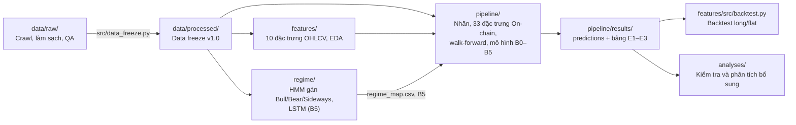

# Dự báo hướng giá Bitcoin bằng dữ liệu On-chain

**Đề tài C1** · Môn IS6105 Công nghệ Blockchain · **Nhóm 1 – BLOCK&ROLL**

Repo này kiểm tra xem **thêm dữ liệu On-chain** có giúp dự báo **hướng giá BTC ngày t+1** (tăng hay giảm) tốt hơn so với khi **chỉ dùng dữ liệu giá (OHLCV)** hay không:

```
Δ = M(OHLCV + On-chain) − M(OHLCV-only)
```

Hai vế dùng cùng mô hình, cùng 82 fold walk-forward và cùng cách tuning, chỉ khác bộ đặc trưng. `M` là một metric (DA, log-loss, Brier, AUC).

| | Câu hỏi | Thí nghiệm |
|---|---|---|
| RQ1 | OHLCV + On-chain có tốt hơn OHLCV-only không, và chênh lệch có ý nghĩa thống kê không? | E1 |
| RQ2 | Mỗi nhóm On-chain (Activity, Flows, Mining, Valuation) đóng góp bao nhiêu? | E2 |
| RQ3 | Δ có khác nhau giữa các chế độ thị trường Bull, Bear, Sideways không? | E3 |

Chi tiết về dữ liệu, EDA và kết quả nằm ở [`PROJECT_FLOW.md`](PROJECT_FLOW.md). Mỗi thư mục có README riêng.

---

## 1. Luồng tổng thể



Mọi file dự báo dùng chung một định dạng: `date, fold, y_true, p_hat, regime`. Nhờ vậy code tính bảng, kiểm định và backtest dùng được cho mọi mô hình mà không phải sửa.

---

## 2. Cấu trúc thư mục

```
.
├── README.md                 ← bạn đang đọc
├── PROJECT_FLOW.md           Tổng quan đề tài: dữ liệu, pipeline, EDA, kết quả
├── data/
│   ├── raw/                  (1) Dữ liệu thô: crawl, làm sạch, QA
│   └── processed/            (2) Data freeze v1.0: nguồn dữ liệu DUY NHẤT cho thí nghiệm
├── src/
│   └── data_freeze.py        Tạo data/processed/ từ data/raw/
├── features/                 (3) Đặc trưng OHLCV, EDA, backtest
├── pipeline/                 (4) Pipeline chính: walk-forward, mô hình, thí nghiệm E1–E3
├── regime/                   (5) Gán regime thị trường (HMM), mô hình LSTM
├── analyses/                 (6) Kiểm tra và phân tích bổ sung (theo góp ý của giảng viên)
└── docs/                     (7) Proposal, báo cáo giữa kỳ, góp ý, kế hoạch
```

---

## 3. Chức năng từng thành phần

### (1) `data/raw/` — Dữ liệu thô

| Thư mục | Nội dung |
|---|---|
| `khoa-btc-onchain-ohlcv-daily-2016-2026/` | Bảng ngày 2016-01-01 → 2026-08-31: nến BTCUSDT của Binance, chỉ số On-chain từ CoinMetrics và Blockchain.com, Puell Multiple, NVT. Kèm data dictionary và kiểm tra tính sẵn có của từng chỉ số |
| `vi_ohlcv_flows/` | Tải nến 1h từ Binance Data Vision (có kiểm `.CHECKSUM`), làm sạch OHLCV, kiểm chứng dữ liệu Flows (dòng BTC vào/ra sàn), QA và kiểm tra CoinMetrics có sửa lại lịch sử hay không |

Thư mục này chỉ để tạo dữ liệu. **Mô hình không đọc trực tiếp từ đây.**

### (2) `data/processed/` — Data freeze v1.0

Đây là dữ liệu chính thức. Mọi đặc trưng và thí nghiệm **chỉ đọc** từ đây, và mỗi lần chạy đều so sha256 với `MANIFEST.json` (lệch thì dừng).

| File | Nội dung |
|---|---|
| `master_daily.csv` | Bảng chính: 3.896 ngày × 24 cột (OHLCV + On-chain) |
| `ohlcv_1h_clean.csv` | Giá theo giờ, chỉ dùng để tính realized volatility |
| `data_dictionary_{A,B}.csv` | Mô tả từng cột và cột nào được đưa vào mô hình, theo phương án Flows A hoặc B |
| `MANIFEST.json` | sha256, số dòng, số cột của từng file |

Tạo lại bằng `src/data_freeze.py`. Khi thấy lỗi dữ liệu thì ra phiên bản mới (v1.1, …), **không sửa đè**.

### (3) `features/` — Đặc trưng OHLCV, EDA, backtest

| File | Chức năng |
|---|---|
| `src/features_ohlcv.py` | 10 đặc trưng OHLCV (log return trễ 1–5 ngày, biên độ cao–thấp, thay đổi volume, RSI 14, realized volatility 7/30 ngày) cùng cột `up_today`. Pipeline gọi hàm `build_ohlcv_features` trong file này |
| `src/backtest.py` | Backtest chiến lược long/flat từ p̂ (phí 0,1%/lượt): lợi nhuận tích luỹ, Sharpe, max drawdown, so với buy-and-hold |
| `notebooks/eda.ipynb` | EDA trên data freeze. Hình nằm ở `reports/figures/` |
| `data/features_ohlcv.csv` | Bảng đặc trưng OHLCV đã tính sẵn |

### (4) `pipeline/` — Pipeline chính

Đây là phần lõi của đề tài: tạo nhãn, tạo đặc trưng, chia fold, huấn luyện mô hình, ghi dự báo và tính các bảng kết quả.

**`src/`**

| File | Chức năng |
|---|---|
| `data.py` | Đọc data freeze (kiểm sha256), tên cột dùng chung, đọc/ghi CSV |
| `features.py` | Nhãn `y_t = 1[close_{t+1} > close_t]` và 33 đặc trưng On-chain (dịch 1 ngày vì On-chain công bố trễ) |
| `walkforward.py` | Walk-forward chống rò rỉ: train 730 ngày, gap 1 ngày, test 30 ngày, 82 fold (01/2020 – 08/2026); tune bằng `TimeSeriesSplit(5, gap=1)` theo log-loss, tune lại mỗi 6 fold |
| `models.py` | Interface chung cho mô hình và danh sách mô hình đã đăng ký (xem bảng dưới) |
| `run_all.py` | Chạy E1 bằng một lệnh (`--stage data / e1 / regime / tables`), ghép regime, tính bảng Δ |
| `stats.py` | Kiểm định: block bootstrap, McNemar, Diebold–Mariano, hiệu chỉnh Holm |
| `experiments.py` | Báo cáo tuning, E2 (ablation theo nhóm On-chain), E3 (Δ theo regime) |
| `gate.py` | Kiểm baseline OHLCV trước, sau đó thêm từng nhóm On-chain theo inner CV |
| `hybrid.py` | Kết hợp luật đảo chiều với mô hình (dùng luật làm đặc trưng hoặc để ghi đè dự báo) |
| `lr_tuning.py` | Tuning đầy đủ cho B1 Logistic Regression (tập đặc trưng, C, L1/L2, class_weight) |
| `rules30.py` | Luật đơn giản theo cửa sổ 30 ngày, bảng accuracy / F1 |

**Mô hình** (config ở `configs/models/*.yaml`; quy ước đặt tên ở [`configs/models/README.md`](pipeline/configs/models/README.md)). Mã có **hậu tố `t`** là bản **đã tune lại**, nằm cạnh bản tune bằng grid gốc:

| Baseline | Không tune | Grid gốc (Phụ lục C) | Đã tune lại |
|---|---|---|---|
| B0 | `b0maj` Majority (mức sàn log-loss)<br>`b0pers` Persistence (mức sàn DA)<br>`b0rev` Đảo chiều (chiều chọn trên train) | | |
| B1 Logistic Regression | | `lr`<br>`lrfs` (+ chọn đặc trưng tiến dần) | `lrt` (tune cả tập đặc trưng, C, L1/L2, class_weight; chạy bằng `lr_tuning.py`) |
| B2 Random Forest | | `b2` | `b2t` (xem `analyses/b2_tuning/`) |
| B3 SVM RBF | | `b3` | |
| B4 XGBoost | | `b4` (số cây chọn bằng early stopping) | |
| B5 LSTM | `b5` (code ở `regime/model_lstm.py`) | | |

**`configs/`**: `walkforward.yaml` (lịch fold), `features_onchain.yaml` (bộ đặc trưng On-chain v1, dùng cho E1), `features_onchain_v2.yaml` (bộ v2, dùng cho E2).

**`results/`**: `predictions/` (dự báo `{model}_{config}.csv`), `tables/` (bảng E1), `e2/`, `e3/`, `tuning/`, `lr_tuning/`, `gate/`, `hybrid/`, `rules30/`, `figures/`.

### (5) `regime/` — Chế độ thị trường và LSTM

| File | Chức năng |
|---|---|
| `regime_hmm.py` | HMM gán regime Bull / Bear / Sideways theo walk-forward |
| `run_regime.py` | Tái lập `regime_map.csv` từ data freeze; tạo thêm regime theo xu hướng (MA200 + return 90 ngày) và so sánh hai cách gán |
| `regime_map.csv`, `regime_trend_map.csv` | Regime theo ngày và fold, được ghép vào cột `regime` của mọi file dự báo |
| `model_lstm.py` | Mô hình B5 LSTM, được gọi từ `pipeline/src/run_all.py` |

### (6) `analyses/` — Kiểm tra và phân tích bổ sung

Các phân tích này phần lớn được làm theo góp ý của giảng viên. Chúng dùng lại dữ liệu, đặc trưng và fold của `pipeline/` và `features/` để số liệu so được trực tiếp với nhau. Mỗi thư mục có `src/` (code), `reports/` (báo cáo `.md` và hình) và thường có `results/`.

| Thư mục | Chức năng | Báo cáo chính |
|---|---|---|
| `baseline_check/` | Góp ý 1: kiểm tra dữ liệu và nhãn bằng ví dụ cụ thể, EDA của nhãn, baseline cơ bản trên cách chia cố định, xem trực tiếp dự báo đúng/sai | `reports/baseline_check.md` |
| `metrics_check/` | Góp ý 2: kiểm định nghĩa và cách tính DA, log-loss, Brier, AUC trên file dự báo chính thức | `reports/metrics_check.md` |
| `baselines/` | Chạy và tune B0 (Majority, Persistence, Đảo chiều, Buy-and-hold) và B3 SVM, so trước và sau tuning | `reports/baselines_report.md` |
| `b2_tuning/` | Tune lại grid của B2 Random Forest, tạo mô hình `b2t` | `README.md` |
| `lstm_tuning/` | Tune B5 LSTM và kiểm độ nhạy theo random seed | `reports/lstm_tuning.md` |
| `simple_split/` | Chạy 5 nhóm baseline trên cùng một cách chia train / validation / test | `reports/simple_split.md` |
| `naive_folds/` | So các mô hình với baseline "luôn tăng" và "luôn giảm" trên từng fold | `reports/naive_folds.md` |
| `up_today/` | Thêm đặc trưng `up_today` (dấu return hôm nay), chạy lại B1 và B3 | `reports/up_today_report.md` |
| `paper_replication/` | Tái lập các bài báo tham khảo (Hafid 2024, …) và áp dụng lên dữ liệu của nhóm | `<bài báo>/reports/` |

### (7) `docs/` — Tài liệu

| File / thư mục | Nội dung |
|---|---|
| `Blockchain-Group1-Project-Proposal-V2-FINAL.pdf` | Proposal |
| `*Midterm*.pdf`, `*.docx`, `midterm/` | Báo cáo giữa kỳ (các bản review) |
| `feedback_review/report.md` | Tổng hợp phản hồi cho từng góp ý của giảng viên |
| `TOM_TAT_DU_AN.md` | Tóm tắt dự án |
| `midterm_*.md` | Ghi chú các thay đổi trong báo cáo giữa kỳ |
| `Task_Planning_Group1_BlocknRoll.docx` | Phân công công việc |
| `superpowers/` | Thiết kế và kế hoạch chi tiết của một số phân tích |

---

## 4. Quy tắc chung

- **Chỉ đọc `data/processed/`.** Không sửa dữ liệu trong code của mình. Thấy lỗi dữ liệu thì báo để ra phiên bản mới.
- **Không rò rỉ thông tin từ tương lai:**
  - Dòng ngày t chỉ dùng OHLCV đến hết ngày t, và On-chain đến hết ngày t−1.
  - Giữa train và test có gap 1 ngày.
  - Scaler và mọi biến đổi đều được fit lại trong từng cửa sổ train.
- **Tuning chỉ dùng train/validation**, không chọn mô hình hoặc tham số theo kết quả test.
- **Mô hình tốt nhất** được chọn theo log-loss của cấu hình OHLCV + On-chain, trước khi xem Δ.
- **Mọi lệnh chạy từ thư mục gốc repo.**

---

## 5. Bắt đầu nhanh

Cài thư viện (Python 3.12):

```bash
python -m venv .venv && source .venv/bin/activate
pip install numpy pandas scikit-learn scipy matplotlib pyyaml tabulate
pip install xgboost torch      # chỉ cần cho B4, B5/LSTM, simple_split, lstm_tuning
```

Các lệnh thường dùng:

```bash
python pipeline/src/run_all.py --test                     # chạy test của pipeline (~10 giây)
python pipeline/src/run_all.py --stage data               # kiểm data freeze, đặc trưng, fold
python pipeline/src/run_all.py --stage e1 --models lr b0pers b0maj b2 b3 b4 b5   # chạy E1
python pipeline/src/run_all.py --stage tables             # tính lại bảng từ predictions có sẵn
python features/src/backtest.py                           # backtest mọi file dự báo
python analyses/metrics_check/src/metrics_check.py        # kiểm tra metric
```

Lệnh chi tiết của từng phần: xem README trong thư mục tương ứng.

---

## 6. Đổi tên thư mục (11/2026)

Thư mục đã được sắp xếp lại theo chức năng. Nếu tài liệu cũ hoặc branch cũ còn dùng tên cũ, đối chiếu theo bảng sau:

| Tên cũ | Tên mới |
|---|---|
| `crawl_data/` | `data/raw/` |
| `ngoc_pipeline/` | `pipeline/` |
| `tram_features_backtest/` | `features/` |
| `ngan_lstm_hmm_analysis/` | `regime/` |
| `tram_baselines/` | `analyses/baselines/` |
| `baseline_check/`, `metrics_check/`, `simple_split/`, `b2_tuning/`, `lstm_tuning/` | `analyses/<cùng tên>/` |
| `tram_naive_folds/` | `analyses/naive_folds/` |
| `tram_up_today/` | `analyses/up_today/` |
| `experiment_paper/` | `analyses/paper_replication/` |
| `feedback_review/` | `docs/feedback_review/` |
