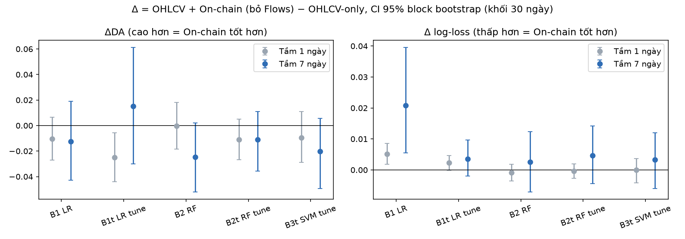
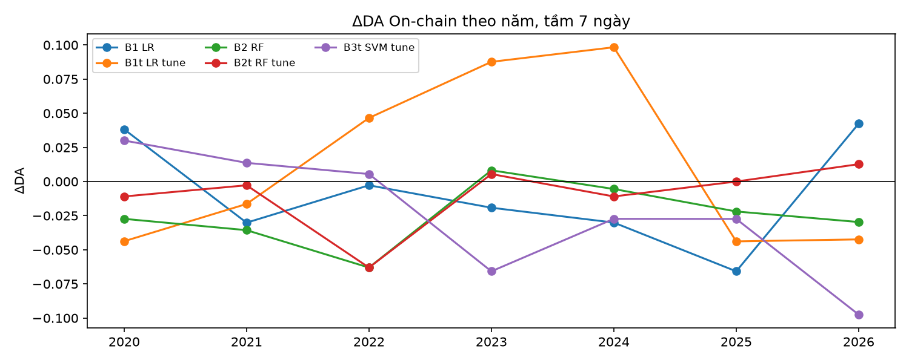

# Task 6 – Dự báo hướng giá 7 ngày tới: On-chain có thực sự giúp ích?

Owner: Vi · Kế hoạch cuối kỳ, mục 6 (liên quan 5c: tầm dự báo 7 ngày) · Code: `analyses/horizon7/src/horizon7.py`

## Kết luận ngắn

**Không.** Ở tầm 7 ngày, thêm On-chain (bỏ Flows) **không cải thiện** dự báo hướng giá, giống kết quả ở tầm 1 ngày:

- 4/5 mô hình có ΔDA âm (−1,1 đến −2,5 điểm %), chỉ B1t dương (+1,5 điểm). Khoảng tin cậy 95% của **cả 5 mô hình đều chứa 0**. Sau hiệu chỉnh Holm, không có ΔDA nào có ý nghĩa.
- Log-loss tăng (kém đi) ở **cả 5 mô hình**. B1 LR kém đi rõ nhất: +0,021, CI [+0,006; +0,040], p_DM = 0,011, sau Holm là 0,056.
- Kết quả không nhất quán theo năm. Không mô hình nào có ΔDA > 0 ở quá 3/7 năm. Mức +1,5 điểm của B1t chỉ đến từ 2022–2024; các năm 2020, 2021, 2025, 2026 đều âm.
- Ở tầm 7 ngày, bài toán còn khó hơn tầm 1 ngày. Mọi mô hình có DA quanh 47–53% và AUC < 0,5. Không mô hình nào thắng chắc chắn luật Majority (50,6%).

Vì vậy giả thuyết "tín hiệu On-chain đổi chậm nên chỉ có ích ở tầm dài hơn" **không được dữ liệu ủng hộ**, ít nhất với tầm 7 ngày, bộ đặc trưng v1 bỏ Flows và các mô hình hiện có.

## 1. Thiết kế (chốt trước khi chạy)

Giữ nguyên mọi thứ của E1 bỏ Flows (`pipeline/results/no_flows`), chỉ đổi nhãn và những gì nhãn mới bắt buộc phải đổi:

| | Tầm 1 ngày (E1 no_flows) | Tầm 7 ngày (task này) |
|---|---|---|
| Nhãn | `y_t = 1[close_{t+1} > close_t]` | `y_t = 1[close_{t+7} > close_t]` |
| Đặc trưng | 10 OHLCV; + 27 On-chain v1 bỏ Flows | giống hệt |
| Walk-forward | train 730, test 30, bước 30 | giống hệt |
| Gap train–test | 1 ngày | **7 ngày** (nhãn ngày train cuối dùng close 7 ngày sau) |
| Inner CV để tune | TimeSeriesSplit(5, gap 1), log-loss, tune lại mỗi 6 fold | TimeSeriesSplit(5, **gap 7**), còn lại giống hệt |
| Ngày test | 01/01/2020 – 30/08/2026, 82 fold | 01/01/2020 – 24/08/2026, 81 fold (7 ngày cuối chưa có nhãn) |
| Mô hình | grid/config trong `pipeline/configs/models/` | giống hệt (SVM hiệu chỉnh với gap 7) |

Luật B0 ở tầm 7 ngày: **Persistence 7d** dự báo xu hướng 7 ngày qua tiếp diễn, `p̂_t = 1[close_t > close_{t−7}]`. **Đảo chiều 7d** chọn persistence hoặc ngược lại theo cửa sổ train, như `b0rev`. **Majority** dùng p̂ = tỷ lệ tăng trong train.

**Kiểm định khi nhãn chồng lấn.** Nhãn 7 ngày của hai ngày liền nhau dùng chung 6/7 đoạn giá, nên các ngày test không độc lập. Vì vậy:

- CI 95% tính bằng circular block bootstrap, khối **30 ngày**. Bảng tầm 1 ngày trong báo cáo này cũng được tính lại với khối 30 để hai tầm so được với nhau.
- Δ log-loss kiểm bằng Diebold–Mariano, lag Newey–West = 14 (= 2 × 7).
- **Không dùng McNemar**, vì kiểm định này giả định các ngày độc lập.
- Kiểm thêm trên **mẫu không chồng lấn**: mỗi 7 ngày lấy 1 ngày (347 ngày), làm lại với cả 7 cách chọn ngày bắt đầu.
- Hiệu chỉnh Holm trên 5 mô hình có học, riêng cho DA và cho log-loss.

## 2. Kết quả chính: Δ = OHLCV + On-chain − OHLCV-only

`results/tables/delta_onchain.csv`

| Mô hình | DA OHLCV | DA +On-chain | **ΔDA** [CI 95%] | p Holm | Δ log-loss [CI 95%] | p_DM Holm | Mẫu không chồng lấn: ΔDA > 0 |
|---|---|---|---|---|---|---|---|
| B1 LR | 49,4% | 48,2% | −1,2 [−4,3; +1,9] | 1,00 | **+0,021 [+0,006; +0,040]** | 0,056 | 2/7 |
| B1t LR tune | 47,3% | 48,9% | +1,5 [−3,0; +6,1] | 1,00 | +0,004 [−0,002; +0,010] | 0,76 | 6/7 |
| B2 RF | 49,2% | 46,7% | −2,5 [−5,2; +0,2] | 0,37 | +0,003 [−0,007; +0,012] | 0,99 | 1/7 |
| B2t RF tune | 50,3% | 49,2% | −1,1 [−3,6; +1,1] | 1,00 | +0,005 [−0,004; +0,014] | 0,88 | 2/7 |
| B3t SVM tune | 53,0% | 51,0% | −2,0 [−4,9; +0,6] | 0,57 | +0,003 [−0,006; +0,012] | 0,99 | 1/7 |

ΔDA tính bằng điểm %. Δ log-loss dương nghĩa là On-chain làm dự báo **kém** đi.



### So với tầm 1 ngày

`results/tables/h1_vs_h7.csv`

| Mô hình | ΔDA, 1 ngày | ΔDA, 7 ngày | Δ log-loss, 1 ngày | Δ log-loss, 7 ngày |
|---|---|---|---|---|
| B1 LR | −1,0 | −1,2 | +0,005 | +0,021 |
| B1t LR tune | −2,5 | +1,5 | +0,002 | +0,004 |
| B2 RF | −0,0 | −2,5 | −0,001 | +0,003 |
| B2t RF tune | −1,1 | −1,1 | −0,000 | +0,005 |
| B3t SVM tune | −0,9 | −2,0 | −0,000 | +0,003 |

Kéo dài tầm dự báo không đảo được dấu của Δ. Log-loss của bản có On-chain còn kém hơn rõ hơn ở tầm 7 ngày. Một cách giải thích hợp lý: 27 đặc trưng On-chain cộng với chỉ khoảng 104 "mẫu độc lập" trong mỗi cửa sổ train 730 ngày (730 / 7) làm mô hình dễ overfit hơn.

## 3. Có nhất quán qua các năm không?

`results/tables/delta_by_year.csv`, `consistency_by_year.csv`

ΔDA theo năm (điểm %):

| Năm | B1 | B1t | B2 | B2t | B3t |
|---|---|---|---|---|---|
| 2020 | +3,8 | −4,4 | −2,7 | −1,1 | +3,0 |
| 2021 | −3,0 | −1,6 | −3,6 | −0,3 | +1,4 |
| 2022 | −0,3 | +4,7 | −6,3 | −6,3 | +0,5 |
| 2023 | −1,9 | +8,8 | +0,8 | +0,5 | −6,6 |
| 2024 | −3,0 | +9,8 | −0,5 | −1,1 | −2,7 |
| 2025 | −6,6 | −4,4 | −2,2 | 0,0 | −2,7 |
| 2026 (đến 24/08) | +4,2 | −4,2 | −3,0 | +1,3 | −9,7 |
| **Số năm ΔDA > 0** | 2/7 | 3/7 | 1/7 | 2/7 | 3/7 |
| Số năm CI > 0 | 0 | 1 | 0 | 0 | 0 |



Không mô hình nào cải thiện ổn định. Mức dương của B1t tập trung ở 2022–2024, rồi đổi dấu ở 2025–2026. Đây là kiểu "có tác dụng ở một giai đoạn" mà góp ý 5 của thầy yêu cầu báo cáo rõ, không được tính là cải thiện chung.

Theo regime HMM (`delta_by_regime.csv`), B2, B2t, B3t có ΔDA âm ở cả Bull, Bear lẫn Sideways. Chỉ B1t dương ở Bull (+2,7) và Bear (+5,0, nhưng chỉ có 282 ngày).

## 4. Mô hình có thắng luật đơn giản không? (tầm 7 ngày)

`results/tables/metrics.csv`, `vs_baselines.csv`

| | DA | Log-loss | AUC |
|---|---|---|---|
| B0 Majority | 50,6% | 0,698 | – |
| B0 Persistence 7d | 48,9% | – | – |
| B0 Đảo chiều 7d | 48,5% | – | – |
| Mô hình tốt nhất (B3t, OHLCV) | 53,0% | 0,702 | 0,488 |
| Các mô hình còn lại | 46,7–50,3% | 0,697–0,725 | 0,446–0,475 |

Tỷ lệ tuần tăng giá trong giai đoạn test là 53,5%, nhưng Majority chỉ đạt 50,6% vì có những fold mà cửa sổ train thiên về giảm. Không mô hình nào có DA cao hơn Majority với CI nằm trên 0. B3t OHLCV hơn Majority +2,4 điểm, CI [−1,8; +6,7]. AUC của mọi mô hình < 0,5, tức xác suất dự báo không xếp hạng được ngày tăng và ngày giảm. Tầm 7 ngày vì vậy chưa có tín hiệu dự báo, kể cả khi chỉ dùng OHLCV. On-chain không thêm được tín hiệu vào một nền như vậy.

## 5. Dự báo thật cho 7 ngày sau ngày cuối của data freeze

`results/tables/forecast_next7.csv` · `--stage forecast`

Cách làm: train trên 730 ngày có nhãn gần nhất (25/08/2024 – 24/08/2026), tune lại theo cùng quy trình, rồi dự báo cho các ngày 25–31/08/2026 (kết quả là giá của 01–07/09/2026). Data freeze v1.0 dừng ở 31/08/2026 nên **chưa chấm được**. Muốn chấm phải có data freeze mới.

P(close_{t+7} > close_t), ngày t = 31/08/2026, tức dự báo hướng giá đến 07/09/2026:

| Mô hình | OHLCV | OHLCV + On-chain |
|---|---|---|
| B1 LR | 0,526 | 0,578 |
| B1t LR tune | 0,444 | 0,500 (\*) |
| B2t RF tune | 0,521 | 0,534 |

(\*) Với cấu hình On-chain, B1t chọn C = 1e-4 và L1, làm mọi hệ số bằng 0, nên p̂ = 0,5: mô hình "không dự báo".

Mọi xác suất đều nằm trong khoảng 0,44–0,58, tức gần mức không biết. Điều này khớp với AUC < 0,5 ở phần 4: không nên dùng các con số này để ra quyết định giao dịch.

## 6. Giới hạn

- **SVM, fold 36–41.** Ở lần tune fold 36, đoạn hiệu chỉnh xác suất nhỏ nhất của SVM (24 ngày liền nhau) chỉ có một loại nhãn, nên cả 30 tổ hợp đều lỗi. `walkforward.tune` khi đó lấy tổ hợp đầu tiên của lưới (C = 0,01, gamma = 0,001) cho cả hai cấu hình. Hai bên chịu cùng một quy tắc nên Δ vẫn công bằng, nhưng B3t ở 6 fold này coi như không được tune.
- **Mô hình chưa chạy.** B4/B4t (XGBoost) và B5 (LSTM) chưa chạy vì máy chạy thiếu `xgboost`/`torch`. B1fs cũng chưa chạy vì tốn thời gian. Có thể chạy thêm bằng cách thêm mã mô hình vào `--models` (B4 cần `gap=7` như B3t; script đã tự đặt).
- **Một tầm, một bộ đặc trưng.** Mới thử một tầm (7 ngày) và một bộ đặc trưng (v1 bỏ Flows). Bộ v2 có sai phân 7 ngày, phù hợp hơn cho tầm tuần, và có thể thử tiếp. Theo nguyên tắc của kế hoạch, kết quả trên mới là kết quả chính, còn các phép thử thêm chỉ là phân tích độ nhạy.
- **Ít mẫu độc lập.** 2.428 ngày test chỉ tương đương khoảng 347 tuần độc lập, nên CI rộng (±3–5 điểm DA). Một hiệu ứng thật cỡ 1–2 điểm sẽ không phát hiện được với dữ liệu này.

## Tái lập

```bash
python analyses/horizon7/src/horizon7.py --test
python analyses/horizon7/src/horizon7.py --stage run --models b0maj b0pers b0rev b1 b1t b2 b2t b3t   # ~45 phút, 4 nhân
python analyses/horizon7/src/horizon7.py --stage tables
python analyses/horizon7/src/horizon7.py --stage forecast
```
