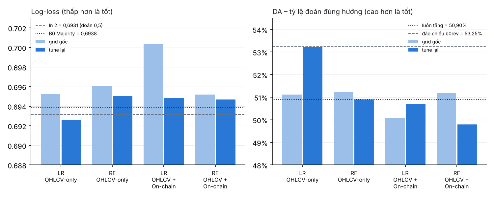

# Metric chính, metric phụ và kết quả (góp ý 3 của thầy)

Phụ trách: Trâm. Script: `analyses/tram_metrics/src/metrics_report.py`. Mô hình đã chốt: **LR** (`b1` → `b1t`) và **RF** (`b2` → `b2t`). Bộ đặc trưng chính: On-chain **bỏ Flows** (27 đặc trưng, `pipeline/results/no_flows/`). 82 fold walk-forward, 2.434 ngày test (01/01/2020 → 30/08/2026).

## 1. Đoạn văn đưa vào báo cáo (mục Metric)

> **Metric chính là DA** (directional accuracy, tỷ lệ ngày đoán đúng hướng giá t+1), vì câu hỏi nghiên cứu là đoán đúng hướng. Mọi kết luận về RQ1 dựa trên ΔDA = DA(OHLCV + On-chain) − DA(OHLCV-only), tính trên cùng ngày test, kiểm định bằng McNemar chính xác. **Log-loss là metric phụ** và là **tiêu chí tuning**: mọi tham số được chọn bằng log-loss trung bình trên `TimeSeriesSplit(5, gap 1)` bên trong cửa sổ train 730 ngày của từng fold; test chỉ dùng một lần để báo cáo, không dùng để chọn mô hình, tham số hay bộ đặc trưng. Log-loss được chọn để tune vì nó chấm cả độ tự tin của xác suất, thay đổi mượt hơn DA nên ít chọn nhầm do may. Δ log-loss được kiểm định bằng Diebold–Mariano. Mọi Δ báo cáo kèm CI 95% (block bootstrap, khối 15 ngày) và p đã hiệu chỉnh Holm. Mốc so sánh: DA của "luôn đoán tăng" trên cùng ngày (50,90%) và luật đảo chiều 1 ngày (53,25%); log-loss của B0 Majority (0,6938) và ln 2 = 0,6931 (luôn đoán 0,5). Luật B0 chỉ cho p̂ bằng 0 hoặc 1 nên không tính log-loss (trừ B0 Majority).

## 2. Tóm tắt

1. **Tune lại làm log-loss giảm ở cả 4 tổ hợp, nhưng chỉ một chỗ có ý nghĩa sau Holm: LR + On-chain** (Δ log-loss -0,0056, p Holm 0,035), vì LR grid gốc với 37 đặc trưng bị quá khớp, còn `b1t` có winsorize và regularization mạnh hơn (C nhỏ tới 0,0001, có L1). Không tổ hợp nào có DA thay đổi có ý nghĩa; tăng nhiều nhất là LR OHLCV-only (51,11% → 53,20%, p Holm 0,525); RF + On-chain còn giảm 1,40 điểm.
2. **Thêm On-chain (bỏ Flows) không giúp, còn có xu hướng làm tệ đi.** Sau tune: LR ΔDA -2,51 điểm (CI [-4,68; -0,45], p Holm 0,087), Δ log-loss +0,0023 (p Holm 0,235); RF ΔDA -1,11 điểm (CI [-2,92; +0,62], p Holm 0,485), Δ log-loss -0,0003 (p Holm 0,785). Không Δ nào có ý nghĩa sau Holm → **chưa chấp nhận H1**. Riêng ΔDA của LR có CI không chứa 0, nhưng theo chiều On-chain làm *tệ đi*.
3. **Chỉ LR OHLCV-only sau tune lại có log-loss thấp hơn mốc B0 Majority** (0,6926 so với 0,6938), và chênh lệch này cũng chưa có ý nghĩa (p DM 0,496). Mọi log-loss đều sát ln 2: xác suất mô hình đưa ra gần như 0,5.
4. **Không mô hình nào vượt luật đảo chiều** (53,25%). LR OHLCV-only sau tune bằng luật (-0,04 điểm, vì `b1t` gần như chính là luật đảo chiều); ba tổ hợp còn lại thua 2,34 đến 3,45 điểm, p McNemar chưa hiệu chỉnh 0,007–0,047. So với luôn tăng: chỉ LR OHLCV-only hơn (+2,30 điểm, p 0,119), chưa có ý nghĩa.
5. **Kết luận giống khi còn Flows** (mục 6): bỏ Flows không đổi chiều kết quả nào.

## 3. Metric của từng tổ hợp

| Mô hình | Cấu hình | Giai đoạn | DA | Log-loss | Brier | % ngày đoán tăng |
|---|---|---|---:|---:|---:|---:|
| LR (`b1`) | OHLCV-only | grid gốc | 51,11% | 0,6953 | 0,2511 | 56,4% |
| LR (`b1t`) | OHLCV-only | tune lại | 53,20% | 0,6926 | 0,2497 | 49,0% |
| RF (`b2`) | OHLCV-only | grid gốc | 51,23% | 0,6961 | 0,2514 | 54,7% |
| RF (`b2t`) | OHLCV-only | tune lại | 50,90% | 0,6950 | 0,2509 | 52,6% |
| B0 Majority (mốc) (`b0maj`) | OHLCV-only | - | 50,08% | 0,6938 | 0,2503 | 63,0% |
| LR (`b1`) | OHLCV + On-chain | grid gốc | 50,08% | 0,7004 | 0,2535 | 53,2% |
| LR (`b1t`) | OHLCV + On-chain | tune lại | 50,70% | 0,6948 | 0,2508 | 54,3% |
| RF (`b2`) | OHLCV + On-chain | grid gốc | 51,19% | 0,6952 | 0,2510 | 51,9% |
| RF (`b2t`) | OHLCV + On-chain | tune lại | 49,79% | 0,6947 | 0,2508 | 48,4% |
| B0 Majority (mốc) (`b0maj`) | OHLCV + On-chain | - | 50,08% | 0,6938 | 0,2503 | 63,0% |

Mốc: luôn tăng DA 50,90%; luật đảo chiều DA 53,25%; ln 2 = 0,6931. B0 Majority dự báo p̂ = tỷ lệ ngày tăng trong train nên có log-loss; DA của nó (50,08%) thấp hơn luôn tăng vì có fold train nghiêng về giảm.

## 4. Trước và sau tune lại (Δ = tune lại − grid gốc)

"Trước" là bản E1 tune bằng grid gốc của proposal (Phụ lục C): LR chỉ tune C ∈ {0,01; 0,1; 1; 10}, RF tune 12 tổ hợp số cây, độ sâu, min_samples_leaf. "Sau" là bản tune lại: `b1t` (Vi, 300 tổ hợp gồm cả tập đặc trưng, C, kiểu regularization) và `b2t` (grid mới: min_samples_leaf tới 200, max_features, max_samples). Cả hai đều chọn bằng log-loss trên validation trong train; bảng này chỉ **mô tả** tác động lên test. Bản hoàn toàn chưa tune (tham số mặc định sklearn) chỉ có cho bộ còn Flows, ở `pipeline/results/tuning/tuning_before_after.csv`.

| Mô hình | Cấu hình | ΔDA (điểm) | CI 95% | p McNemar | p Holm | Δ log-loss | CI 95% | p DM | p Holm |
|---|---|---:|---|---:|---:|---:|---|---:|---:|
| LR | OHLCV-only | +2,10 | [-0,08; +4,27] | 0,077 | 0,525 | -0,0027 | [-0,0058; +0,0004] | 0,094 | 0,525 |
| LR | OHLCV + On-chain | +0,62 | [-1,27; +2,38] | 0,587 | 1,000 | -0,0056 | [-0,0091; -0,0022] | 0,004 | 0,035 |
| RF | OHLCV-only | -0,33 | [-1,68; +1,07] | 0,695 | 1,000 | -0,0011 | [-0,0028; +0,0007] | 0,233 | 0,933 |
| RF | OHLCV + On-chain | -1,40 | [-2,75; +0,04] | 0,075 | 0,525 | -0,0005 | [-0,0021; +0,0011] | 0,535 | 1,000 |

Δ log-loss âm = tune lại làm xác suất tốt hơn. Holm tính trên cả 8 p-value của bảng.

## 5. OHLCV-only so với OHLCV + On-chain (Δ = +On-chain − OHLCV, mô hình đã tune)

| Mô hình | ΔDA (điểm) | CI 95% | chỉ OHLCV đúng / chỉ +On-chain đúng | p McNemar | p Holm | Δ log-loss | CI 95% | p DM | p Holm |
|---|---:|---|---:|---:|---:|---:|---|---:|---:|
| LR (`b1t`) | -2,51 | [-4,68; -0,45] | 373 / 312 | 0,022 | 0,087 | +0,0023 | [-0,0002; +0,0047] | 0,078 | 0,235 |
| RF (`b2t`) | -1,11 | [-2,92; +0,62] | 261 / 234 | 0,243 | 0,485 | -0,0003 | [-0,0028; +0,0021] | 0,785 | 0,785 |

ΔDA > 0 hoặc Δ log-loss < 0 nghĩa là On-chain giúp. Holm tính trên 4 p-value (2 mô hình × 2 metric).

### So với các mốc

| Mô hình | Cấu hình | ΔDA vs luôn tăng | p | ΔDA vs đảo chiều | p | Δ log-loss vs B0 Majority | CI 95% | p DM |
|---|---|---:|---:|---:|---:|---:|---|---:|
| LR | OHLCV-only | +2,30 | 0,119 | -0,04 | 1,000 | -0,0013 | [-0,0048; +0,0023] | 0,496 |
| RF | OHLCV-only | 0,00 | 1,000 | -2,34 | 0,047 | +0,0012 | [-0,0016; +0,0040] | 0,422 |
| LR | OHLCV + On-chain | -0,21 | 0,905 | -2,55 | 0,020 | +0,0010 | [-0,0017; +0,0038] | 0,527 |
| RF | OHLCV + On-chain | -1,11 | 0,463 | -3,45 | 0,007 | +0,0008 | [-0,0018; +0,0035] | 0,542 |

## 6. Đối chiếu: bộ On-chain còn Flows (33 đặc trưng, `rerun_2026-11-19`)

| Mô hình | ΔDA (điểm) | CI 95% | chỉ OHLCV đúng / chỉ +On-chain đúng | p McNemar | p Holm | Δ log-loss | CI 95% | p DM | p Holm |
|---|---:|---|---:|---:|---:|---:|---|---:|---:|
| LR (`b1t`) | -2,01 | [-4,23; +0,12] | 389 / 340 | 0,075 | 0,232 | +0,0019 | [-0,0010; +0,0047] | 0,205 | 0,410 |
| RF (`b2t`) | -1,93 | [-3,70; -0,16] | 318 / 271 | 0,058 | 0,232 | +0,0004 | [-0,0024; +0,0032] | 0,798 | 0,798 |

| Mô hình | Cấu hình | DA bỏ Flows | DA còn Flows | Log-loss bỏ Flows | Log-loss còn Flows |
|---|---|---:|---:|---:|---:|
| LR | OHLCV + On-chain | 50,70% | 51,19% | 0,6948 | 0,6944 |
| RF | OHLCV + On-chain | 49,79% | 49,22% | 0,6947 | 0,6951 |

Cấu hình OHLCV-only không dùng On-chain nên giống nhau ở hai thư mục.

## 7. Hình

## 8. Ghi chú

- Δ log-loss nhỏ cỡ 0,001–0,005 vì mọi mô hình đều đưa xác suất gần 0,5; DM vẫn phát hiện được chênh lệch nhỏ nếu nó đều đặn qua các ngày.
- Holm trong bảng 5 tính trên 2 mô hình đã chốt. Bảng `pipeline/results/no_flows/tables/delta_onchain.csv` của pipeline hiệu chỉnh trên cả 7 mô hình có học nên p Holm ở đó lớn hơn; kết luận không đổi.
- Mọi số tính lại từ file dự báo; DA và log-loss khớp `pipeline/results/no_flows/tables/metrics.csv`.
