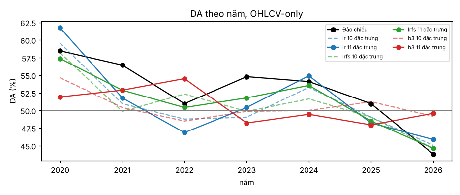

# Thêm đặc trưng up_today: chạy lại B1 (lr, lrfs) và B3 (SVM RBF) – Trâm

Tạo bởi `analyses/up_today/src/compare_up_today.py`. `up_today` = 1 nếu giá đóng cửa ngày t cao hơn ngày t−1 (`features/src/features_ohlcv.py`). Mô hình, grid, 82 fold, chuẩn hoá lấy nguyên từ `pipeline`; tune bằng inner CV trong cửa sổ train, không dùng ngày test. Mốc so sánh: luật đảo chiều `b0rev` đúng 53,25% trên 2434 ngày test.

**Vì sao thêm cột này:** `baseline_check` cho thấy quy luật duy nhất có ý nghĩa là hướng giá đảo chiều sau 1 ngày, tức nằm ở *dấu* của return hôm nay. 10 đặc trưng ban đầu chỉ đo *độ lớn* (return, biên độ, RSI, biến động), nên mô hình tuyến tính phải tự suy ra dấu từ độ lớn, và bị các ngày biến động mạnh lấn át.

## Tóm tắt
1. **B1 (lr) OHLCV-only:** 51,11% → **51,68%** khi thêm up_today (ΔDA 0,58 điểm, p = 0,450); log-loss 0,6953 → 0,6945. So với 50%: p = 0,101.
2. **lrfs OHLCV-only:** 51,11% → 51,64%; lrfs giữ up_today ở 59% số fold.
3. **B3 SVM OHLCV-only:** 50,62% → 50,70% (ΔDA 0,08 điểm, p = 0,954). SVM RBF gần như không dùng được cột 0/1 này.
4. **So với luật đảo chiều (53,25%):** mô hình tốt nhất sau khi thêm up_today là B1 Logistic Regression (lr) với 51,68%, vẫn kém luật 1,56 điểm (p = 0,112).
5. **Thêm On-chain trên bộ 11 đặc trưng:** lr ΔDA -0,62 điểm (p = 0,572); lrfs ΔDA 1,40 điểm (p = 0,176); b3 ΔDA -1,11 điểm (p = 0,271).
6. **Tuning của lr chọn C = 0.01 (giá trị nhỏ nhất của grid, regularization mạnh nhất) ở 14/14 lần tune.** Khi tín hiệu yếu, tiêu chí log-loss luôn ưu tiên thu hệ số về gần 0 để p̂ sát tỷ lệ tăng của train: log-loss tốt hơn nhưng phần lớn tác dụng của up_today lên DA bị triệt tiêu. Cùng mô hình nhưng C = 1 cố định (không tune): DA 52,67% (p = 0,009), log-loss 0,6990 (10 đặc trưng, C = 1: DA 50,70%). Nhóm cần chốt metric chính (DA hay log-loss) trước, vì hai metric đang kéo tuning về hai hướng.
**Ảnh hưởng tới cả nhóm:** `pipeline` lấy mọi cột mà `build_ohlcv_features` trả về, nên sau khi gộp PR này, lần chạy `run_all.py --stage e1` tiếp theo sẽ dùng 11 đặc trưng OHLCV cho mọi mô hình (B1–B5). Các file dự báo hiện có trong `pipeline/results/predictions/` vẫn là bản 10 đặc trưng cho tới khi chạy lại. Muốn giữ 10 đặc trưng thì dùng `FEATURES_10`.

## 1. OHLCV-only (làm trước)

| Mô hình | Bộ đặc trưng | DA (%) | CI 95% | p (DA = 50%) | Log-loss | AUC | % đoán tăng | So với đảo chiều (điểm) | p |
|---|---|---|---|---|---|---|---|---|---|
| B1 Logistic Regression (lr) | 10 ban đầu | 51,11 | [49,1; 53,1] | 0,283 | 0,6953 | 0,510 | 56,4 | -2,14 | 0,078 |
| B1 Logistic Regression (lr) | 10 + up_today | 51,68 | [49,7; 53,7] | 0,101 | 0,6945 | 0,520 | 51,2 | -1,56 | 0,112 |
| B1 LR chọn đặc trưng tiến dần (lrfs) | 10 ban đầu | 51,11 | [49,1; 53,1] | 0,283 | 0,6933 | 0,521 | 54,8 | -2,14 | 0,067 |
| B1 LR chọn đặc trưng tiến dần (lrfs) | 10 + up_today | 51,64 | [49,6; 53,6] | 0,109 | 0,6931 | 0,526 | 49,1 | -1,60 | 0,099 |
| B3 SVM RBF (b3) | 10 ban đầu | 50,62 | [48,6; 52,6] | 0,557 | 0,7009 | 0,503 | 72,8 | -2,63 | 0,076 |
| B3 SVM RBF (b3) | 10 + up_today | 50,70 | [48,7; 52,7] | 0,504 | 0,7049 | 0,505 | 69,1 | -2,55 | 0,078 |

Log-loss: đoán 50/50 mọi ngày cho 0,6931; thấp hơn là tốt hơn. "So với đảo chiều" = DA mô hình − DA luật, p theo McNemar chính xác trên các ngày hai bên khác nhau.

## 2. OHLCV + On-chain (cùng mô hình, cùng protocol)

| Mô hình | Bộ đặc trưng | DA (%) | CI 95% | p (DA = 50%) | Log-loss | AUC | % đoán tăng | So với đảo chiều (điểm) | p |
|---|---|---|---|---|---|---|---|---|---|
| B1 Logistic Regression (lr) | 10 ban đầu | 51,89 | [49,9; 53,9] | 0,065 | 0,7006 | 0,513 | 54,7 | -1,36 | 0,303 |
| B1 Logistic Regression (lr) | 10 + up_today | 51,07 | [49,1; 53,1] | 0,301 | 0,7000 | 0,520 | 52,5 | -2,18 | 0,058 |
| B1 LR chọn đặc trưng tiến dần (lrfs) | 10 ban đầu | 51,56 | [49,6; 53,6] | 0,128 | 0,6968 | 0,517 | 54,0 | -1,68 | 0,192 |
| B1 LR chọn đặc trưng tiến dần (lrfs) | 10 + up_today | 53,04 | [51,0; 55,0] | 0,003 | 0,6961 | 0,525 | 51,8 | -0,21 | 0,884 |
| B3 SVM RBF (b3) | 10 ban đầu | 50,29 | [48,3; 52,3] | 0,792 | 0,6959 | 0,498 | 64,7 | -2,96 | 0,042 |
| B3 SVM RBF (b3) | 10 + up_today | 49,59 | [47,6; 51,6] | 0,700 | 0,6959 | 0,501 | 62,6 | -3,66 | 0,009 |

## 3. Tác dụng của up_today (11 − 10 đặc trưng, cùng mô hình, cùng cấu hình)

| Mô hình | Cấu hình | DA 10 (%) | DA 11 (%) | ΔDA (điểm) | p McNemar | Log-loss 10 | Log-loss 11 |
|---|---|---|---|---|---|---|---|
| B1 Logistic Regression (lr) | ohlcv | 51,11 | 51,68 | 0,58 | 0,450 | 0,6953 | 0,6945 |
| B1 Logistic Regression (lr) | ohlcv_onchain | 51,89 | 51,07 | -0,82 | 0,196 | 0,7006 | 0,7000 |
| B1 LR chọn đặc trưng tiến dần (lrfs) | ohlcv | 51,11 | 51,64 | 0,53 | 0,468 | 0,6933 | 0,6931 |
| B1 LR chọn đặc trưng tiến dần (lrfs) | ohlcv_onchain | 51,56 | 53,04 | 1,48 | 0,012 | 0,6968 | 0,6961 |
| B3 SVM RBF (b3) | ohlcv | 50,62 | 50,70 | 0,08 | 0,954 | 0,7009 | 0,7049 |
| B3 SVM RBF (b3) | ohlcv_onchain | 50,29 | 49,59 | -0,70 | 0,259 | 0,6959 | 0,6959 |

## 4. Δ khi thêm On-chain, trên từng bộ đặc trưng OHLCV

| Mô hình | Bộ OHLCV | DA OHLCV-only (%) | DA + On-chain (%) | ΔDA (điểm) | p McNemar | ΔLog-loss |
|---|---|---|---|---|---|---|
| B1 Logistic Regression (lr) | 10 ban đầu | 51,11 | 51,89 | 0,78 | 0,488 | 0,0054 |
| B1 Logistic Regression (lr) | 10 + up_today | 51,68 | 51,07 | -0,62 | 0,572 | 0,0055 |
| B1 LR chọn đặc trưng tiến dần (lrfs) | 10 ban đầu | 51,11 | 51,56 | 0,45 | 0,684 | 0,0036 |
| B1 LR chọn đặc trưng tiến dần (lrfs) | 10 + up_today | 51,64 | 53,04 | 1,40 | 0,176 | 0,0031 |
| B3 SVM RBF (b3) | 10 ban đầu | 50,62 | 50,29 | -0,33 | 0,755 | -0,0050 |
| B3 SVM RBF (b3) | 10 + up_today | 50,70 | 49,59 | -1,11 | 0,271 | -0,0090 |

ΔLog-loss âm nghĩa là On-chain làm xác suất tốt hơn.

## 5. Tuning đã chạy và cột được chọn

Tham số chọn ở 14 lần tune (inner TimeSeriesSplit(5, gap 1) trong cửa sổ train, tiêu chí log-loss):

- B1 Logistic Regression (lr), 10 đặc trưng, ohlcv: C = 0.01 (14 lần)
- B1 Logistic Regression (lr), 11 đặc trưng, ohlcv: C = 0.01 (14 lần)
- B1 Logistic Regression (lr), 10 đặc trưng, ohlcv_onchain: C = 0.01 (14 lần)
- B1 Logistic Regression (lr), 11 đặc trưng, ohlcv_onchain: C = 0.01 (14 lần)
- B1 LR chọn đặc trưng tiến dần (lrfs), 10 đặc trưng, ohlcv: C = 0.01 (10 lần); C = 1 (3 lần); C = 0.1 (1 lần)
- B1 LR chọn đặc trưng tiến dần (lrfs), 11 đặc trưng, ohlcv: C = 0.01 (13 lần); C = 1 (1 lần)
- B1 LR chọn đặc trưng tiến dần (lrfs), 11 đặc trưng, ohlcv_onchain: C = 0.01 (13 lần); C = 1 (1 lần)
- B3 SVM RBF (b3), 10 đặc trưng, ohlcv: C = 1, gamma = 0.1 (3 lần); C = 10, gamma = 0.1 (3 lần); C = 0.1, gamma = 0.001 (3 lần); C = 1, gamma = 0.001 (2 lần); C = 0.1, gamma = 0.01 (1 lần); C = 0.1, gamma = 0.1 (1 lần); C = 1, gamma = 0.01 (1 lần)
- B3 SVM RBF (b3), 11 đặc trưng, ohlcv: C = 1, gamma = 0.1 (4 lần); C = 0.1, gamma = 0.001 (3 lần); C = 10, gamma = 0.01 (2 lần); C = 1, gamma = 0.001 (2 lần); C = 10, gamma = 0.1 (1 lần); C = 0.1, gamma = 0.1 (1 lần); C = 10, gamma = 0.001 (1 lần)
- B3 SVM RBF (b3), 10 đặc trưng, ohlcv_onchain: C = 10, gamma = 0.01 (5 lần); C = 1, gamma = 0.01 (3 lần); C = 10, gamma = 0.001 (2 lần); C = 10, gamma = 0.1 (2 lần); C = 0.1, gamma = 0.01 (1 lần); C = 0.1, gamma = 0.1 (1 lần)
- B3 SVM RBF (b3), 11 đặc trưng, ohlcv_onchain: C = 10, gamma = 0.01 (4 lần); C = 10, gamma = 0.001 (3 lần); C = 10, gamma = 0.1 (2 lần); C = 1, gamma = 0.1 (1 lần); C = 1, gamma = 0.001 (1 lần); C = 0.1, gamma = 0.01 (1 lần); C = 0.1, gamma = 0.1 (1 lần); C = 1, gamma = 0.01 (1 lần)

lrfs 10 đặc trưng + On-chain không có log tham số vì lần chạy đó (24 phút) được giữ lại từ lần chạy trước khi thêm phần ghi log; dự báo của nó vẫn dùng đầy đủ trong các bảng.

**lrfs giữ lại những cột nào** (tính trên 82 fold):

| Cấu hình | Bộ đặc trưng | Số cột giữ TB | % fold giữ up_today | Cột hay được giữ nhất |
|---|---|---|---|---|
| ohlcv | 10 | 2.2 | – | logret_lag1 (82/82), logret_lag2 (29/82), hl_range (24/82), logret_lag3 (16/82) |
| ohlcv | 11 | 2.9 | 59 | logret_lag1 (82/82), up_today (48/82), hl_range (32/82), logret_lag2 (27/82) |
| ohlcv_onchain | 10 | không có log | – | – |
| ohlcv_onchain | 11 | 7.2 | 66 | logret_lag1 (82/82), up_today (54/82), hl_range (35/82), cm_SplyExNtv_logdiff (31/82) |

## 6. DA theo năm, OHLCV-only

| Năm | Đảo chiều | lr 10 | lr 11 | lrfs 10 | lrfs 11 | b3 10 | b3 11 |
|---|---|---|---|---|---|---|---|
| 2020 | 58,5 | 59,6 | 61,7 | 58,2 | 57,4 | 54,6 | 51,9 |
| 2021 | 56,4 | 51,0 | 51,8 | 49,9 | 52,9 | 50,4 | 52,9 |
| 2022 | 51,0 | 48,8 | 46,8 | 52,3 | 50,4 | 48,5 | 54,5 |
| 2023 | 54,8 | 49,0 | 50,4 | 49,9 | 51,8 | 49,9 | 48,2 |
| 2024 | 54,1 | 53,3 | 54,9 | 51,6 | 53,6 | 50,0 | 49,5 |
| 2025 | 51,0 | 49,0 | 48,2 | 49,0 | 48,5 | 51,2 | 47,9 |
| 2026 | 43,8 | 45,0 | 45,9 | 44,6 | 44,6 | 49,2 | 49,6 |

## 7. Backtest long/flat (phí 0,1%/lượt, tham khảo)

| Mô hình | Bộ | Cấu hình | Lợi nhuận | Sharpe | MDD | % ngày giữ BTC |
|---|---|---|---|---|---|---|
| Buy-and-hold | – | – | 990% | 0,90 | -77% | 100% |
| Luật đảo chiều | – | – | 211% | 0,61 | -71% | 49% |
| lr | 10 | ohlcv | 19% | 0,31 | -87% | 56% |
| lr | 11 | ohlcv | 97% | 0,45 | -88% | 51% |
| lrfs | 10 | ohlcv | 27% | 0,33 | -81% | 55% |
| lrfs | 11 | ohlcv | 110% | 0,48 | -75% | 49% |
| b3 | 10 | ohlcv | 286% | 0,65 | -72% | 73% |
| b3 | 11 | ohlcv | 166% | 0,55 | -67% | 69% |
| lr | 10 | ohlcv_onchain | 245% | 0,63 | -65% | 55% |
| lr | 11 | ohlcv_onchain | -1% | 0,24 | -87% | 53% |
| lrfs | 10 | ohlcv_onchain | 408% | 0,75 | -77% | 54% |
| lrfs | 11 | ohlcv_onchain | 384% | 0,74 | -79% | 52% |
| b3 | 10 | ohlcv_onchain | 63% | 0,41 | -80% | 65% |
| b3 | 11 | ohlcv_onchain | -6% | 0,25 | -85% | 63% |
