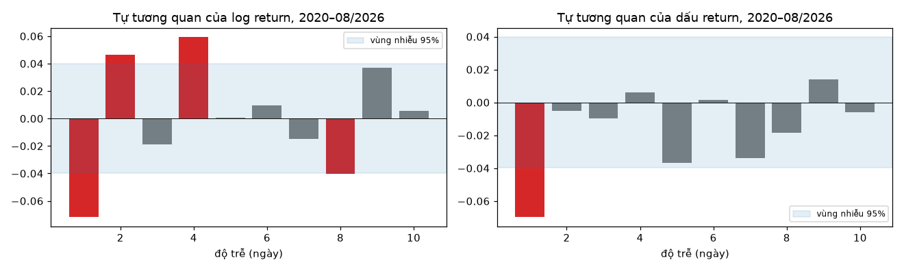
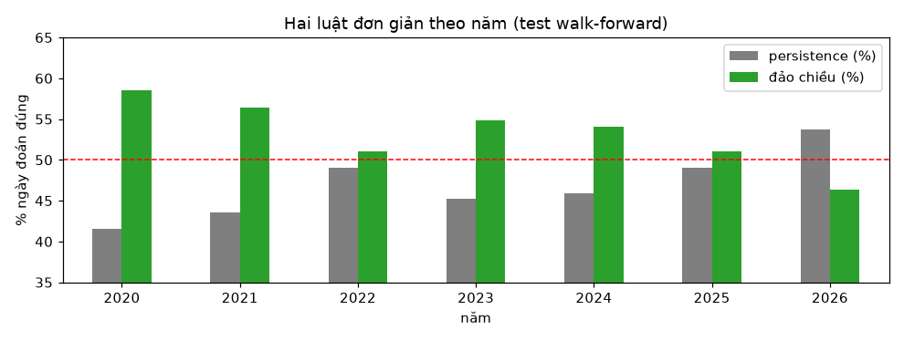
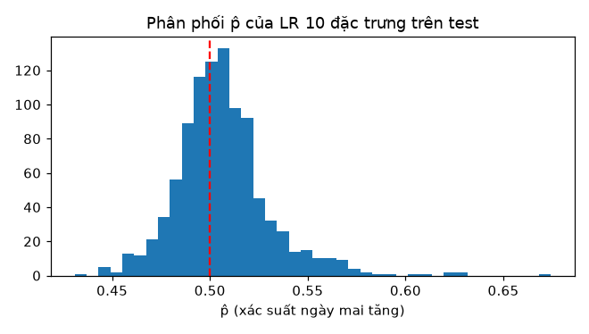

# Kiểm tra baseline OHLCV-only (góp ý 1 của thầy)

Tạo bởi `baseline_check/src/baseline_check.py` trên data freeze v1.0 (sha256 khớp MANIFEST). Chỉ dùng 10 đặc trưng OHLCV của `tram_features_backtest`; không dùng On-chain, không dùng `ngoc_pipeline`.

## Tóm tắt

| # | Câu hỏi | Kết quả |
|---|---|---|
| 1 | Dữ liệu và nhãn có đúng không? | Đúng. Giá ngày khớp nến 1h; nhãn kiểm bằng ví dụ; không có ngày giá bằng nhau. Chỉ ngày 08/02/2018 lấy giá đóng cửa lúc 01:00 UTC (nằm trong train) |
| 2 | Pipeline có nhận ra tín hiệu khi tín hiệu có thật? | Có. Rò rỉ cố ý → DA 96.6%; xáo nhãn → DA 50.4% |
| 3 | Có quy luật đơn giản nào không? | Có: hướng giá **đảo chiều sau 1 ngày**. Luật "mai ngược hôm nay" đúng 53.25% trên walk-forward 2020–08/2026 (p = 0.001), cao hơn mọi mô hình có học trong báo cáo giữa kỳ, nhưng yếu dần và đảo ngược năm 2026 |
| 4 | Baseline OHLCV-only có ổn định? | Chưa. Walk-forward: LR 1 đặc trưng 52.22% > LR 10 đặc trưng 50.66%. Chia cố định: validation dưới 51% với mọi C, test 52.62% (p = 0.11) |
| 5 | Dự báo trông thế nào? | p̂ gần như luôn trong 0,47–0,55; sai tự tin nhất đều sau ngày giảm mạnh; đúng 4/10 ngày biến động mạnh nhất |

**Đề xuất cho nhóm trước khi so On-chain:**

1. Thêm luật đảo chiều vào B0. Mọi mô hình có học phải được so với nó, không chỉ với Majority.
2. Dựng baseline OHLCV từ ít đặc trưng lên (bắt đầu từ logret_lag1), thêm từng đặc trưng và giữ lại cái nào cải thiện trên validation. Hiện 10 đặc trưng kém hơn 1 đặc trưng.
3. Báo cáo kết quả theo từng năm. Tín hiệu thay đổi mạnh giữa các năm, con số gộp 2020–2026 che mất điều này.
4. Chỉ so On-chain sau khi baseline OHLCV vượt luật đảo chiều một cách ổn định. Δ ±1 điểm hiện nằm trong nhiễu (sai số chuẩn của DA khoảng 1 điểm).

## Phần 1. Dữ liệu và nhãn

**Nhãn.** Dòng ngày t có y_t = 1 nếu giá đóng cửa ngày t+1 > ngày t. Đặc trưng của dòng t chỉ dùng dữ liệu đến hết ngày t. Ví dụ quanh ngày sập 12/03/2020:

| date       |   close_t |   close_t+1 |   logret_lag1 (return ngày t) |   y_t |
|:-----------|----------:|------------:|------------------------------:|------:|
| 2020-03-10 |   7894.56 |     7934.52 |                       -0.0045 |     1 |
| 2020-03-11 |   7934.52 |     4800    |                        0.005  |     0 |
| 2020-03-12 |   4800    |     5578.6  |                       -0.5026 |     1 |
| 2020-03-13 |   5578.6  |     5172.06 |                        0.1503 |     0 |
| 2020-03-14 |   5172.06 |     5361.3  |                       -0.0757 |     1 |

Đọc dòng 2020-03-11: giá đóng cửa 7.934,52 → ngày 12/03 đóng cửa 4.800,00, nên y = 0 (giảm). Đặc trưng của dòng này chỉ biết return của ngày 11/03 (+0,5%), chưa biết cú sập ngày 12/03.

**Giá ngày so với nến 1h.** Gộp lại 78.761 nến 1h theo ngày UTC rồi so với `master_daily.csv`: lệch tối đa open 0e+00, high 0e+00, low 0e+00, close 0e+00 USD (chỉ là sai số làm tròn).

**Ngày giá đóng cửa không lấy từ nến 23:00 UTC:** ['2018-02-08']. Ngày này chỉ có 1 nến (00:00) vì Binance bảo trì, nên close của 08/02/2018 thực ra là giá lúc 01:00 UTC. Nhãn của 07/02 và 08/02/2018 vì vậy không đúng nghĩa "cuối ngày"; hai ngày này chỉ nằm trong train.

**Ngày giá đóng cửa bằng nhau (y không xác định):** 0 ngày.

**Ngày thiếu nến 1h (< 24 nến) trong 2018–08/2026:** 28 ngày; 15 ngày nằm trong giai đoạn test walk-forward. Giá đóng cửa của các ngày thiếu 1–10 nến vẫn là nến 23:00, nên nhãn vẫn đúng.

## Phần 2. EDA cho nhãn

Chỉ dùng chính chuỗi giá và nhãn (không xem đặc trưng nào với nhãn).

|                                  |   số ngày |   tỷ lệ ngày tăng (%) |   ACF return trễ 1 |   ACF dấu return trễ 1 |   persistence đúng (%) |   p (persistence = 50%) |   độ lệch chuẩn return ngày (%) |
|:---------------------------------|----------:|----------------------:|-------------------:|-----------------------:|-----------------------:|------------------------:|--------------------------------:|
| 2018–2019 (train fold 0)         |       730 |                  51.1 |             -0.047 |                 -0.081 |                   45.9 |                  0.0289 |                            4.02 |
| 2020–08/2026 (test walk-forward) |      2434 |                  50.9 |             -0.072 |                 -0.07  |                   46.5 |                  0.0006 |                            3.22 |
| Train baseline 2018–2021         |      1461 |                  52.6 |             -0.083 |                 -0.118 |                   44.2 |                  0      |                            4.13 |
| Validation 2022–2023             |       730 |                  48.1 |             -0     |                 -0.061 |                   47.1 |                  0.1291 |                            2.89 |
| Test baseline 2024–08/2026       |       973 |                  50.7 |             -0.046 |                 -0.019 |                   49   |                  0.5639 |                            2.48 |

**Phát hiện chính: hướng giá có xu hướng đảo chiều sau 1 ngày.** Tự tương quan của dấu return là âm ở mọi giai đoạn, nên "mai cùng chiều hôm nay" chỉ đúng 46.5% trên 2020–08/2026, thấp hơn 50% có ý nghĩa thống kê. Ngược lại, luật "mai ngược chiều hôm nay" đúng 53.5%. Quy luật này đã thấy ngay trên train 2018–2019 (persistence 45.9%), nên được phép dùng làm baseline mà không nhìn test.

Theo năm trong giai đoạn test walk-forward:

|   date |   tỷ lệ tăng (%) |   persistence (%) |   đảo chiều (%) |
|-------:|-----------------:|------------------:|----------------:|
|   2020 |             57.7 |              41.5 |            58.5 |
|   2021 |             50.4 |              43.6 |            56.4 |
|   2022 |             45.8 |              49   |            51   |
|   2023 |             50.4 |              45.2 |            54.8 |
|   2024 |             52.5 |              45.9 |            54.1 |
|   2025 |             50.1 |              49   |            51   |
|   2026 |             48.8 |              53.7 |            46.3 |

Quy luật yếu dần theo thời gian: đảo chiều đúng ≥ 54% ở 2020, 2021, 2023, 2024; chỉ 50–52% ở 2022, 2025; dưới 50% ở 2026. Trên đoạn test của baseline (2024–08/2026) đảo chiều chỉ còn đúng 51.0%.

**Ngưỡng nhiễu.** Với 2.434 ngày test, sai số chuẩn của DA khoảng 1.0 điểm. Một mô hình đoán ngẫu nhiên có 95% khả năng rơi vào khoảng 48.0–52.0%. Mọi DA 49–52% trong báo cáo giữa kỳ đều nằm trong vùng này.

## Phần 3. Baseline cơ bản: train / validation / test

| Đoạn | Từ | Đến | Số ngày |
|---|---|---|---|
| train | 2018-01-01 | 2021-12-30 | 1460 |
| val | 2022-01-01 | 2023-12-30 | 729 |
| test | 2024-01-01 | 2026-08-30 | 973 |

Ngày cuối của train và validation bị bỏ (gap 1 ngày) vì nhãn của ngày đó dùng giá của đoạn sau. Chuẩn hoá (StandardScaler) nằm trong pipeline nên chỉ học trên dữ liệu train. Tham số C của Logistic Regression chọn trên validation theo log-loss; sau đó học lại trên train + validation và chạy test **đúng 1 lần**.

### Tuning (chỉ train → validation, chưa đụng test)

Bảng ghi đủ mọi giá trị C đã chạy, kèm kết quả trước tuning (C = 1 mặc định) và sau tuning.

**LR 1 đặc trưng (logret_lag1).** C tốt nhất trên validation = 0.1 (val log-loss 0.6946, val DA 49.9%; mặc định C = 1: val log-loss 0.6946, val DA 50.5%).

|       C |   train_log_loss |   val_log_loss |   train_DA |   val_DA |
|--------:|-----------------:|---------------:|-----------:|---------:|
|   0.001 |           0.6898 |         0.6955 |       52.9 |     48   |
|   0.01  |           0.6876 |         0.6946 |       53.1 |     49.9 |
|   0.1   |           0.6873 |         0.6946 |       52.9 |     49.9 |
|   1     |           0.6873 |         0.6946 |       53.2 |     50.5 |
|  10     |           0.6873 |         0.6946 |       53.3 |     50.5 |
| 100     |           0.6873 |         0.6946 |       53.3 |     50.5 |

**LR 10 đặc trưng OHLCV.** C tốt nhất trên validation = 0.01 (val log-loss 0.6954, val DA 49.2%; mặc định C = 1: val log-loss 0.6970, val DA 49.2%).

|       C |   train_log_loss |   val_log_loss |   train_DA |   val_DA |
|--------:|-----------------:|---------------:|-----------:|---------:|
|   0.001 |           0.6893 |         0.6954 |       52.2 |     48.1 |
|   0.01  |           0.686  |         0.6954 |       53.5 |     49.2 |
|   0.1   |           0.6853 |         0.6967 |       55.3 |     49.4 |
|   1     |           0.6853 |         0.697  |       55.2 |     49.2 |
|  10     |           0.6853 |         0.6971 |       55.2 |     49.1 |
| 100     |           0.6853 |         0.6971 |       55.2 |     49.1 |

**Lưu ý:** trên validation 2022–2023, không giá trị C nào của cả hai mô hình đạt DA trên 51% và val log-loss của mọi C đều cao hơn mức đoán 50/50 (0,6931). Mô hình học trên 2018–2021 không dùng được cho 2022–2023; kết quả trên test ở dưới cần đọc với lưu ý này.

### Kết quả trên test (2024 – 08/2026)

Trên train + validation: tỷ lệ ngày tăng 51.0%, persistence đúng 45.2% → chọn luật đảo chiều.

|                                         |   n |   DA (%) | CI 95% DA    |   p (DA = 50%) |   bal_acc |    MCC |   AUC |   log_loss |   brier |   pct_pred_up |
|:----------------------------------------|----:|---------:|:-------------|---------------:|----------:|-------:|------:|-----------:|--------:|--------------:|
| B0 Majority (p̂ = tỷ lệ tăng của train) | 973 |    50.67 | [47.5; 53.9] |          0.7   |     0.5   |  0     | 0.5   |     0.6931 |   0.25  |         1     |
| B0 Luôn đoán tăng                       | 973 |    50.67 | [47.5; 53.9] |          0.7   |     0.5   |  0     | 0.5   |     2.2769 |   0.484 |         1     |
| B0 Persistence (mai cùng chiều hôm nay) | 973 |    49.02 | [45.8; 52.2] |          0.564 |     0.49  | -0.02  | 0.49  |     2.3525 |   0.5   |         0.507 |
| B0 Đảo chiều (mai ngược chiều hôm nay)  | 973 |    50.98 | [47.8; 54.2] |          0.564 |     0.51  |  0.02  | 0.51  |     2.2627 |   0.481 |         0.493 |
| LR 1 đặc trưng (logret_lag1) (C = 0.1)  | 973 |    52.42 | [49.2; 55.6] |          0.14  |     0.521 |  0.047 | 0.516 |     0.6923 |   0.25  |         0.703 |
| LR 10 đặc trưng OHLCV (C = 0.01)        | 973 |    52.62 | [49.4; 55.8] |          0.109 |     0.525 |  0.051 | 0.525 |     0.6914 |   0.249 |         0.602 |

Cột: DA = % ngày đoán đúng hướng; CI 95% và p theo kiểm định nhị thức so với 50%; bal_acc = trung bình độ chính xác của hai lớp; MCC từ −1 đến 1 (0 = ngẫu nhiên); AUC 0,5 = ngẫu nhiên; log-loss và Brier càng thấp càng tốt (đoán 50/50 mọi ngày: log-loss 0,6931, Brier 0,25); pct_pred_up = tỷ lệ ngày mô hình nói "tăng". Các luật B0 dùng p̂ = 0,99/0,01 nên log-loss của chúng rất lớn; chỉ so DA với chúng.

Hệ số của LR 10 đặc trưng (đã chuẩn hoá; âm = đặc trưng càng lớn thì càng nghiêng về "giảm"):

|             |   hệ số |
|:------------|--------:|
| logret_lag1 | -0.148  |
| logret_lag5 | -0.0246 |
| logret_lag4 | -0.024  |
| dlog_volume | -0.0176 |
| rv_30d      | -0.0161 |
| logret_lag3 | -0.0092 |
| rv_7d       |  0.0004 |
| logret_lag2 |  0.0128 |
| rsi_14      |  0.0331 |
| hl_range    |  0.0703 |

### Kiểm chứng metric bằng tay (6 ngày đầu của test, LR 10 đặc trưng)

| date       |   y |   p_hat |   dự báo | đúng?   |   −log p(nhãn thật) |   (p − y)² |
|:-----------|----:|--------:|---------:|:--------|--------------------:|-----------:|
| 2024-01-01 |   1 |  0.4773 |        0 | False   |              0.7395 |     0.2732 |
| 2024-01-02 |   0 |  0.4944 |        0 | True    |              0.682  |     0.2444 |
| 2024-01-03 |   1 |  0.5812 |        1 | True    |              0.5426 |     0.1754 |
| 2024-01-04 |   0 |  0.4789 |        0 | True    |              0.6517 |     0.2293 |
| 2024-01-05 |   0 |  0.509  |        1 | False   |              0.7114 |     0.2591 |
| 2024-01-06 |   0 |  0.5196 |        1 | False   |              0.7331 |     0.2699 |

Tính tay: DA = 0.5000, log-loss = 0.6767, Brier = 0.2419. sklearn: DA = 0.5000, log-loss = 0.6767, Brier = 0.2419. Khớp.

Cách đọc: log-loss của một ngày = −log(xác suất mô hình gán cho điều thật sự xảy ra). Ngày tăng (y = 1) mà mô hình nói p̂ = 0,52 thì phạt −log 0,52 = 0,654; nói p̂ = 0,48 thì phạt −log 0,48 = 0,734.

### Phép thử để chắc kết quả có ý nghĩa

| Phép thử | Kỳ vọng nếu pipeline đúng | Kết quả |
|---|---|---|
| Xáo trộn nhãn train 200 lần, học lại, đo DA test | quanh 50% | TB 50.4%, 95% trong [48.5; 52.2] |
| Rò rỉ cố ý: thêm return của ngày mai vào đặc trưng | gần 100% | 96.6% |
| Đổi mục tiêu thành "hôm nay tăng?" (đặc trưng có chứa đáp án) | gần 100% | 95.1% |

Phép thử 2 và 3 cho thấy pipeline nhận ra tín hiệu khi tín hiệu có thật, và nhãn được căn đúng ngày. Phép thử 1 cho biết vùng "ngẫu nhiên" để so các DA ở trên.

## Phần 4. Xem trực tiếp dự báo (LR 10 đặc trưng, test 2024 – 08/2026)

Toàn bộ dự báo từng ngày: `reports/predictions_test.csv`.

**Ma trận nhầm lẫn**

|            |   đoán: giảm |   đoán: tăng |
|:-----------|-------------:|-------------:|
| thật: giảm |          203 |          277 |
| thật: tăng |          184 |          309 |

**p̂ rất sát 0,5:** trung vị 0.504, 90% số ngày nằm trong [0.472; 0.550]. Mô hình gần như không tự tin ngày nào.

**LR có học được quy luật đảo chiều không?** Có: hệ số lớn nhất là logret_lag1 = -0.148 (âm = hôm nay tăng thì nghiêng về mai giảm), và LR đồng ý với luật đảo chiều ở 82% số ngày test. Khác biệt là LR dựa vào *độ lớn* return, còn luật đảo chiều chỉ dựa vào *dấu*.

**10 ngày ngẫu nhiên**

| date       |   ohlcv_close |   logret_lag1 |   rsi_14 |   p_hat |   dự báo |   y | đúng   |   return ngày mai (%) |
|:-----------|--------------:|--------------:|---------:|--------:|---------:|----:|:-------|----------------------:|
| 2024-05-22 |       69166.6 |        -0.014 |   59.649 |   0.523 |        1 |   0 | False  |                -1.746 |
| 2024-10-22 |       67426   |         0.001 |   61.782 |   0.503 |        1 |   0 | False  |                -1.13  |
| 2024-11-08 |       76509.8 |         0.009 |   71.683 |   0.5   |        1 |   1 | True   |                 0.219 |
| 2025-06-08 |      105734   |         0.002 |   54.034 |   0.504 |        1 |   1 | True   |                 4.194 |
| 2025-12-29 |       87237.1 |        -0.008 |   42.685 |   0.496 |        0 |   1 | False  |                 1.421 |
| 2026-02-12 |       66272.2 |        -0.012 |   29.332 |   0.509 |        1 |   1 | True   |                 3.822 |
| 2026-03-21 |       68918.1 |        -0.023 |   45.834 |   0.538 |        1 |   0 | False  |                -1.549 |
| 2026-04-18 |       75691.8 |        -0.018 |   62.014 |   0.539 |        1 |   0 | False  |                -2.529 |
| 2026-05-13 |       79313.6 |        -0.015 |   54.29  |   0.516 |        1 |   1 | True   |                 2.215 |
| 2026-08-26 |       79023.8 |         0.006 |   80.577 |   0.518 |        1 |   1 | True   |                 1.539 |

**8 ngày sai mà mô hình tự tin nhất**

| date       |   ohlcv_close |   logret_lag1 |   rsi_14 |   p_hat |   dự báo |   y | đúng   |   return ngày mai (%) |
|:-----------|--------------:|--------------:|---------:|--------:|---------:|----:|:-------|----------------------:|
| 2025-10-10 |      112774   |        -0.076 |   41.784 |   0.626 |        1 |   0 | False  |                -1.907 |
| 2026-01-31 |       78741.1 |        -0.068 |   25.177 |   0.589 |        1 |   0 | False  |                -2.277 |
| 2024-08-02 |       61498.3 |        -0.061 |   40.494 |   0.58  |        1 |   0 | False  |                -1.31  |
| 2025-01-07 |       96954.6 |        -0.053 |   49.78  |   0.569 |        1 |   0 | False  |                -1.973 |
| 2026-06-02 |       66760.8 |        -0.067 |   21.891 |   0.568 |        1 |   0 | False  |                -4.001 |
| 2024-04-30 |       60672   |        -0.051 |   37.91  |   0.568 |        1 |   0 | False  |                -3.877 |
| 2025-03-09 |       80734.4 |        -0.066 |   34.285 |   0.567 |        1 |   0 | False  |                -2.685 |
| 2025-11-20 |       86637.2 |        -0.055 |   24.373 |   0.566 |        1 |   0 | False  |                -1.756 |

Cả 8/8 ngày đều là ngày t vừa giảm mạnh (logret_lag1 từ -7.6% đến -5.1%): mô hình đoán "sẽ bật lại" nhưng giá giảm tiếp. Mô hình tự tin nhất đúng vào lúc quy luật đảo chiều dễ sai nhất.

**10 ngày biến động mạnh nhất (theo return ngày mai)**

| date       |   ohlcv_close |   logret_lag1 |   rsi_14 |   p_hat |   dự báo |   y | đúng   |   return ngày mai (%) |
|:-----------|--------------:|--------------:|---------:|--------:|---------:|----:|:-------|----------------------:|
| 2026-02-04 |       73165.8 |        -0.035 |   22.891 |   0.548 |        1 |   0 | False  |               -15.103 |
| 2026-02-05 |       62909.9 |        -0.151 |   15.82  |   0.674 |        1 |   1 | True   |                11.505 |
| 2024-08-07 |       55134.2 |        -0.016 |   32.057 |   0.537 |        1 |   1 | True   |                11.229 |
| 2024-11-10 |       80370   |         0.047 |   77.338 |   0.459 |        0 |   1 | False  |                 9.803 |
| 2025-03-01 |       86064.5 |         0.02  |   31.184 |   0.498 |        0 |   1 | False  |                 9.107 |
| 2024-03-19 |       61937.4 |        -0.088 |   46.745 |   0.62  |        1 |   1 | True   |                 9.104 |
| 2024-02-27 |       57037.3 |         0.046 |   81.43  |   0.489 |        0 |   1 | False  |                 9.037 |
| 2025-03-02 |       94270   |         0.091 |   51.186 |   0.448 |        0 |   0 | True   |                -8.925 |
| 2024-03-18 |       67610   |        -0.012 |   58.317 |   0.534 |        1 |   0 | False  |                -8.763 |
| 2024-11-05 |       69372   |         0.022 |   56.421 |   0.492 |        0 |   1 | False  |                 8.56  |

Mô hình đúng 4/10 ngày, tức không đoán được những ngày quyết định lời lỗ của backtest.

**Độ chính xác theo mức biến động của ngày mai**

| nhóm biến động     |   số_ngày |   LR_đúng |   đảo_chiều_đúng |
|:-------------------|----------:|----------:|-----------------:|
| 25% ngày yên nhất  |       244 |      52.9 |             50   |
| Q2                 |       243 |      56.8 |             55.1 |
| Q3                 |       243 |      49.8 |             49   |
| 25% ngày mạnh nhất |       243 |      51   |             49.8 |

**Calibration: p̂ có khớp tỷ lệ tăng thật không?**

| bin          |   số_ngày |   p_hat_TB |   tỷ_lệ_tăng_thật |
|:-------------|----------:|-----------:|------------------:|
| (0.0, 0.45]  |         6 |      0.444 |             0     |
| (0.45, 0.48] |        89 |      0.471 |             0.494 |
| (0.48, 0.5]  |       292 |      0.491 |             0.479 |
| (0.5, 0.52]  |       379 |      0.509 |             0.522 |
| (0.52, 0.55] |       158 |      0.531 |             0.525 |
| (0.55, 1.0]  |        49 |      0.572 |             0.571 |

## Phần 5. Đối chiếu walk-forward (82 fold, 2020 – 08/2026)

Cùng lịch với `ngoc_pipeline` (train 730, gap 1, test 30, bước 30). LR dùng C = 1 cố định, không tune (lịch này không có validation riêng). Luật đảo chiều chọn lại chiều trên từng cửa sổ train (3/82 fold cửa sổ train cho persistence ≥ 50% nên dùng persistence).

|                                     |    n |   DA (%) | CI 95% DA    | p (DA = 50%)   |   bal_acc |    MCC |   AUC |   log_loss |   brier |   pct_pred_up |
|:------------------------------------|-----:|---------:|:-------------|:---------------|----------:|-------:|------:|-----------:|--------:|--------------:|
| Majority                            | 2434 |    50.08 | [48.1; 52.1] | 0.952          |     0.498 | -0.003 | 0.501 |     0.6938 |   0.25  |         0.63  |
| Persistence                         | 2434 |    46.51 | [44.5; 48.5] | <0,001         |     0.465 | -0.07  | 0.465 |     2.4681 |   0.524 |         0.509 |
| Đảo chiều                           | 2434 |    53.25 | [51.2; 55.2] | 0.001          |     0.533 |  0.065 | 0.533 |     2.1585 |   0.458 |         0.494 |
| LR 1 đặc trưng (logret_lag1), C = 1 | 2434 |    52.22 | [50.2; 54.2] | 0.030          |     0.521 |  0.042 | 0.53  |     0.6921 |   0.249 |         0.581 |
| LR 10 đặc trưng OHLCV, C = 1        | 2434 |    50.66 | [48.7; 52.7] | 0.530          |     0.506 |  0.012 | 0.511 |     0.6991 |   0.253 |         0.526 |

So với báo cáo giữa kỳ: Majority 50.08% và Persistence 46.51% khớp đúng Bảng 8.1 (hai code độc lập). Luật đảo chiều đúng 53.25% (p = 0.001), cao hơn mọi mô hình có học trong Bảng 8.1 (49,0–51,9%). LR chỉ với 1 đặc trưng (52.22%) tốt hơn LR với 10 đặc trưng (50.66%): thêm đặc trưng đang thêm nhiễu.

**Thận trọng với luật đảo chiều:** chiều của luật được chọn lại trên từng cửa sổ train nên không nhìn test, nhưng quy luật được phát hiện khi làm EDA trên cả giai đoạn 2018–2026. Nên coi đây là một baseline cần thêm vào, không phải một phát hiện đã kiểm định độc lập.
