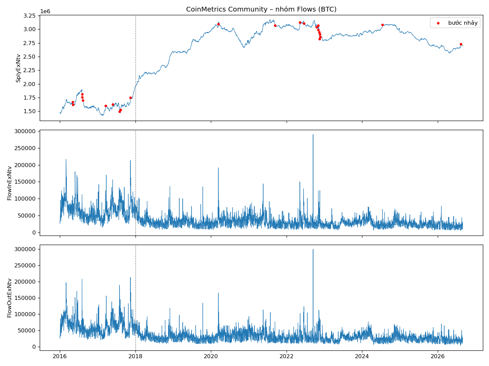

# Kiểm chứng nhóm Flows (task 1.10)

- Nguồn: CoinMetrics Community API `https://community-api.coinmetrics.io/v4/timeseries/asset-metrics`, gọi từng metric một; tải lúc 2026-10-24T09:11:03+00:00 (UTC).
- Khoảng crawl: 2016-01-01 → 2026-08-31. Tỷ lệ thiếu tính trên 2018-01-01 → 2026-08-31.
- Đối chiếu: file community trên GitHub `https://raw.githubusercontent.com/coinmetrics/data/master/csv/btc.csv`.

## Kết quả theo metric

| Metric | API | Ngày đầu | Ngày cuối | Thiếu từ 2018 | Trạng thái giá trị | Ngày trùng GitHub | Ngày cuối GitHub | Lệch tương đối lớn nhất | Số ngày lệch >1% |
|---|---|---|---|---|---|---|---|---|---|
| FlowInExNtv | OK | 2016-01-01 | 2026-08-31 | 0.00% | {'flash': 3896} | 3796 | 2026-05-23 | 0.00e+00 | 0 |
| FlowOutExNtv | OK | 2016-01-01 | 2026-08-31 | 0.00% | {'flash': 3896} | 3796 | 2026-05-23 | 0.00e+00 | 0 |
| SplyExNtv | OK | 2016-01-01 | 2026-08-31 | 0.00% | {'flash': 3896} | 3796 | 2026-05-23 | 0.00e+00 | 0 |

## Bước nhảy đột ngột của SplyExNtv (|robust z| > 8)

Bước nhảy lớn trong lượng BTC trên sàn thường do CoinMetrics thêm/bớt ví của một sàn vào danh sách gắn nhãn, không phải dòng tiền thật. Các ngày này cần ghi vào Limitations.

| Ngày | Δ SplyExNtv (BTC) | % lượng BTC trên sàn |
|---|---|---|
| 2016-08-02 | -95,066 | -4.99% |
| 2022-11-18 | 88,036 | 3.12% |
| 2017-07-30 | -84,834 | -5.36% |
| 2022-05-09 | 84,303 | 2.77% |
| 2017-11-12 | 78,221 | 4.68% |
| 2022-11-04 | 75,268 | 2.51% |
| 2017-08-08 | 59,210 | 4.04% |
| 2022-11-17 | -52,318 | -1.82% |
| 2016-05-06 | -48,564 | -2.91% |
| 2022-11-11 | -47,671 | -1.59% |
| 2021-09-10 | -47,419 | -1.52% |
| 2026-08-13 | 46,954 | 1.75% |
| 2022-11-02 | -46,423 | -1.53% |
| 2024-07-16 | 43,909 | 1.45% |
| 2022-11-23 | -43,785 | -1.51% |
| 2020-03-12 | 43,537 | 1.43% |
| 2016-05-04 | 42,284 | 2.60% |
| 2016-08-04 | -38,051 | -2.12% |
| 2022-06-17 | -37,780 | -1.20% |
| 2017-03-18 | 37,620 | 2.41% |
| … | còn 3 ngày | |

## Đề xuất

**GIỮ nhóm Flows (go)** — tiêu chí tự động: đủ 3 metric, thiếu ≤ 5% số ngày từ 2018-01-01, có dữ liệu đến 2026-08-31. Quyết định cuối cùng do cả nhóm chốt ở họp go/no-go (task 1.19); phụ thuộc nhãn ví sàn phải được nêu trong Limitations dù giữ hay bỏ.
