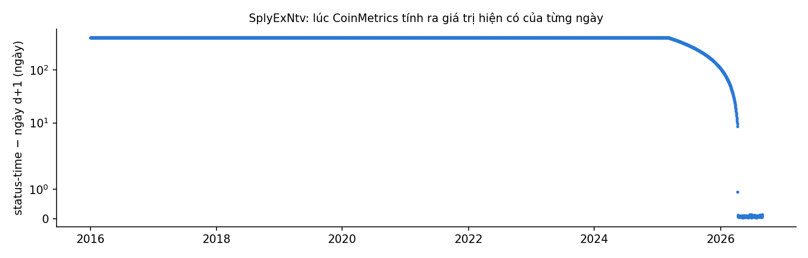

# Flows: thời điểm có sẵn và mức bị sửa lịch sử (góp ý 5)

Vintage mới tải lúc 2026-11-10 19:16 UTC, so với data freeze v1.0 (tải 2026-10-24). 3,896 ngày chung, 2016-01-01 → 2026-08-31. Ngưỡng coi là "đã đổi": lệch > 1 BTC.

## 1. Giá trị nào đã đổi giữa hai lần tải

| metric       |   n_days |   n_changed |   max_abs_btc | first_changed   | last_changed   |
|:-------------|---------:|------------:|--------------:|:----------------|:---------------|
| FlowInExNtv  |     3896 |           0 |   1.45519e-11 | -               | -              |
| FlowOutExNtv |     3896 |           0 |   1.45519e-11 | -               | -              |
| SplyExNtv    |     3896 |           0 |   0.00088893  | -               | -              |

## 2. Thời điểm dữ liệu có sẵn

**Kết luận chính.** Mọi ngày từ 2016-01-01 đến 2026-04-09 có giá trị hiện tại được tính lại trong khoảng 01/04/2026 – 20/04/2026: CoinMetrics đã tính lại **toàn bộ lịch sử** một lần trong đợt đó. Từ 2026-04-10 trở đi, giá trị là giá trị công bố lần đầu (độ trễ trung vị 2.0 giờ sau 00:00 UTC ngày d+1, 95% trong vòng 3.0 giờ). Hệ quả: với mọi ngày test trước 2026-04-10, Flows trong freeze không phải giá trị có sẵn lúc dự báo; chỉ phần từ ngày đó mới đúng thời điểm (point-in-time). Dịch 1 ngày đủ cho độ trễ công bố, nhưng không sửa được việc tính lại này.

`status-time` là lúc CoinMetrics tính ra giá trị hiện có của ngày d. Độ trễ = status-time − 00:00 UTC ngày d+1. Ngày có độ trễ ≤ 48 giờ: giá trị hiện tại là giá trị công bố lần đầu. Ngày có độ trễ > 48 giờ: giá trị đã được tính lại sau đó.

| metric       |   median_lag_h |   p95_lag_h |   max_lag_h_on_time |   n_days_recomputed_later |   share_recomputed | latest_status_time               |
|:-------------|---------------:|------------:|--------------------:|--------------------------:|-------------------:|:---------------------------------|
| FlowInExNtv  |           2.03 |        2.96 |               21.77 |                      3752 |               0.96 | 2026-09-01 01:57:42.332955+00:00 |
| FlowOutExNtv |           2.01 |        2.97 |               21.77 |                      3752 |               0.96 | 2026-09-01 01:57:50.876005+00:00 |
| SplyExNtv    |           2.02 |        3.03 |               21.78 |                      3752 |               0.96 | 2026-09-01 01:58:14.911732+00:00 |

% số ngày của SplyExNtv đã được tính lại (độ trễ > 48 giờ), theo năm:

|   date |   % ngày tính lại |
|-------:|------------------:|
|   2016 |             100   |
|   2017 |             100   |
|   2018 |             100   |
|   2019 |             100   |
|   2020 |             100   |
|   2021 |             100   |
|   2022 |             100   |
|   2023 |             100   |
|   2024 |             100   |
|   2025 |             100   |
|   2026 |              40.7 |

## 3. Đẳng thức ΔSply = In − Out

Số ngày lệch > 1 BTC theo tháng (từ 09/2025). Nếu phần cuối chuỗi đã được tính lại, cột vintage mới sẽ về 0 ở những tháng mà cột freeze còn lệch.

| tháng   |   lệch_freeze |   lệch_vintage_mới |
|:--------|--------------:|-------------------:|
| 2025-09 |             0 |                  0 |
| 2025-10 |             0 |                  0 |
| 2025-11 |             1 |                  1 |
| 2025-12 |             0 |                  0 |
| 2026-01 |             0 |                  0 |
| 2026-02 |             1 |                  1 |
| 2026-03 |             0 |                  0 |
| 2026-04 |            21 |                 21 |
| 2026-05 |            31 |                 31 |
| 2026-06 |            30 |                 30 |
| 2026-07 |            31 |                 31 |
| 2026-08 |            31 |                 31 |

