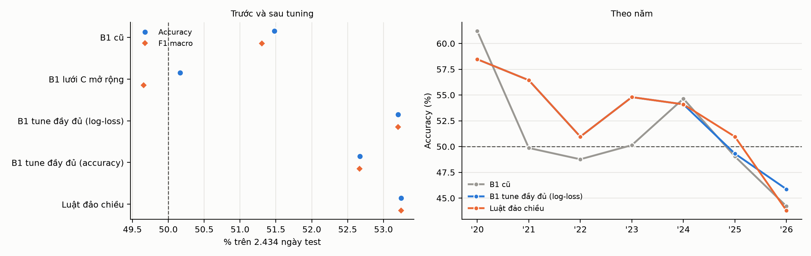
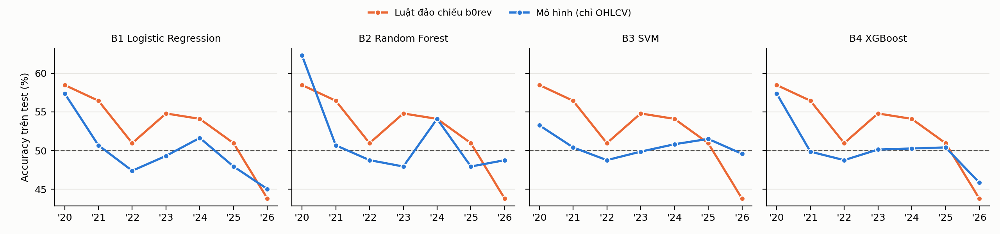
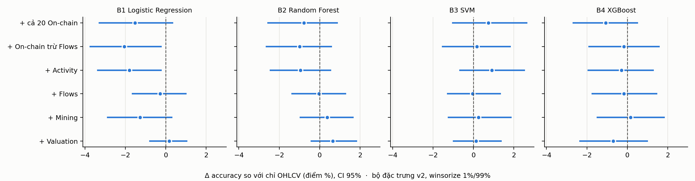
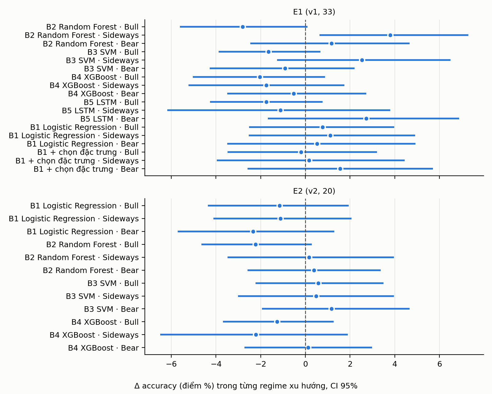
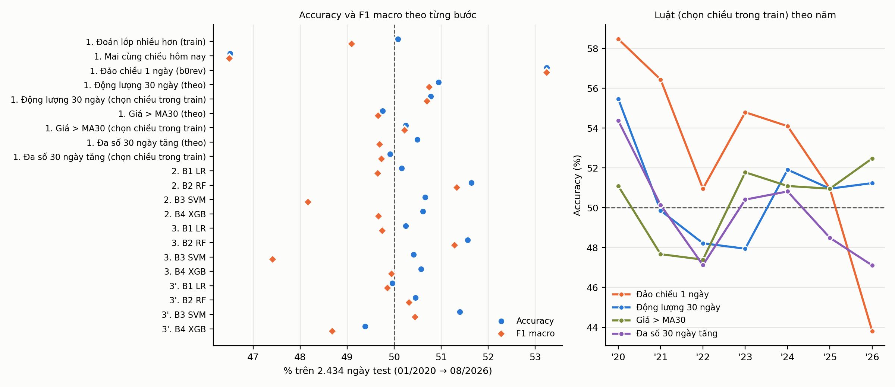

# Đánh giá lại theo nhận xét của thầy (góp ý 1–6)

Branch `vi/feedback-3-6` (tách từ `vi/baseline-reversal-metrics-check`). Mọi số liệu dưới đây được tạo lại bằng code trong repo trên data freeze v1.0. Giai đoạn test là walk-forward 82 fold, 2.434 ngày (01/01/2020 → 30/08/2026), trừ khi ghi khác.

## Tóm tắt

| # | Góp ý | Trước | Sau lần này | Bằng chứng chính |
|---|---|---|---|---|
| 1 | Kiểm tra data, EDA, baseline, xem dự báo đúng/sai | ✅ | ✅ | `analyses/baseline_check/`, `eda_pre_training/` (branch `feat/test-eda`) |
| 2 | Metric đúng định nghĩa, đối chiếu ví dụ | ✅ | ✅ | `analyses/metrics_check/` |
| 3 | Ghi rõ tuning, trước/sau tuning | ⚠️ | ✅ Tuning B1–B4 (3a) + tuning đầy đủ B1: 51,48% → 52,59%, qua cổng baseline (3b) | `pipeline/results/tuning/`, `results/lr_tuning/` |
| 4 | Baseline ổn định rồi mới thêm On-chain; ablation theo nhóm | ❌ | ✅ Có cổng kiểm tra baseline (tiêu chí chốt trước), stepwise On-chain trên validation, ablation. **Kết quả: B1–B4 với 10 feature OHLCV không qua cổng; chỉ B1 sau tuning đầy đủ (mục 3b) qua cổng. Stepwise bỏ qua On-chain ở 9–13/14 lần tune** | `pipeline/src/gate.py`, `results/gate/`, `results/e2/` |
| 5 | Thời điểm Flows có sẵn; đối chứng bỏ Flows | ⚠️ | ✅ | `data/raw/vi_ohlcv_flows/reports/flows_vintage.md`, cấu hình `no_flows` |
| 6 | Regime tái lập được, đúng nghĩa, rồi mới trả lời RQ3 | ⚠️ | ✅ | `regime/run_regime.py`, `reports/regime_check.md`, `results/e3/` |

**Kết luận chung không đổi:** chưa cách thêm On-chain nào cải thiện dự báo hướng ngày mai một cách có ý nghĩa thống kê. Điều này đúng với:
- bộ đặc trưng đã sửa theo EDA;
- từng nhóm chỉ số riêng lẻ;
- cấu hình bỏ Flows;
- từng regime, dù gán theo HMM hay theo xu hướng.

Mọi mô hình, kể cả khi đã thêm On-chain, vẫn **thua luật đảo chiều** (53,25%).

---

## Góp ý 3: tuning

> Ghi rõ phần tuning nào đã thực sự chạy, chọn tham số thế nào và kết quả trước/sau tuning. Tuning bằng train/validation, không chọn model hoặc tham số theo test; hoàn thiện từng baseline trước khi so sánh.

Phần này có hai bước:
- **3a** ghi lại tuning đã chạy trong pipeline E1 cho B1–B4.
- **3b** tune lại B1 đầy đủ, vì 3a cho thấy lưới của B1 chạm biên. Đây là phần "hoàn thiện từng baseline".

### 3a. Tuning trong pipeline E1 (B1–B4)

**Cách tune đã chạy (E1):**
- GridSearchCV với TimeSeriesSplit(5 phần, gap 1 ngày) **chỉ bên trong cửa sổ train 730 ngày** của fold, tiêu chí log-loss.
- Tune lại mỗi 6 fold, tức **14 lần trên 82 fold**. Các fold ở giữa dùng lại tham số đã chọn nhưng vẫn học lại mô hình.
- Không lần tune nào dùng dữ liệu test.
- B5 (LSTM) không qua GridSearch: số epoch chọn bằng early stopping trên 20% cuối của train.

**"Trước tuning"** nghĩa là: tham số trong lưới để ở giá trị mặc định của thư viện; tham số cố định trong config giữ nguyên.

| Mô hình | Lưới | Mặc định |
|---|---|---|
| B1 LR | C ∈ {0,01; 0,1; 1; 10} | C = 1 |
| B2 RF | 200/500 cây × độ sâu {3, 6, không giới hạn} × min_samples_leaf {20, 50} | 100 cây, không giới hạn, 1 |
| B3 SVM | C {0,1; 1; 10} × gamma {0,001; 0,01; 0,1} | C = 1, gamma = "scale" |
| B4 XGB | learning_rate {0,01; 0,05} × max_depth {2, 3, 4} | 0,05; 3 |

**Kết quả trước/sau tuning** (`results/tuning/tuning_before_after.csv`). Δ = sau − trước, cùng ngày test, kèm CI 95% (block bootstrap):

| Mô hình | Cấu hình | Log-loss inner CV: trước → sau | DA test: trước → sau | Δ DA (CI) | Log-loss test: trước → sau | Δ log-loss (CI) |
|---|---|---|---|---|---|---|
| B1 | OHLCV | 0,726 → 0,697 | 50,70 → 51,11 | +0,41 [−0,78; +1,60] | 0,6991 → 0,6953 | **−0,004 [−0,006; −0,002]** |
| B1 | + On-chain | 0,952 → 0,707 | 50,08 → 51,89 | +1,81 [0,00; +3,53] | 0,7413 → 0,7006 | **−0,041 [−0,067; −0,023]** |
| B2 | OHLCV | 0,733 → 0,696 | 51,36 → 51,23 | −0,12 [−2,22; +1,97] | 0,7178 → 0,6961 | **−0,022 [−0,030; −0,013]** |
| B2 | + On-chain | 0,709 → 0,695 | 50,74 → 51,40 | +0,66 [−1,40; +2,71] | 0,7082 → 0,6957 | **−0,013 [−0,018; −0,007]** |
| B3 | OHLCV | 0,699 → 0,695 | 49,88 → 50,62 | +0,74 [−0,70; +2,18] | 0,6951 → 0,7009 | +0,006 [+0,000; +0,012] |
| B3 | + On-chain | 0,699 → 0,696 | 49,47 → 50,29 | +0,82 [−0,70; +2,30] | 0,6959 → 0,6959 | 0,000 |
| B4 | OHLCV | 0,699 → 0,696 | 50,37 → 50,21 | −0,16 [−1,36; +0,99] | 0,6969 → 0,6952 | −0,002 [−0,004; +0,000] |
| B4 | + On-chain | 0,703 → 0,696 | 51,44 → 49,67 | **−1,77 [−3,20; −0,37]** | 0,6948 → 0,6953 | +0,001 |

**Tham số được chọn ở 14 lần tune** (`results/tuning/tuning_params.csv`):

| Mô hình | Chọn gì | Đọc |
|---|---|---|
| B1 LR | C = 0,01 ở **14/14** lần, cả hai cấu hình | Luôn chọn mức regularization mạnh nhất của lưới |
| B2 RF | min_samples_leaf = 50 ở 14/14 (OHLCV) và 13/14 (+ On-chain); độ sâu 3 hoặc 6 | Luôn chọn cây "nông", lá lớn |
| B3 SVM | 6–7 tổ hợp khác nhau trong 14 lần | Không ổn định |
| B4 XGB | 5–6 tổ hợp khác nhau | Không ổn định |

**Nhận xét:**
1. **Tuning giúp xác suất (log-loss)** rõ ở B1 và B2, nhưng **không giúp accuracy**: mọi Δ DA trước/sau đều nằm trong nhiễu, trừ B4 + On-chain, nơi tuning làm DA *kém đi*.
2. **Tham số chạm biên lưới:** B1 luôn chọn C nhỏ nhất, B2 luôn chọn lá lớn nhất. Mô hình "muốn" đơn giản hơn nữa, đúng với việc tín hiệu rất yếu. Lưới mở rộng cho B1–B4 nằm ở mục 4a; tuning đầy đủ cho B1 nằm ở mục 3b.
3. **B3 và B4 chọn tham số không ổn định** giữa các lần tune: inner CV gần như không phân biệt được các tổ hợp.

### 3b. Tuning đầy đủ cho B1 (Logistic Regression)

Code: `pipeline/src/lr_tuning.py`. Kết quả: `pipeline/results/lr_tuning/`.

#### Mục tiêu

Mục 3a và 4a cho thấy B1 với 10 feature OHLCV:
- chọn C nhỏ nhất của lưới ở mọi lần tune;
- trên validation, chỉ hơn mốc "đoán theo tỷ lệ ngày tăng" ở 9/14 lần tune;
- đoán "tăng" ở 55–59% số ngày, nên F1 lớp giảm thấp.

Mục tiêu của 3b là tune lại B1 trên một không gian rộng hơn, **chỉ dùng train/validation**, để có một baseline OHLCV hoàn chỉnh trước khi thêm On-chain.

#### Thiết lập

**Quy trình**, giống mọi mô hình khác của pipeline:
1. Walk-forward 82 fold: train 730 ngày, gap 1 ngày, test 30 ngày, giai đoạn test 01/2020 → 08/2026 (2.434 ngày).
2. Tune lại mỗi 6 fold, tức 14 lần tune: fold 0, 6, …, 78. Tham số chọn ở fold k được dùng cho fold k đến k+5.
3. Trong mỗi lần tune, cửa sổ train 730 ngày được chia bằng `TimeSeriesSplit(5, gap = 1)`. Validation luôn nằm sau train.
4. Mỗi tổ hợp được fit trên phần train và chấm điểm trên phần validation của cả 5 split, rồi lấy trung bình.
5. Tổ hợp tốt nhất được fit lại trên toàn bộ 730 ngày train rồi mới dự báo test.

**Pipeline**, được fit lại trong từng split:

```
Winsorize 1%/99% → StandardScaler → LogisticRegression(solver = "saga", max_iter = 5000, random_state = 0)
```

**Không gian tìm**, chốt trước khi chạy, 5 × 10 × 3 × 2 = **300 tổ hợp mỗi lần tune**:

| Tham số | Giá trị | Lý do đưa vào |
|---|---|---|
| Tập feature | `sign` (1 nếu hôm nay tăng); `lag1` (return hôm nay); `lag1` + `sign`; 10 OHLCV; 10 OHLCV + `sign` | `baseline_check`: LR 1 feature tốt hơn LR 10 feature; luật đảo chiều dùng dấu của return |
| C | 0,0001; 0,0003; 0,001; 0,003; 0,01; 0,03; 0,1; 0,3; 1; 10 | Lưới cũ {0,01 … 10} chạm biên dưới 14/14 lần |
| Regularization (`l1_ratio`) | 0 (L2), 0,5 (elastic-net), 1 (L1) | L1 có thể đưa hệ số của feature vô ích về 0 |
| `class_weight` | không có, balanced | Sửa việc nghiêng về đoán "tăng" |

**Tiêu chí chọn**, chốt trước khi chạy:
- **Chính:** log-loss trung bình trên validation thấp nhất, cùng tiêu chí với mọi mô hình của pipeline.
- **Độ nhạy:** accuracy trung bình trên validation cao nhất.
- Nếu bằng điểm (làm tròn 10 chữ số), chọn tập feature ít hơn, rồi C nhỏ hơn.

**Ví dụ một lần tune** (fold 0, train 31/12/2017 → 30/12/2019, theo log-loss): chọn `lag1`, C = 10, L2, balanced. Điểm của cả 300 tổ hợp được lưu ở `log/grid/fold00.csv`.

#### Tham số được chọn

Từ `tables/lr_tuning_choices.csv`; chi tiết từng lần ở `log/chosen.csv`:

| | Chọn theo log-loss | Chọn theo accuracy |
|---|---|---|
| Tập feature | `lag1` 6, `sign` 6, `lag1 + sign` 1, 10 OHLCV 1 | `lag1` 4, `lag1 + sign` 4, 10 OHLCV 3, `sign` 2, 10 OHLCV + `sign` 1 |
| C | 10 (5 lần), 0,01–0,03 (6 lần), còn lại rải rác | 0,0001–0,03 (12 lần), 0,1–0,3 (2 lần) |
| C chạm biên lưới | 6/14 | 2/14 |
| Regularization | L2 8, L1 4, elastic-net 2 | L2 9, L1 3, elastic-net 2 |
| `class_weight` | balanced 11, không có 3 | balanced 14 |
| Log-loss validation (mốc "đoán theo tỷ lệ" = 0,6950) | 0,6891 | 0,6919 |
| Số lần tốt hơn mốc trên validation | **14/14** | **13/14** |

**Đọc kết quả:**
- **Tập feature nhỏ được chọn áp đảo.** Theo log-loss, 13/14 lần chọn tập chỉ có return hôm nay hoặc dấu của nó. 10 feature OHLCV còn lại chủ yếu là nhiễu với LR.
- **`balanced` gần như luôn được chọn.** Điều này sửa việc nghiêng về đoán "tăng" mà F1 đã chỉ ra.
- **C = 10 không phải dấu hiệu bất ổn.** Với 1 feature, C lớn chỉ có nghĩa là gần như không cần regularize.
- **Tập feature đổi qua lại giữa `lag1` và `sign`**, nhưng hai tập này mang cùng một thông tin (return hôm nay), nên dự báo gần như không đổi.

#### Kết quả trước và sau tuning trên test



Từ `tables/lr_tuning_summary.csv`. "B1 trước tuning" là B1 của E2: 10 OHLCV, winsorize, lưới C {0,01 … 10}, L2. Cả bốn bản dùng cùng 2.434 ngày test.

| B1 | Accuracy | F1 lớp tăng | F1 lớp giảm | F1 macro | MCC | Log-loss | AUC | % đoán tăng |
|---|---|---|---|---|---|---|---|---|
| Trước tuning | 51,48 | 0,542 | 0,484 | 0,513 | 0,028 | 0,6953 | 0,513 | 55% |
| Lưới C mở rộng (mục 4a) | 50,16 | 0,547 | 0,446 | 0,497 | 0,000 | 0,6953 | 0,499 | 59% |
| **Sau tuning, theo log-loss** | **52,59** | 0,523 | 0,529 | **0,526** | 0,052 | **0,6921** | **0,531** | 48% |
| Sau tuning, theo accuracy | 53,04 | 0,526 | 0,534 | 0,530 | 0,062 | 0,6930 | 0,532 | 48% |
| *Luật đảo chiều b0rev (mốc)* | *53,25* | *0,534* | *0,531* | *0,533* | *0,065* | | | *49%* |

- Mọi metric đều tốt lên cùng lúc: accuracy, F1, MCC, log-loss, AUC.
- **Log-loss trên test thấp hơn ln 2 = 0,6931** lần đầu tiên. Các bản trước đều từ 0,695 trở lên, tức xác suất dự báo còn kém hơn tung đồng xu.
- Hai lớp được dự báo cân bằng: F1 lớp tăng và lớp giảm đều khoảng 0,52–0,53.
- **Theo năm** (hình phải): B1 sau tuning và luật đảo chiều đi gần như cùng một đường, cùng yếu dần từ khoảng 59% (2020) xuống khoảng 47% (2026).

#### Kiểm định ý nghĩa

Khoảng tin cậy 95% bằng block bootstrap (khối 15 ngày, 2.000 lần); McNemar cho chênh lệch accuracy; Diebold–Mariano cho log-loss.

| So với | B1 trước tuning | **B1 sau tuning (log-loss)** | B1 sau tuning (accuracy) |
|---|---|---|---|
| **50% (đoán ngẫu nhiên):** accuracy [CI] | 51,48 [49,6; 53,4] | **52,59 [50,5; 54,7]** | **53,04 [51,1; 55,1]** |
| p (accuracy > 50%) | 0,07 | **0,005** | **< 0,001** |
| **b0maj (đoán theo lớp nhiều hơn):** Δ accuracy [CI] | +1,4 [−0,5; +3,3] | +2,5 [−0,1; +5,0] | +3,0 [+0,4; +5,4] |
| p McNemar | 0,19 | 0,09 | 0,03 (≈ 0,06 sau Holm cho 2 bản) |
| **b0maj:** Δ log-loss, p DM | +0,0015, p 0,33 | −0,0017, p 0,38 | −0,0008, p 0,53 |
| **B1 trước tuning:** Δ accuracy [CI] | | +1,1 [−1,1; +3,5] | +1,6 [−0,5; +3,6] |
| **Luật đảo chiều:** Δ accuracy [CI] | −1,8 [−3,9; +0,3] | −0,7 [−1,9; +0,6] | −0,2 [−1,3; +0,8] |

**Đọc kết quả:**
1. **So với đoán ngẫu nhiên:** B1 sau tuning cao hơn 50% có ý nghĩa thống kê (p = 0,005). B1 trước tuning thì không (p = 0,07).
2. **So với baseline đoán theo lớp nhiều hơn:**
   - Bản chọn theo log-loss, tức tiêu chí chính, **chưa** hơn có ý nghĩa (p = 0,09).
   - Bản chọn theo accuracy hơn ở p = 0,03, nhưng sau khi hiệu chỉnh cho 2 bản đã thử thì p ≈ 0,06.
   - Xác suất dự báo (log-loss) không tốt hơn b0maj có ý nghĩa.
3. **So với B1 trước tuning:** cải thiện +1,1 đến +1,6 điểm, nhưng khoảng tin cậy còn chứa 0.
4. **So với luật đảo chiều:** không khác biệt. B1 sau tuning về bản chất là luật đảo chiều viết dưới dạng LR: nó dùng return hôm nay với hệ số âm, cộng với cân bằng lớp.

#### Đối chiếu với cổng "baseline ổn định" (mục 4a)

| Tiêu chí | B1 trước tuning | B1 sau tuning (log-loss) |
|---|---|---|
| G1: tốt hơn mốc trên validation ở ≥ 10/14 lần | 9/14 ✗ | **14/14 ✓** |
| G2: C chạm biên ≤ 7/14 lần | 14/14 ✗ (lưới cũ) | **6/14 ✓** |

B1 sau tuning là **baseline OHLCV đầu tiên qua cổng**. Có hai lưu ý:
- L1 hay L2 được chọn khác nhau giữa các lần tune. Đây là lựa chọn rời rạc nên không tính là "chạm biên".
- Tập feature đổi qua lại giữa `lag1` và `sign`, nhưng hai tập cùng thông tin.

#### Giới hạn

- **Data snooping nhẹ.** Hai tập feature `lag1` và `sign` được đưa vào danh sách ứng viên dựa trên `baseline_check`, mà `baseline_check` có xem kết quả walk-forward. Việc chọn trong từng fold chỉ dựa trên validation, nhưng danh sách ứng viên không hoàn toàn độc lập với giai đoạn test.
- **Hai tiêu chí chọn.** Chỉ bản log-loss là kết quả chính. Bản accuracy chỉ để kiểm tra độ nhạy và không được báo cáo thay cho bản chính.
- **Tín hiệu yếu dần.** Giống luật đảo chiều, accuracy giảm theo thời gian (2026 khoảng 47%). Nếu xu hướng này tiếp tục, baseline sẽ không còn giữ được.

#### Kết luận

> Sau khi tune trên validation (300 tổ hợp × 14 lần tune; tập feature, C, kiểu regularization, cân bằng lớp), B1 Logistic Regression đạt accuracy 52,59%, F1 macro 0,526 và log-loss 0,6921 trên 2.434 ngày test walk-forward. Kết quả này cao hơn 50% có ý nghĩa thống kê (p = 0,005) và qua được cổng "baseline ổn định". Tuy nhiên, B1 chưa vượt có ý nghĩa baseline đoán theo lớp nhiều hơn (+2,5 điểm, p = 0,09), và tương đương luật đảo chiều 1 ngày (−0,7 điểm, không có ý nghĩa). Tuning chọn gần như chỉ dùng return hôm nay cùng cân bằng lớp; tín hiệu B1 học được là hiệu ứng đảo chiều ngắn hạn. B1 sau tuning được dùng làm baseline OHLCV để đo giá trị bổ sung của On-chain (RQ1).

**File kết quả** (trong `pipeline/results/lr_tuning/`):

| File | Nội dung |
|---|---|
| `log/chosen.csv` | Tham số được chọn ở 14 lần tune, theo từng tiêu chí |
| `log/grid/foldXX.csv` | Điểm validation của cả 300 tổ hợp ở mỗi lần tune |
| `predictions/lr_tuned_{logloss,acc}.csv` | Dự báo trên test |
| `tables/lr_tuning_summary.csv` | Metric và Δ trên test |
| `tables/lr_tuning_choices.csv` | Tổng hợp tham số được chọn |
| `tables/lr_tuning_by_year.csv` | Accuracy theo năm |

---

## Góp ý 4: thêm On-chain từng bước, ablation theo nhóm

> Sau khi baseline OHLCV-only đã ổn định, mới bổ sung On-chain từng bước. Giữ cùng model và protocol, tuning phù hợp cho từng cấu hình; làm ablation theo nhóm chỉ số.

Làm đúng thứ tự thầy yêu cầu, gồm ba bước: (a) kiểm tra baseline OHLCV có ổn định không, (b) thêm On-chain từng bước, chỉ khi validation cho thấy có ích, (c) ablation theo nhóm. Bước (a) và (b) dùng `pipeline/src/gate.py`. Mọi quyết định chỉ dựa vào inner CV trong cửa sổ train (TimeSeriesSplit 5, gap 1); ngày test không được dùng để chọn.

### 4a. Cổng "baseline ổn định"

Tiêu chí được ghi trong code **trước khi chạy**. Một mô hình chỉ OHLCV (10 đặc trưng, winsorize 1%/99%) qua cổng khi đạt cả hai:
- **G1, vượt mốc tối thiểu trên validation:** log-loss inner CV thấp hơn B0 ("đoán theo tỷ lệ ngày tăng của phần train", trên cùng split) ở ≥ 70% số lần tune (≥ 10/14).
- **G2, không chạm biên lưới:** mỗi tham số nằm ở đầu hoặc cuối lưới ở ≤ 50% số lần tune. Nếu chạm biên, mô hình đang muốn đơn giản hơn nữa, tức chưa tìm được cấu hình ổn định.

Lưới được **mở rộng** so với E1, vì lưới cũ chạm biên (LR chọn C = 0,01 cả 14/14 lần, RF chọn min_samples_leaf = 50 cả 14/14 lần):

| Mô hình | Lưới mới |
|---|---|
| B1 LR | C ∈ {0,0001; 0,001; 0,01; 0,1; 1} |
| B2 RF | 300 cây; max_depth ∈ {2, 3, 6}; min_samples_leaf ∈ {50, 100, 200} |
| B3 SVM | C ∈ {0,01; 0,1; 1; 10}; gamma ∈ {0,0001; 0,001; 0,01; 0,1} |
| B4 XGB | learning_rate ∈ {0,005; 0,01; 0,05}; max_depth ∈ {1, 2, 3, 4} |

**Kết quả** (`results/gate/tables/gate_summary.csv`):

| Mô hình | G1: hơn B0 trên validation | G2: số lần chạm biên | Qua cổng? | Log-loss inner (B0 = 0,6950) | DA test | So với b0rev (CI 95%) |
|---|---|---|---|---|---|---|
| B1 LR | 9/14 ✗ | C 6/14 ✓ | **Không** | 0,6945 | 50,16% | −3,1 [−5,5; −0,7] |
| B2 RF | 13/14 ✓ | max_depth 13/14, leaf 9/14 ✗ | **Không** | 0,6936 | 51,64% | −1,6 [−3,8; +0,6] |
| B3 SVM | 7/14 ✗ | C 5/14, gamma 8/14 ✗ | **Không** | 0,6950 | 50,66% | −2,6 [−5,3; +0,3] |
| B4 XGB | 9/14 ✗ | learning_rate 7/14, max_depth 10/14 ✗ | **Không** | 0,6944 | 50,62% | −2,6 [−4,9; −0,2] |

**Không mô hình nào qua cổng.** Cụ thể:
- **Mức vượt B0 rất nhỏ.** Log-loss inner trung bình thấp hơn B0 từ 0 (SVM) đến 0,0014 (RF). Mức này chưa tới 0,2% của ln 2.
- **Gần nhất là B2 RF.** RF vượt B0 ở 13/14 lần tune, nhưng chọn cây sâu 2 (nông nhất trong lưới) ở 10/14 lần. Mô hình tự co về dạng gần như hằng số.
- **LR không còn chạm biên** (6/14), nhưng khi đó C = 0,0001, tức hệ số gần bằng 0 và LR gần như chỉ đoán theo tỷ lệ.
- **Mở rộng lưới không làm test tốt hơn.** LR giảm từ 51,48% xuống 50,16%; RF tăng từ 51,23% lên 51,64%; SVM và XGB giữ nguyên.
- **Theo năm** (hình dưới, `gate_by_year.csv`), mô hình vượt 52% chủ yếu ở năm 2020. Luật đảo chiều cao hơn mô hình ở 6/7 năm với B1 và B4, 5/7 năm với B3, 4/7 năm với B2. Mô hình chỉ thắng luật đảo chiều ở năm 2026, năm luật đảo chiều tụt còn 43,8%.



**Kết luận 4a:** baseline OHLCV **không ổn định**. Đây là kết quả đo được theo tiêu chí đặt trước, không phải việc chưa làm. OHLCV ngày không mang đủ tín hiệu về hướng giá ngày mai để mô hình học vượt mức "đoán theo tỷ lệ". Theo đúng quy trình thầy đưa ra, chưa nên kết luận gì về việc On-chain "có ích"; mọi phép so có On-chain bên dưới được báo cáo như kiểm tra, không phải bằng chứng.

### 4b. Thêm On-chain từng bước (stepwise trên validation)

Thực hiện trong mỗi lần tune (14 lần, mỗi lần dùng cho 6 fold tiếp theo):
1. Tune mô hình trên OHLCV.
2. Thử thêm từng nhóm (Activity, Flows, Mining, Valuation của bộ v2) và lấy nhóm cho log-loss inner thấp nhất.
3. **Chỉ thêm nếu log-loss giảm > 0,001.**
4. Lặp lại cho đến khi không còn nhóm nào đạt.

Bước chọn nhóm chỉ nhìn validation, nên đây là cách thêm On-chain mà không "nhìn trộm" test.

**Nhóm được chọn** (`results/gate/tables/stepwise_groups.csv`):

| Mô hình | Không chọn nhóm nào | Activity | Flows | Mining | Valuation |
|---|---|---|---|---|---|
| B1 LR | **13/14** | 0 | 0 | 1 | 1 |
| B2 RF | **12/14** | 0 | 1 | 1 | 0 |
| B3 SVM | **9/14** | 1 | 1 | 1 | 2 |
| B4 XGB | **10/14** | 2 | 1 | 1 | 0 |

- Không nhóm nào được chọn lặp lại một cách nhất quán.
- Các lần được chọn rải rác, mỗi nhóm 0–2 lần trên 14, giống nhiễu hơn là tín hiệu.

**Test, so với baseline cùng mô hình** (`stepwise_delta.csv`):

| Mô hình | DA baseline → stepwise | Δ DA (CI 95%) | Δ log-loss | p DM (Holm) |
|---|---|---|---|---|
| B1 LR | 50,16 → 50,25 | +0,08 [−0,16; +0,33] | +0,0001 | 1,00 |
| B2 RF | 51,64 → 51,56 | −0,08 [−0,54; +0,37] | 0,0000 | 1,00 |
| B3 SVM | 50,66 → 50,41 | −0,25 [−1,19; +0,70] | +0,0135 (kém hơn) | 0,19 |
| B4 XGB | 50,62 → 50,58 | −0,04 [−0,86; +0,82] | −0,0001 | 1,00 |

**Kết luận 4b:**
- Khi để validation tự quyết, On-chain hầu như không được chọn.
- Ở những lần được chọn, On-chain không giúp gì trên test.
- Kết luận này khớp với ablation 4c, nhưng mạnh hơn: nó **không phụ thuộc vào việc nhóm tự chọn cấu hình**.

### 4c. Ablation theo nhóm (E2)

**Bộ đặc trưng v2** (`configs/features_onchain_v2.yaml`) sửa bộ v1 theo EDA. Các lựa chọn được chốt trước khi chạy và không dùng nhãn:

| Thay đổi | Lý do (eda_pre_training) |
|---|---|
| Sai phân 7 ngày cho khối lượng giao dịch, địa chỉ hoạt động, phí | 34–63% phương sai của sai phân 1 ngày là do thứ trong tuần |
| Bỏ MVRV (3 đặc trưng) | R² 0,72–0,98 theo OHLCV |
| Bỏ NVT (3) | Hàm xác định của giá và khối lượng giao dịch (ρ −0,997) |
| Bỏ Puell logdiff | ≈ HashRate logdiff (ρ 0,95) |
| Bỏ SplyExNtv (3) | logdiff ≈ Netflow; MA và z-score không dừng |
| Bỏ difficulty (3) | Hàm trễ của hashrate; logdiff = 0 ở 84% số ngày |
| Winsorize 1%/99% (học trên train của fold) | 11 đặc trưng có kurtosis dư > 10 |

Còn **20 đặc trưng On-chain** (v1 có 33): Activity 9, Flows 3 (chỉ Netflow), Mining 6, Valuation 2 (Puell).

**Cùng mô hình, lưới, cách tune và fold với E1.** Mỗi cấu hình được tune riêng.



**Accuracy (%)** (`results/e2/tables/e2_metrics.csv`):

| | Chỉ OHLCV | + cả 20 | + Activity | + Flows | + Mining | + Valuation | + trừ Flows |
|---|---|---|---|---|---|---|---|
| B1 LR | 51,48 | 49,96 | 49,67 | 51,19 | 50,21 | 51,64 | 49,42 |
| B2 RF | 51,23 | 50,45 | 50,29 | 51,19 | 51,60 | 51,89 | 50,25 |
| B3 SVM | 50,66 | 51,40 | 51,56 | 50,62 | 50,90 | 50,78 | 50,82 |
| B4 XGB | 50,45 | 49,38 | 50,16 | 50,29 | 50,62 | 49,75 | 50,29 |
| Luật đảo chiều | 53,25 | | | | | | |

**Δ so với chỉ OHLCV** (`results/e2/tables/e2_delta.csv`), 24 phép so:
- **Không phép nào có ý nghĩa sau hiệu chỉnh Holm.** p McNemar (Holm) ≥ 0,70.
- Δ DA nằm trong khoảng −2,05 đến +0,90 điểm.
- **B1 bị kém đi khi thêm Activity hoặc thêm cả On-chain trừ Flows:** Δ DA −1,8 và −2,1 điểm (CI không chứa 0, nhưng Holm 0,70); log-loss kém đi có ý nghĩa (DM Holm 0,034 và 0,016).
- **B3 có Δ log-loss âm rõ** ở nhiều cấu hình, nhưng đó là do winsorize làm log-loss của B3 chỉ OHLCV xấu đi (0,7009 → 0,7297), không phải do On-chain giúp.

**So với luật đảo chiều** (`e2_vs_reversal.csv`): cả 28 cấu hình × mô hình đều thấp hơn 53,25%, chênh từ −1,4 đến −3,9 điểm.

**So với E1 (bộ v1, 33 đặc trưng):** sửa đặc trưng theo EDA **không** làm On-chain có ích hơn.

---

## Góp ý 5: Flows

> Flows có lịch sử bị sửa khi cập nhật nhãn ví sàn; dịch trễ một ngày chưa giải quyết được vấn đề này. Kiểm tra thời điểm dữ liệu thực sự có sẵn và chạy đối chứng bỏ Flows.

**Kiểm tra thời điểm có sẵn** (`data/raw/vi_ohlcv_flows/src/flows_vintage.py`, báo cáo `reports/flows_vintage.md`). Tải lại Flows ngày 10/11/2026 kèm trường `status-time` của CoinMetrics (thời điểm tính ra giá trị hiện có của từng ngày), rồi so với data freeze (tải 24/10/2026):

| Phát hiện | Số liệu |
|---|---|
| **Toàn bộ lịch sử đã được tính lại một lần** | Mọi ngày 01/01/2016 → 09/04/2026 có status-time trong **01–20/04/2026** |
| Từ 10/04/2026: giá trị công bố lần đầu | Độ trễ trung vị **2,0 giờ** sau 00:00 UTC ngày d+1; 95% trong vòng 3,0 giờ |
| Giữa hai lần tải (24/10 → 10/11/2026) | **Không giá trị nào đổi** (lệch tối đa 0,0009 BTC) |
| Đẳng thức ΔSply = In − Out | Đúng tới từng BTC trong phần đã tính lại; lệch mọi ngày từ 04/2026 ở cả hai lần tải |

**Hệ quả:**
- Dịch 1 ngày **đủ** cho độ trễ công bố: dữ liệu ngày t−1 có trước khoảng 3 giờ sáng ngày t, trước lúc dự báo 00:00 ngày t+1.
- Nhưng với mọi ngày test trước 10/04/2026, giá trị Flows trong freeze là **giá trị tính lại vào tháng 4/2026, không phải giá trị có sẵn lúc đó**. Chỉ 143 ngày test cuối (10/04 → 30/08/2026) là đúng thời điểm (point-in-time).
- Vết gãy của đẳng thức mà EDA phát hiện ở 04/2026 chính là ranh giới giữa phần đã tính lại và phần công bố lần đầu.

**Đối chứng bỏ Flows** (cấu hình `no_flows` của E2):

| Mô hình | Δ DA: + cả 20 On-chain | Δ DA: + On-chain trừ Flows | Δ DA: chỉ + Flows |
|---|---|---|---|
| B1 | −1,52 | −2,05 | −0,29 |
| B2 | −0,78 | −0,99 | −0,04 |
| B3 | +0,74 | +0,16 | −0,04 |
| B4 | −1,07 | −0,16 | −0,16 |

- **Bỏ Flows không làm thay đổi kết luận:** có hay không có Flows, On-chain đều không giúp.
- Riêng Flows có Δ gần 0 ở cả 4 mô hình.
- Trên 143 ngày đúng thời điểm, CI quá rộng (khoảng ±7 điểm) để kết luận.

**Đề xuất cho báo cáo:** kết luận RQ1 dựa trên cấu hình **trừ Flows**; kết quả có Flows được ghi là cận trên vì dữ liệu đã được tính lại. Lưu vintage Flows mỗi lần tải; vintage đầu tiên đã có trong `data/raw/vi_ohlcv_flows/data/vintages/2026-11-10/`.

---

## Góp ý 6: regime

> Nhãn regime chưa tái lập được và chỉ kéo dài trung bình 2–3 ngày. Hoàn thiện code, kiểm tra các giai đoạn cụ thể và ý nghĩa Bull/Bear/Sideways trước khi dùng kết quả để trả lời RQ3.

**Tái lập** (`regime/run_regime.py`): code HMM của Ngân (`regime_hmm.py`) đã có, chỉ thiếu phần dựng đầu vào. Với `realized_volatility` = căn tổng bình phương log return 1h trong ngày, bản chạy lại **khớp 100%** nhãn và fold của `regime_map.csv` (2.435 ngày). Các cách tính khác chỉ khớp 40–48%. Giờ `regime_map.csv` tái lập được bằng một lệnh.

**Ý nghĩa và các giai đoạn cụ thể** (`regime/reports/regime_check.md`). Thêm regime theo xu hướng: close so với MA200, return 90 ngày ±10%, làm mượt 21 ngày, chỉ dùng quá khứ, ngưỡng theo quy ước.

| | HMM | Theo xu hướng |
|---|---|---|
| Độ dài trung bình một đợt | Bull 3,0 · Sideways 2,8 · Bear 1,9 ngày | Bull 129 · Sideways 32 · Bear 59 ngày |
| % đợt chỉ dài 1 ngày | 40–55% | 0–5% |
| Return 30 ngày trước, Bull / Bear | +5,4% / 0,0% | **+12,0% / −3,3%** |
| Độ lệch chuẩn return ngày, Bull / Bear | 2,9% / **6,5%** | 3,5% / 3,3% |
| Đúng nhãn kỳ vọng trên 9 giai đoạn đã biết | **43%** | **83%** |

- HMM gán FTX (11–12/2022) chủ yếu là Sideways, LUNA (05–07/2022) chủ yếu là Bull. HMM đang tách theo **biến động**, không theo xu hướng.
- Regime theo xu hướng gán đúng các giai đoạn đó, nhưng **phản ứng chậm** với cú sập đột ngột: tháng 03/2020 chủ yếu vẫn là Bull.

**E3 chạy lại trên cả hai cách gán** (`results/e3/`), cho E1 (6 mô hình) và E2 (4 mô hình):



- **Δ DA trong từng regime:** chỉ 1/30 CI không chứa 0 với regime xu hướng (B2 E1 · Sideways +3,8 điểm), và 0/30 với HMM. Với 30 phép so ở mức 95%, kỳ vọng khoảng 1,5 kết quả "có ý nghĩa" chỉ do ngẫu nhiên.
- **Placebo** (xáo thứ tự các đợt regime 1.000 lần, giữ độ dài đợt): chênh lệch Δ giữa Bull và Bear không khác phân phối giả ở mô hình nào. p (Holm) ≥ 0,83 với regime xu hướng, ≥ 0,85 với HMM.

→ **RQ3: không có bằng chứng On-chain giúp khác nhau giữa thị trường tăng, giảm và đi ngang**, kể cả khi regime đã được định nghĩa đúng nghĩa xu hướng.

---

## Chuỗi bước đầy đủ: luật 30 ngày → B1–B4 → thêm On-chain có chọn lọc (accuracy, F1)

> Thầy: thử rule-based (setting 30 ngày) làm baseline cơ bản, tính accuracy, F1; rồi chạy mô hình 2, 3, 4; rồi mới bổ sung On-chain, không đưa hết feature vào mà phải xem feature có hợp lý không.

Code: `pipeline/src/rules30.py`. Kết quả nằm trong `results/rules30/tables/rules30_summary.csv` và `rules30_by_year.csv`. Cùng 82 fold, 2.434 ngày test.

**Các luật 30 ngày** chỉ dùng giá đến hết ngày t, chốt trước khi chạy:
- **mom30:** giá hôm nay > giá 30 ngày trước thì đoán tăng.
- **ma30:** giá hôm nay > trung bình 30 ngày thì đoán tăng.
- **maj30:** ≥ 15/30 ngày qua là ngày tăng thì đoán tăng.

Mỗi luật có hai bản:
- **"Theo":** luôn đi theo tín hiệu.
- **"Chọn chiều":** trong từng cửa sổ train, nếu tín hiệu đúng < 50% thì đảo, giống b0rev.



| Bước | Phương pháp | Accuracy | F1 tăng | F1 giảm | F1 macro | % đoán tăng | So với b0rev (CI 95%) |
|---|---|---|---|---|---|---|---|
| 1. Luật | Đoán lớp nhiều hơn | 50,08 | 0,562 | 0,420 | 0,491 | 63% | −3,2 [−5,8; −0,6] |
| | Mai cùng chiều hôm nay | 46,51 | 0,475 | 0,455 | 0,465 | 51% | −6,7 [−10,7; −2,8] |
| | **Đảo chiều 1 ngày (b0rev)** | **53,25** | 0,534 | 0,531 | **0,533** | 49% | mốc |
| | Động lượng 30 ngày (theo / chọn chiều) | 50,94 / 50,78 | 0,539 / 0,487 | 0,476 / 0,527 | 0,508 / 0,507 | 55% / 45% | −2,3 / −2,5 |
| | Giá > MA30 (theo / chọn chiều) | 49,75 / 50,25 | 0,518 / 0,512 | 0,475 / 0,493 | 0,497 / 0,502 | 53% / 51% | −3,5 / −3,0 |
| | Đa số 30 ngày tăng (theo / chọn chiều) | 50,49 / 49,92 | 0,560 / 0,528 | 0,434 / 0,467 | 0,497 / 0,497 | 62% / 55% | −2,8 / −3,3 |
| 2. ML chỉ OHLCV | B1 LR | 50,16 | 0,547 | 0,446 | 0,497 | 59% | −3,1 [−5,5; −0,7] |
| | B2 RF | 51,64 | 0,552 | 0,475 | 0,513 | 57% | −1,6 [−3,8; +0,6] |
| | B3 SVM | 50,66 | 0,595 | 0,368 | 0,482 | 71% | −2,6 [−5,3; +0,3] |
| | B4 XGB | 50,62 | 0,566 | 0,428 | 0,497 | 63% | −2,6 [−4,9; −0,2] |
| 3. + On-chain chọn lọc (stepwise) | B1 / B2 / B3 / B4 | 50,25 / 51,56 / 50,41 / 50,58 | | | 0,498 / 0,513 / 0,474 / 0,500 | | −1,7 đến −3,0 |
| 3'. + cả 20 On-chain (đối chứng) | B1 / B2 / B3 / B4 | 49,96 / 50,45 / 51,40 / 49,38 | | | 0,499 / 0,503 / 0,505 / 0,487 | | −1,9 đến −3,9 |

**Rút ra:**
1. **Luật 30 ngày không có tín hiệu.**
   - Cả 6 bản cho accuracy 49,8–50,9%, không bản nào khác 50% một cách đáng kể.
   - Ở bản "chọn chiều", chiều được chọn **đảo qua lại giữa các fold**: mom30 đảo ở 27/82 fold, ma30 ở 50/82, maj30 ở 34/82. Train không thống nhất được nên đi theo hay đi ngược xu hướng 30 ngày, tức là không có quy luật xu hướng 30 ngày ổn định.
   - Ngược lại, luật đảo chiều 1 ngày chọn "ngược" ở **79/82** fold, nên quy luật này nhất quán.
2. **F1 cho thấy điều accuracy che mất.**
   - Các mô hình ML nghiêng về đoán "tăng": 57–71% số ngày, trong khi thực tế 50,9% số ngày tăng. Vì vậy F1 lớp "giảm" thấp, chỉ 0,37–0,48, và F1 macro thấp hơn accuracy.
   - B3 SVM rõ nhất: accuracy 50,66% nhưng F1 macro chỉ 0,482, vì đoán tăng 71% số ngày. Mô hình gần như đoán theo lớp nhiều hơn, không phân biệt được ngày tăng và ngày giảm.
   - b0rev cân bằng: F1 tăng 0,534, F1 giảm 0,531, đoán tăng 49%.
3. **Thứ tự các bước** không đổi kết luận. Luật 30 ngày ≈ 50%, ML chỉ OHLCV ≈ 50–51,6%, thêm On-chain có chọn lọc thì không đổi (stepwise hầu như không chọn nhóm nào, xem 4b), thêm cả 20 On-chain thì không tốt hơn. Phương pháp duy nhất vượt 50% rõ ràng vẫn là luật đảo chiều 1 ngày, và luật này cũng yếu dần (58,5% năm 2020 → 43,8% năm 2026).
4. **Sau Holm cho 20 phép so với b0rev**, chỉ "mai cùng chiều hôm nay" kém hơn có ý nghĩa (p 0,016). Các phương pháp còn lại thấp hơn b0rev 1,6–3,9 điểm, nhưng không đủ ý nghĩa sau khi hiệu chỉnh nhiều phép so.

---

## Áp dụng luật vào mô hình (rule-based + ML)

Code: `pipeline/src/hybrid.py`. Bảng: `results/hybrid/tables/hybrid_summary.csv`. Thiết kế và ngưỡng được chốt trước khi chạy, mọi phép so đều so với luật đảo chiều b0rev (53,25%).

**A. Đưa luật vào làm feature:** thêm "dấu return hôm nay" vào 10 feature OHLCV.

| Mô hình | Không có dấu → có dấu | So với b0rev (CI 95%) |
|---|---|---|
| B1 LR | 50,16 → 49,84 | −3,4 [−5,7; −1,2] |
| B2 RF | 51,64 → **52,22** | −1,0 [−3,0; +0,9] |
| B3 SVM | 50,66 → 50,82 | −2,4 [−5,2; +0,4] |
| B4 XGB | 50,62 → 50,62 | −2,6 [−4,8; −0,3] |
| LR chỉ dùng dấu | 51,64 | −1,6 [−2,9; −0,4] |

- B2 RF + dấu đạt 52,22%, **cao nhất trong mọi mô hình ML của nhóm**, và F1 macro tăng lên 0,522. Tuy vậy, mức tăng so với không có dấu là +0,6 điểm (CI có chứa 0), và vẫn thấp hơn b0rev.
- **LR chỉ dùng đúng tín hiệu của luật mà vẫn không tái tạo được luật** (51,64% so với 53,25%). Lý do: LR tối ưu log-loss chứ không tối ưu accuracy. Khi regularize mạnh (C nhỏ), hệ số intercept, tức tỷ lệ ngày tăng của train, lấn át tín hiệu đảo chiều nhỏ. Đây là lời giải thích trực tiếp cho việc vì sao ML thua một luật 1 tham số.

**C. Luật mặc định, mô hình chỉ ghi đè khi tự tin** (|p̂ − 0,5| > 0,05):
- Accuracy tổng 52,2–53,1%, **không cấu hình nào vượt b0rev** (Δ từ −0,1 đến −1,0 điểm).
- Mô hình ghi đè ở 8–28% số ngày. **Đúng ở những ngày mô hình tự tin, mô hình lại đoán kém hơn luật.** Ví dụ B4: mô hình 54,1% so với luật 59,2% trên 314 ngày đó. Độ tự tin của mô hình không mang thông tin.

**B. Luật On-chain cực trị** (|z90| > 2; các ngày khác dùng b0rev):

| Chỉ số | % ngày kích hoạt | Accuracy ngày kích hoạt: luật On-chain / b0rev | Số fold chọn "z cao → tăng" |
|---|---|---|---|
| Netflow sàn | 5,8% | 51,8 / 48,9 | 39/82 |
| Địa chỉ hoạt động | 6,1% | 50,0 / 48,6 | 67/82 |
| Số giao dịch | 6,8% | 41,8 / 51,5 | 36/82 |
| Khối lượng giao dịch | 5,2% | 51,6 / 54,0 | 44/82 |
| Hashrate | 6,9% | 46,7 / 52,1 | 53/82 |
| Phí | 8,0% | 41,8 / 50,0 | 58/82 |
| Puell | 10,7% | 52,5 / 52,1 | 67/82 |

- **Không luật cực trị nào tốt hơn b0rev có ý nghĩa** (Holm ≥ 0,59). Hai luật tốt nhất (Netflow +2,8 điểm, Địa chỉ hoạt động +1,4 điểm) có CI rộng khoảng ±12 điểm, vì chỉ có 140–150 ngày kích hoạt.
- **Chiều của luật không ổn định:** với Netflow, train chọn "z cao → tăng" ở 39/82 fold và "z cao → giảm" ở 43/82 fold. Như vậy ngay cả ở ngày cực trị, On-chain cũng không có hướng tác động nhất quán.

**Kết luận:** áp luật vào mô hình giúp ML tốt lên một chút. B2 RF tăng lên 52,2%, và kết hợp luật + mô hình đạt 53,1%. Nhưng **không cách nào vượt được luật đảo chiều đứng riêng**. On-chain, kể cả chỉ dùng ở ngày cực trị, không thêm được thông tin. Với bài toán này, rule-based khả thi hơn ML, và phần ML đóng góp thêm gần như bằng 0.

---

## Còn lại và đề xuất

| Việc | Vì sao |
|---|---|
| Báo cáo kết luận RQ1 trên cấu hình trừ Flows | Flows trước 10/04/2026 không phải point-in-time |
| Merge các branch vào `main` | Hiện kết quả nằm ở 4 branch khác nhau |

## Chạy lại

Từ thư mục gốc repo:

```
python pipeline/src/experiments.py --stage tuning          # góp ý 3 (~30 phút, B2 chậm nhất)
python pipeline/src/experiments.py --stage tuning-tables
python pipeline/src/experiments.py --stage e2              # góp ý 4, 5 (~45 phút)
python pipeline/src/experiments.py --stage e2-tables
python pipeline/src/gate.py --stage gate                   # góp ý 4a: cổng baseline (~6 phút)
python pipeline/src/gate.py --stage stepwise               # góp ý 4b: stepwise On-chain (~8 phút)
python pipeline/src/gate.py --stage tables
python pipeline/src/rules30.py                             # luật 30 ngày + bảng accuracy/F1 cả chuỗi (cần gate xong)
python pipeline/src/hybrid.py --stage a                    # luật làm feature (~10 phút)
python pipeline/src/hybrid.py --stage tables               # luật + mô hình ghi đè, luật On-chain cực trị
python pipeline/src/lr_tuning.py --stage run               # tuning đầy đủ B1 (~15 phút)
python pipeline/src/lr_tuning.py --stage tables
python regime/run_regime.py                     # góp ý 6: tái lập HMM, regime xu hướng
python pipeline/src/experiments.py --stage e3
cd data/raw/vi_ohlcv_flows && python src/flows_vintage.py      # góp ý 5: gọi API CoinMetrics
```

Mỗi lệnh `experiments.py` chạy test của mọi module trước. Các stage nhận `--models` và `--configs` để chạy song song.
