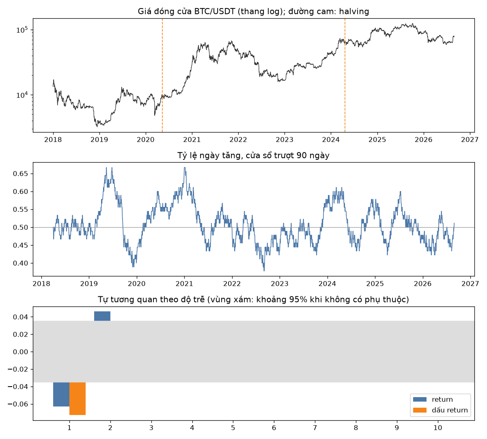
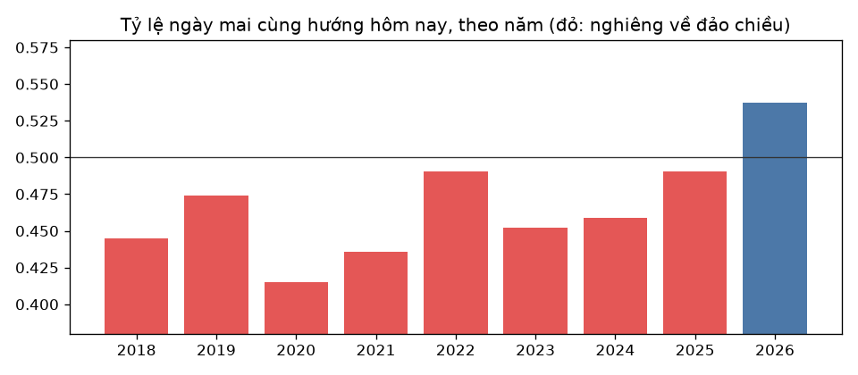
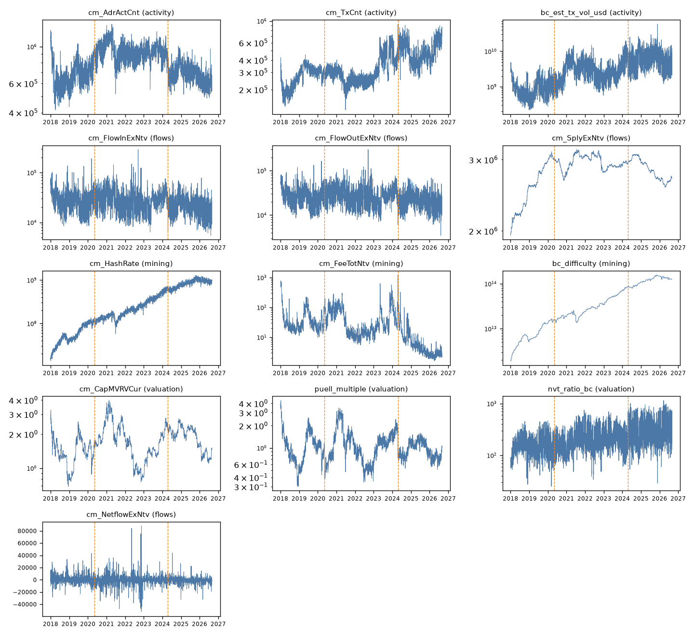
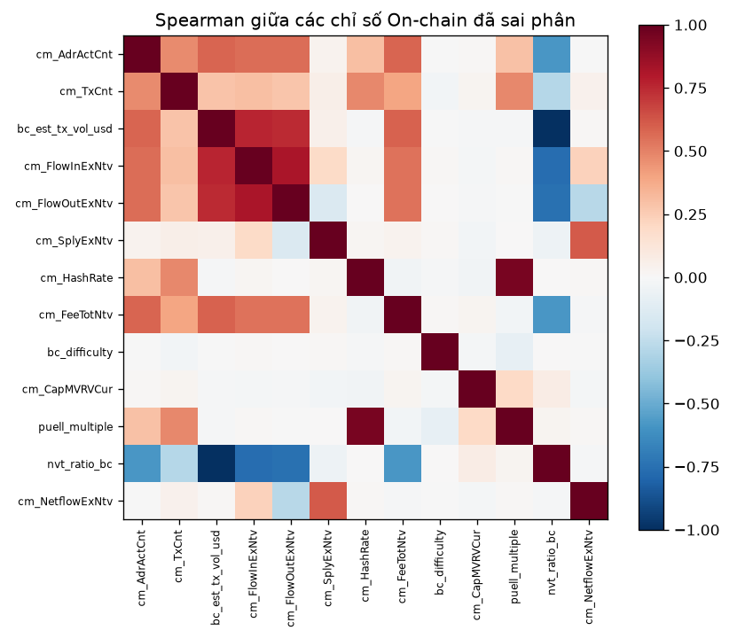

# Kiểm tra dữ liệu và EDA (góp ý 1 của thầy)

Tạo bởi `eda/src/eda.py`. **Chỉ đọc `data/processed/`** (data freeze, sha256 khớp `MANIFEST.json`); không dùng kết quả hay code của thư mục nào khác. Mọi kiểm tra là `assert`, báo cáo chỉ được ghi khi tất cả đều đúng. Theo quy tắc của data freeze, không có phép tính nào giữa chỉ số On-chain và nhãn.

## Tóm tắt

| Câu hỏi                    | Kết quả                                                                                                                                                                                                                                                 |
|:---------------------------|:--------------------------------------------------------------------------------------------------------------------------------------------------------------------------------------------------------------------------------------------------------|
| Dữ liệu có đúng không?     | Đúng: lịch ngày đủ; giá ngày khớp nến 1h trên 3.287 ngày; cột tự tính khớp công thức. Ô trống từ 2018 chỉ ở `bc_est_tx_vol_usd`, `bc_difficulty`, `nvt_ratio_bc`. 28 ngày thiếu nến trong giai đoạn nghiên cứu; close không phải nến 23:00 ở 2018-02-08 |
| Giá có khớp nguồn thứ hai? | Có: lệch trung vị 0,13% so với CoinMetrics; cùng hướng ở 96,4% số ngày                                                                                                                                                                                  |
| Nhãn có cân bằng?          | Có: 50,95% ngày tăng (3.164 ngày), nhưng theo năm từ 45,8% (2022) đến 57,7% (2020)                                                                                                                                                                      |
| Nhãn có nhiễu?             | Nhiều: 21% số ngày đi dưới 0,5%; trung vị |return| 1,45%                                                                                                                                                                                                |
| Có quy luật đơn giản nào?  | Đảo chiều sau 1 ngày: ngày mai cùng hướng hôm nay chỉ 46,4% (p < 0,0001); ACF1 = -0,063. Không ổn định: năm không đảo chiều 2026                                                                                                                        |
| On-chain cần lưu ý gì?     | 3/13 chỉ số có xu hướng mạnh ở mức thô; 7 chỉ số có mùa vụ tuần; `cm_SplyExNtv` có bước nhảy tới 3,1%/ngày (nghi do đổi nhãn ví sàn)                                                                                                                    |

## Hệ quả cho bước baseline

1. **Mốc so sánh:** DA 50%; luôn đoán tăng 50,95%; luật "ngày mai ngược hôm nay" (đúng 53,62% trên cả giai đoạn, chưa tính chọn chiều trong train). Một mô hình chưa vượt luật đảo chiều thì chưa học được gì hơn quy luật đơn giản nhất.
2. **Báo cáo theo năm**, không chỉ con số gộp: tỷ lệ tăng và mức đảo chiều đổi mạnh giữa các năm.
3. **Sai số của DA** với khoảng 3.164 ngày là khoảng 0,9% (một độ lệch chuẩn), nên chênh lệch dưới ~2 điểm % giữa hai mô hình cần kiểm định cặp (McNemar) trước khi kết luận.
4. **On-chain:** không dùng mức thô; biến đổi trên cửa sổ 7 ngày để khử mùa vụ tuần; fit mọi biến đổi trong train; chỉ dùng On-chain đến ngày t−1 (độ trễ công bố).
5. **Flows:** chạy đối chứng bỏ Flows vì `cm_SplyExNtv` có bước nhảy do đổi nhãn ví sàn (góp ý 5).

## Phần 1. Kiểm tra dữ liệu

### 1.1 Lịch ngày và ô trống

`master_daily.csv`: 3.896 ngày liên tục từ 2016-01-01 đến 2026-08-31, không trùng, không thiếu ngày (sha256 của 4 file khớp `MANIFEST.json` v1.0). Giá Binance có từ 2017-08-17 và không thiếu ngày nào sau đó.

| cột               | nhóm      | dùng trong A   | dùng trong B   | ngày đầu có số   |   ô trống (cả file) |   ô trống từ 2018 |
|:------------------|:----------|:---------------|:---------------|:-----------------|--------------------:|------------------:|
| ohlcv_open        | ohlcv     |                |                | 2017-08-17       |                 594 |                 0 |
| ohlcv_high        | ohlcv     |                |                | 2017-08-17       |                 594 |                 0 |
| ohlcv_low         | ohlcv     |                |                | 2017-08-17       |                 594 |                 0 |
| ohlcv_close       | ohlcv     |                |                | 2017-08-17       |                 594 |                 0 |
| ohlcv_volume      | ohlcv     |                |                | 2017-08-17       |                 594 |                 0 |
| cm_AdrActCnt      | activity  | có             | có             | 2016-01-01       |                   0 |                 0 |
| cm_TxCnt          | activity  | có             | có             | 2016-01-01       |                   0 |                 0 |
| bc_est_tx_vol_usd | activity  | có             | có             | 2016-01-01       |                   8 |                 8 |
| cm_SplyExNtv      | flows     | có             | có             | 2016-01-01       |                   0 |                 0 |
| cm_NetflowExNtv   | flows     | có             |                | 2016-01-01       |                   0 |                 0 |
| cm_HashRate       | mining    | có             | có             | 2016-01-01       |                   0 |                 0 |
| cm_FeeTotNtv      | mining    | có             | có             | 2016-01-01       |                   0 |                 0 |
| bc_difficulty     | mining    | có             | có             | 2016-01-01       |                   3 |                 3 |
| cm_CapMVRVCur     | valuation | có             | có             | 2016-01-01       |                   0 |                 0 |
| puell_multiple    | valuation | có             | có             | 2016-12-30       |                 364 |                 0 |
| nvt_ratio_bc      | valuation | có             | có             | 2016-01-01       |                   8 |                 8 |
| cm_FlowInExNtv    | flows     |                | có             | 2016-01-01       |                   0 |                 0 |
| cm_FlowOutExNtv   | flows     |                | có             | 2016-01-01       |                   0 |                 0 |

Ô trống từ 2018 (giai đoạn nghiên cứu): `bc_est_tx_vol_usd`: 2021-12-11, 2021-12-21, 2021-12-24, 2023-07-14, 2023-11-14, 2024-06-30, 2024-11-18, 2025-06-24; `bc_difficulty`: 2025-11-13, 2025-11-14, 2025-11-15; `nvt_ratio_bc`: 2021-12-11, 2021-12-21, 2021-12-24, 2023-07-14, 2023-11-14, 2024-06-30, 2024-11-18, 2025-06-24. Ô trống còn lại đều trước 2018 (giá Binance trước niêm yết, Puell cần 365 ngày lịch sử).

### 1.2 Giá ngày khớp nến 1 giờ

Mọi ngày có giá: low ≤ open, close ≤ high và mọi giá, volume > 0 (3.302 ngày).

Gộp 78.761 nến 1h theo ngày UTC (open đầu, high max, low min, close cuối, volume tổng) rồi so với master trên 3.287 ngày chung: lệch lớn nhất open 0.0e+00, high 0.0e+00, low 0.0e+00, close 0.0e+00, volume 0.0e+00, n_bars_1h 0.0e+00. 15 ngày đầu (2017-08-17 → 2017-08-31) chỉ có trong master vì file 1h bắt đầu 2017-09-01; các ngày này trước giai đoạn nghiên cứu.

**Ngày thiếu nến:** 30 ngày có dưới 24 nến, 28 ngày trong giai đoạn nghiên cứu. Giá đóng cửa của ngày là giá của nến cuối cùng trong ngày; ngày mà nến cuối không phải nến 23:00 UTC: 2018-02-08 (nến cuối lúc 00:00). Ở những ngày này, "giá đóng cửa" không phải giá cuối ngày, nên nhãn của ngày đó và ngày trước bị lệch nghĩa. 43 nến có `flag_ts_shifted` (đã làm tròn về đầu giờ).

### 1.3 Đối chiếu với nguồn giá thứ hai

`cm_PriceUSD` là giá tham chiếu của CoinMetrics (tổng hợp nhiều sàn), độc lập với Binance. Từ 2018, giá đóng cửa Binance lệch với nó trung vị 0,125%, 95% số ngày dưới 0,941%, lớn nhất 6,25% (các ngày lệch nhiều nhất: 2018-11-14 (6,25%), 2018-11-20 (5,59%), 2018-02-08 (5,29%), 2018-10-15 (4,81%), 2018-01-16 (4,65%)). Hai nguồn chốt giá ở thời điểm khác nhau, nên ngày biến động mạnh thì lệch nhiều. Không có dấu hiệu sai đơn vị hay lệch ngày.

Hướng giá ngày (tăng/giảm) theo hai nguồn trùng nhau ở 96,43% số ngày từ 2018. Trong 113 ngày hai nguồn ngược hướng, 89% là ngày giá Binance đi dưới 0,5% (so với 21% trên mọi ngày): hướng của ngày gần như đứng yên phụ thuộc vào nguồn và giờ chốt giá. Đây là một mức nhiễu của nhãn mà không mô hình nào vượt qua được.

### 1.4 Cột tự tính

Tính lại từ cột gốc: `cm_NetflowExNtv` = FlowIn − FlowOut (lệch tối đa 1.5e-11 BTC); `puell_multiple` = IssTotUSD / trung bình 365 ngày (lệch tương đối 4.7e-16); `nvt_ratio_bc` = CapMrktCurUSD / bc_est_tx_vol_usd (lệch tương đối 0.0e+00).

## Phần 2. Nhãn: hướng giá ngày mai (chỉ dùng giá)

y_t = 1 nếu close_{t+1} > close_t. Dòng ngày t mô tả return của ngày t+1. Giai đoạn: 2018-01-01 → 2026-08-30 (3.164 ngày có nhãn; ngày cuối 2026-08-31 không có nhãn vì chưa biết giá hôm sau). Không có ngày nào giá đóng cửa bằng nhau.

### 2.1 Ví dụ quanh ngày sập 12/03/2020

| date       |   close_t |   close_t+1 |   y |
|:-----------|----------:|------------:|----:|
| 2020-03-10 |   7894.56 |     7934.52 |   1 |
| 2020-03-11 |   7934.52 |     4800.00 |   0 |
| 2020-03-12 |   4800.00 |     5578.60 |   1 |
| 2020-03-13 |   5578.60 |     5172.06 |   0 |

Dòng 11/03 có y = 0 vì giá ngày 12/03 giảm. Mô hình bắt được cú sập phải dự báo giảm ở dòng **11/03**, chỉ với thông tin đến hết ngày 11/03.

### 2.2 Tỷ lệ ngày tăng

Cả giai đoạn: 50,95% ngày tăng (p = 0,29 so với 50%). Nhãn gần cân bằng, nên DA 50% là mốc đoán bừa và "luôn đoán tăng" chỉ được 50,95%. Theo năm:

|   năm |   n |   tỷ lệ tăng |   return TB |   độ lệch chuẩn return |   p_binom |
|------:|----:|-------------:|------------:|-----------------------:|----------:|
|  2018 | 365 |       0.5041 |     -0.0035 |                 0.0441 |    0.9166 |
|  2019 | 365 |       0.5178 |      0.0018 |                 0.0357 |    0.5300 |
|  2020 | 366 |       0.5765 |      0.0038 |                 0.0424 |    0.0040 |
|  2021 | 365 |       0.5041 |      0.0013 |                 0.0424 |    0.9166 |
|  2022 | 365 |       0.4575 |     -0.0029 |                 0.0337 |    0.1162 |
|  2023 | 365 |       0.5041 |      0.0027 |                 0.0229 |    0.9166 |
|  2024 | 366 |       0.5246 |      0.0021 |                 0.0275 |    0.3742 |
|  2025 | 365 |       0.5014 |     -0.0002 |                 0.0218 |    1.0000 |
|  2026 | 242 |       0.4876 |     -0.0005 |                 0.0245 |    0.7480 |

Tỷ lệ tăng thay đổi từ 45,75% (2022) đến 57,65% (2020). Một mô hình chỉ học "tỷ lệ tăng của 2 năm train" sẽ đoán lệch khi chuyển năm, và con số gộp cả giai đoạn che mất điều này.

### 2.3 Biên độ return: nhãn của nhiều ngày gần như là nhiễu

| ngưỡng |return|   |   tỷ lệ ngày |
|:------------------|-------------:|
| < 0,1%            |       0.0455 |
| < 0,25%           |       0.1094 |
| < 0,5%            |       0.2130 |
| < 1%              |       0.3815 |

Trung vị |return| là 1,45%. 21,3% số ngày đi dưới 0,5%: hướng của những ngày này phụ thuộc vào vài phút giao dịch quanh 00:00 UTC (xem 1.3: hai nguồn giá còn không đồng ý về hướng ở một phần số ngày). Đúng hay sai ở các ngày này gần như ngẫu nhiên, nên trần DA thực tế thấp hơn nhiều so với 100%.

### 2.4 Hướng giá có lặp lại hay đảo chiều?

Tự tương quan của return ngày, dấu return và |return| (khoảng 95% khi không có phụ thuộc: ±0,035):

|   độ trễ k |   ACF return |   ACF dấu return |   ACF |return| |
|-----------:|-------------:|-----------------:|---------------:|
|          1 |      -0.0630 |          -0.0728 |         0.1690 |
|          2 |       0.0461 |          -0.0041 |         0.1128 |
|          3 |       0.0095 |          -0.0070 |         0.1089 |
|          4 |       0.0205 |           0.0035 |         0.1723 |
|          5 |       0.0173 |          -0.0323 |         0.1470 |
|          6 |       0.0128 |          -0.0168 |         0.1301 |
|          7 |      -0.0034 |          -0.0121 |         0.1450 |
|          8 |      -0.0303 |           0.0022 |         0.1228 |
|          9 |      -0.0024 |           0.0019 |         0.0953 |
|         10 |       0.0168 |          -0.0060 |         0.0829 |

- **Hướng giá có xu hướng đảo chiều sau 1 ngày:** ACF bậc 1 của return là -0,063, của dấu là -0,073. Hướng ngày mai trùng hướng hôm nay chỉ ở 46,38% số ngày (p < 0,0001 so với 50%). Ljung–Box trên 10 bậc đầu của return: Q = 26,2, p = 0,0035.
- Các bậc ACF của return nằm ngoài khoảng nhiễu: 1, 2.
- **|return| tự tương quan mạnh và kéo dài** (bậc 1: 0,17): biến động tụ thành cụm. Dự báo được *độ lớn* biến động dễ hơn nhiều so với *hướng*.

Theo năm:

|   năm |   n |   tỷ lệ cùng hướng hôm trước |   p_binom |   ACF1 return |
|------:|----:|-----------------------------:|----------:|--------------:|
|  2018 | 364 |                       0.4451 |    0.0408 |       -0.0522 |
|  2019 | 365 |                       0.4740 |    0.3461 |       -0.0486 |
|  2020 | 366 |                       0.4153 |    0.0014 |       -0.1796 |
|  2021 | 365 |                       0.4356 |    0.0159 |       -0.0633 |
|  2022 | 365 |                       0.4904 |    0.7535 |       -0.0169 |
|  2023 | 365 |                       0.4521 |    0.0750 |        0.0084 |
|  2024 | 366 |                       0.4590 |    0.1294 |       -0.0507 |
|  2025 | 365 |                       0.4904 |    0.7535 |       -0.0795 |
|  2026 | 242 |                       0.5372 |    0.2744 |       -0.0153 |

Tỷ lệ cùng hướng dưới 50% (nghiêng về đảo chiều) ở 8/9 năm, thấp nhất 2020 (41,53%); năm không đảo chiều: 2026. Đây là quy luật đơn giản nhất có trong dữ liệu, nên mọi mô hình cần được so với luật "ngày mai ngược hôm nay", không chỉ với 50%.

### 2.5 Theo ngày trong tuần

Dòng ngày t mô tả return của ngày t+1, nên bảng xếp theo **ngày được dự báo**:

| ngày được dự báo   |   n |   tỷ lệ tăng |   |return| TB |
|:-------------------|----:|-------------:|--------------:|
| T2                 | 452 |       0.5044 |        0.0275 |
| T3                 | 452 |       0.4934 |        0.0239 |
| T4                 | 452 |       0.5288 |        0.0251 |
| T5                 | 452 |       0.4513 |        0.0256 |
| T6                 | 452 |       0.5221 |        0.0237 |
| T7                 | 452 |       0.5487 |        0.0135 |
| CN                 | 452 |       0.5177 |        0.0183 |

Tỷ lệ tăng giữa các ngày trong tuần: χ² = 10,5, p = 0,11. Biên độ T7 và CN chỉ bằng khoảng 63% ngày thường, tức nhãn cuối tuần nhiễu hơn.

### 2.6 Phân phối return

Return ngày: trung bình 0,056%, độ lệch chuẩn 3,42%, skew -1,13, kurtosis dư 18,0 (phân phối chuẩn: 0). Đuôi dày: 5 ngày biến động lớn nhất là 2020-03-12 (-50,3%), 2018-01-16 (-21,7%), 2021-02-08 (17,8%), 2022-06-13 (-16,7%), 2018-02-05 (-16,5%). DA và log-loss tính các ngày này như mọi ngày khác; backtest thì không, nên vài ngày cực đoan có thể quyết định kết quả backtest.

## Phần 3. On-chain: đặc tính của từng chuỗi

Phần này không đặt chỉ số On-chain cạnh nhãn (quy tắc chống data snooping của data freeze). Gồm 13 cột của hai phương án Flows A và B; giai đoạn 2018-01-01 → 2026-08-31.

### 3.1 Mô tả

| cột               | nhóm      | A/B   |   trung vị |       min |      max |   max/min |   tỷ lệ ngày ≤ 0 |   tương quan hạng với thời gian |
|:------------------|:----------|:------|-----------:|----------:|---------:|----------:|-----------------:|--------------------------------:|
| cm_AdrActCnt      | activity  | A, B  |   7.98e+05 |  4.15e+05 | 1.37e+06 |      3.29 |            0     |                         -0.0372 |
| cm_TxCnt          | activity  | A, B  |   3.2e+05  |  1.24e+05 | 9.28e+05 |      7.49 |            0     |                          0.667  |
| bc_est_tx_vol_usd | activity  | A, B  |   2.77e+09 |  2.2e+08  | 5.84e+10 |    265    |            0     |                          0.728  |
| cm_FlowInExNtv    | flows     | B     |   2.78e+04 |  5.48e+03 | 2.9e+05  |     53    |            0     |                         -0.246  |
| cm_FlowOutExNtv   | flows     | B     |   2.77e+04 |  3.48e+03 | 2.99e+05 |     85.9  |            0     |                         -0.203  |
| cm_SplyExNtv      | flows     | A, B  |   2.89e+06 |  1.95e+06 | 3.18e+06 |      1.63 |            0     |                          0.223  |
| cm_HashRate       | mining    | A, B  |   2.03e+08 |  1.37e+07 | 1.31e+09 |     95.1  |            0     |                          0.986  |
| cm_FeeTotNtv      | mining    | A, B  |  20.8      |  1.62     | 1.21e+03 |    742    |            0     |                         -0.605  |
| bc_difficulty     | mining    | A, B  |   2.82e+13 |  1.92e+12 | 1.56e+14 |     81.1  |            0     |                          0.99   |
| cm_CapMVRVCur     | valuation | A, B  |   1.67     |  0.69     | 3.96     |      5.73 |            0     |                          0.174  |
| puell_multiple    | valuation | A, B  |   1.01     |  0.303    | 4.36     |     14.4  |            0     |                         -0.0457 |
| nvt_ratio_bc      | valuation | A, B  | 166        | 25.2      | 1.14e+03 |     45.4  |            0     |                          0.356  |
| cm_NetflowExNtv   | flows     | A     | 136        | -5.23e+04 | 8.8e+04  |    nan    |            0.482 |                         -0.111  |

- **Mức (level) của 3/13 chỉ số có xu hướng mạnh theo thời gian** (|tương quan hạng với thời gian| > 0,7): `bc_est_tx_vol_usd`, `cm_HashRate`, `bc_difficulty`. Đưa mức thô vào mô hình thì mô hình học "đang ở năm nào" thay vì tín hiệu, và giá trị ở giai đoạn test nằm ngoài khoảng của train. Cần biến đổi (log-diff, tỷ số MA, z-score trượt) trước khi dùng; mọi tham số biến đổi phải fit trong cửa sổ train.
- `cm_NetflowExNtv` có giá trị ≤ 0 nên không lấy log được; ở các phần sau dùng sai phân thường thay cho log-diff.

### 3.2 Bước nhảy bất thường

Robust z = (x − trung vị) / (1,4826 × MAD) trên chuỗi đã sai phân (log-diff, hoặc sai phân thường với cột có giá trị ≤ 0):

| cột               |   số ngày |z| > 8 | ngày lớn nhất   |   |z| lớn nhất |
|:------------------|------------------:|:----------------|---------------:|
| cm_AdrActCnt      |                 0 | 2024-04-20      |            5.2 |
| cm_TxCnt          |                 0 | 2024-06-07      |            7.0 |
| bc_est_tx_vol_usd |                 0 | 2019-07-29      |            5.9 |
| cm_FlowInExNtv    |                 0 | 2019-10-14      |            6.0 |
| cm_FlowOutExNtv   |                 0 | 2019-10-14      |            6.6 |
| cm_SplyExNtv      |                21 | 2022-11-18      |           21.0 |
| cm_HashRate       |                 0 | 2021-04-16      |            4.3 |
| cm_FeeTotNtv      |                 5 | 2024-08-22      |           10.7 |
| bc_difficulty     |               516 | 2018-01-02      |          inf   |
| cm_CapMVRVCur     |                 5 | 2020-03-12      |           21.9 |
| puell_multiple    |                 0 | 2024-04-20      |            6.6 |
| nvt_ratio_bc      |                 0 | 2019-07-29      |            5.9 |
| cm_NetflowExNtv   |                 8 | 2022-11-18      |           22.9 |

`cm_SplyExNtv` (tổng BTC trên sàn) là chuỗi tồn kho nên lẽ ra thay đổi từ từ, nhưng có các ngày nhảy: 2022-11-18 (3,12%), 2022-05-09 (2,77%), 2022-11-04 (2,51%), 2022-11-17 (-1,82%), 2026-08-13 (1,75%), 2022-11-11 (-1,59%). Bước nhảy cỡ vài % lượng BTC trên sàn trong một ngày thường là do CoinMetrics thêm/bớt ví của một sàn vào danh sách gắn nhãn, không phải dòng tiền thật. Dictionary ghi Flows là `flash`: lịch sử có thể bị sửa khi danh sách ví cập nhật. Đây là lý do cần chạy đối chứng bỏ Flows (góp ý 5).

### 3.3 Mùa vụ theo ngày trong tuần

Trung bình log-diff theo ngày trong tuần (ví dụ cột T2 = thay đổi từ CN sang T2):

| cột               |     T2 |     T3 |     T4 |     T5 |     T6 |     T7 |     CN |   p (Kruskal) |
|:------------------|-------:|-------:|-------:|-------:|-------:|-------:|-------:|--------------:|
| cm_AdrActCnt      |  0.165 |  0.011 | -0.010 |  0.007 |  0.016 | -0.121 | -0.068 |         0.000 |
| cm_TxCnt          |  0.084 |  0.017 | -0.003 |  0.003 | -0.013 | -0.048 | -0.038 |         0.000 |
| bc_est_tx_vol_usd |  0.858 |  0.072 | -0.013 |  0.011 |  0.014 | -0.785 | -0.157 |         0.000 |
| cm_FlowInExNtv    |  0.669 |  0.023 | -0.007 |  0.013 |  0.007 | -0.647 | -0.059 |         0.000 |
| cm_FlowOutExNtv   |  0.681 |  0.041 |  0.012 | -0.010 |  0.034 | -0.686 | -0.073 |         0.000 |
| cm_SplyExNtv      |  0.000 |  0.000 | -0.000 |  0.000 | -0.000 |  0.000 |  0.000 |         0.001 |
| cm_HashRate       | -0.012 | -0.003 | -0.004 |  0.010 |  0.000 |  0.012 |  0.006 |         0.044 |
| cm_FeeTotNtv      |  0.300 |  0.062 |  0.020 |  0.033 | -0.003 | -0.265 | -0.158 |         0.000 |
| bc_difficulty     |  0.002 |  0.001 |  0.002 |  0.001 |  0.002 |  0.001 |  0.000 |         1.000 |
| cm_CapMVRVCur     |  0.002 | -0.002 |  0.002 | -0.004 |  0.001 |  0.001 | -0.001 |         0.086 |
| puell_multiple    | -0.012 | -0.007 | -0.003 |  0.004 | -0.000 |  0.011 |  0.005 |         0.092 |
| nvt_ratio_bc      | -0.855 | -0.073 |  0.016 | -0.015 | -0.012 |  0.786 |  0.157 |         0.000 |

Mùa vụ tuần rất rõ (p < 1e-6) ở 7 chỉ số: `cm_AdrActCnt`, `cm_TxCnt`, `bc_est_tx_vol_usd`, `cm_FlowInExNtv`, `cm_FlowOutExNtv`, `cm_FeeTotNtv`, `nvt_ratio_bc`. Log-diff 1 ngày của các chỉ số này vì vậy chủ yếu đo "hôm nay là thứ mấy". Biến đổi trên cửa sổ 7 ngày (MA7, thay đổi so với 7 ngày trước) khử được phần này.

### 3.4 Tương quan giữa các chỉ số On-chain (trên chuỗi đã sai phân)

| cột 1             | cột 2           |   Spearman |
|:------------------|:----------------|-----------:|
| bc_est_tx_vol_usd | nvt_ratio_bc    |      -1.00 |
| cm_HashRate       | puell_multiple  |       0.95 |
| cm_FlowInExNtv    | cm_FlowOutExNtv |       0.81 |
| bc_est_tx_vol_usd | cm_FlowInExNtv  |       0.76 |
| cm_FlowInExNtv    | nvt_ratio_bc    |      -0.76 |
| bc_est_tx_vol_usd | cm_FlowOutExNtv |       0.74 |
| cm_FlowOutExNtv   | nvt_ratio_bc    |      -0.74 |
| cm_SplyExNtv      | cm_NetflowExNtv |       0.61 |

Cặp tương quan cao mang thông tin trùng nhau: hệ số của mô hình tuyến tính không ổn định, và ablation theo nhóm khó tách đóng góp. Netflow = In − Out nên ba cột này không được đưa vào cùng lúc (lý do có hai phương án Flows A và B).

