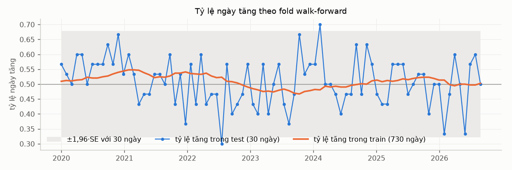
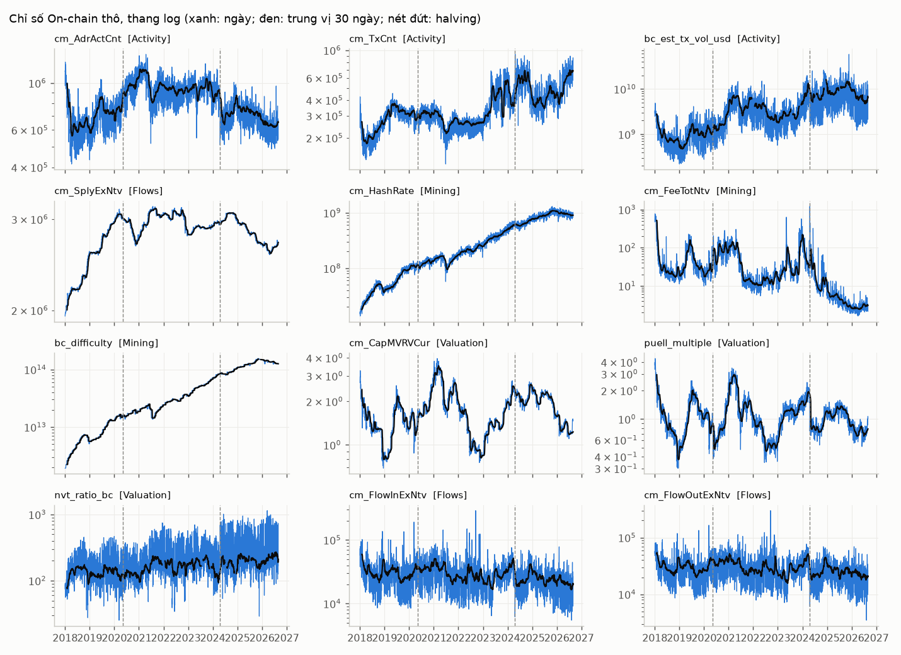
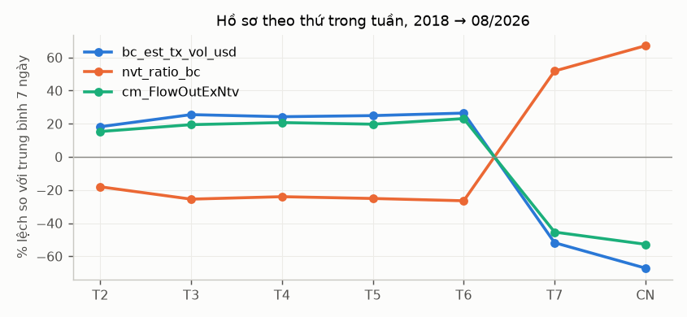
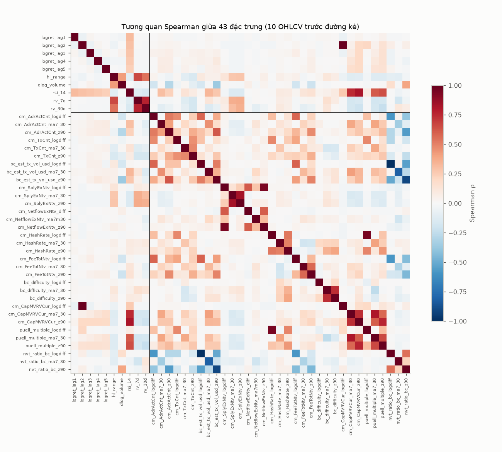
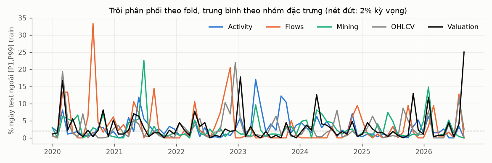
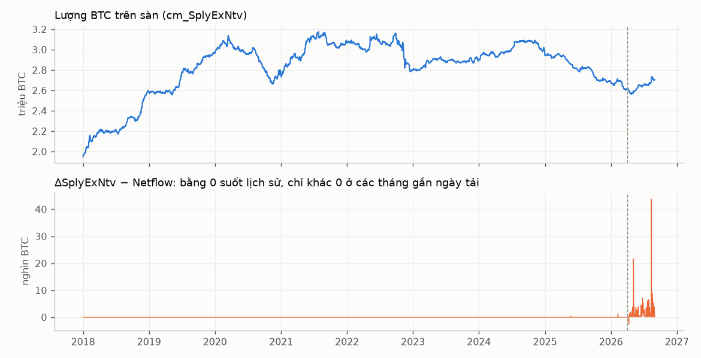
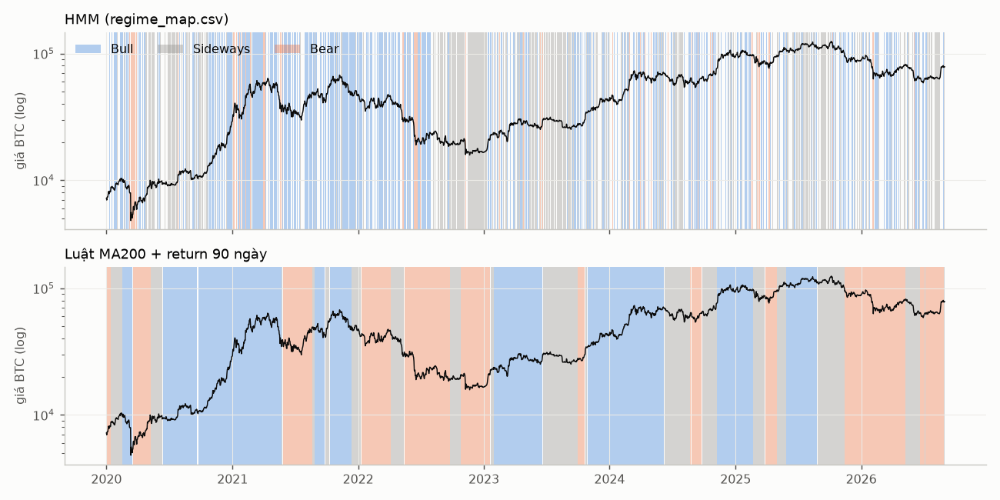

# EDA dữ liệu trước khi training

Tạo bởi `eda_pre_training/src/eda_pre_training.py` trên data freeze v1.0. Lịch walk-forward: 82 fold, test 2020-01-01 → 2026-08-30. Phương án Flows: A.

**Không có thống kê nào giữa đặc trưng On-chain và nhãn y** (data/processed/README.md, lưu ý 6). Mọi phát hiện về On-chain dưới đây chỉ dựa trên chính chuỗi On-chain, giá và đặc trưng OHLCV, nên các thay đổi đề xuất được phép áp dụng trước khi chạy thí nghiệm.

## Tóm tắt

| # | Kiểm tra | Kết quả | Việc cần làm trước khi train |
|---|---|---|---|
| 0 | Toàn vẹn dữ liệu | Đúng phiên bản, không thiếu ngày, OHLC hợp lệ, CoinMetrics và Binance cùng quy ước ngày | Không |
| 1 | Nhãn và metric | DA từng fold (30 ngày) có SE ≈ 9 điểm: không đọc được. SE của DA gộp ≈ 1 điểm. Log-loss phải < 0,6931 mới hơn đoán 50/50 | In kèm các mốc tham chiếu (1b) trong mọi bảng kết quả |
| 2 | Mùa vụ tuần | 6 chỉ số có > 25% phương sai `logdiff` do thứ trong tuần (`bc_est_tx_vol_usd`, `nvt_ratio_bc`, `cm_FlowOutExNtv`, `cm_FlowInExNtv`, `cm_AdrActCnt`, `cm_FeeTotNtv`; nặng nhất `bc_est_tx_vol_usd`: 63%) | Đổi `logdiff` thành sai phân 7 ngày cho các cột này |
| 2 | Tính dừng | Không biến đổi nào của `cm_SplyExNtv` dừng | Cân nhắc bỏ, hoặc chỉ giữ sai phân |
| 3 | Trùng thông tin với giá | 3 đặc trưng On-chain có R² > 0,5 theo 10 đặc trưng OHLCV, đều là MVRV; `cm_CapMVRVCur_logdiff` ≈ `logret_lag2` (ρ 0,99) | Ablation phải tách riêng MVRV, nếu không thì Valuation "đóng góp" chỉ là return trễ |
| 3 | Đuôi dày, trôi phân phối | Đặc trưng đuôi dày nhất là của Flows, difficulty và OHLCV; trôi vừa phải và tập trung ở vài fold | Winsorize hoặc QuantileTransformer trong pipeline cho LR/SVM |
| 4 | Flows bị sửa lịch sử | ΔSply = Netflow chính xác đến 2026-04, sau đó ngày nào cũng lệch: lịch sử đã được tính lại, mấy tháng cuối chưa | Chạy đối chứng bỏ Flows; ghi các fold cuối là dữ liệu chưa sửa; bắt đầu lưu vintage |
| 5 | Regime | HMM đổi nhãn mỗi 2.8 ngày; tách theo biến động chứ không theo xu hướng (return 30 ngày sau Bear: +4.7%) | Định nghĩa lại regime theo xu hướng dài hạn, đưa script vào repo, rồi mới chạy E3 |

Thứ tự đề xuất (theo góp ý 7): (1) sửa biến đổi On-chain ở mục 2–3 → (2) chốt baseline OHLCV-only theo `baseline_check` → (3) thêm On-chain **từng nhóm**, giữ nguyên model, fold và tuning, trong đó có cấu hình bỏ Flows → (4) sửa regime rồi mới làm E3.

## Phần 0. Toàn vẹn dữ liệu

- sha256 của 5 file khớp `MANIFEST.json` (data freeze v1.0).
- `master_daily.csv`: 3,896 dòng, 2016-01-01 → 2026-08-31; ngày trùng: 0; bước ngày khác 1: 0.
- Logic OHLC từ 2018 (low ≤ open, close ≤ high; volume > 0): 0 ngày vi phạm.

**Ô trống, giá trị không dương và giá trị bị "đứng" (bằng hệt ngày trước) trong 2018 → 08/2026:**

| cột               |   ô trống từ 2018 | ≤ 0      |   giá trị lặp y hệt ngày trước |
|:------------------|------------------:|:---------|-------------------------------:|
| cm_AdrActCnt      |                 0 | 0        |                              0 |
| cm_TxCnt          |                 0 | 0        |                              0 |
| bc_est_tx_vol_usd |                 8 | 0        |                              0 |
| cm_SplyExNtv      |                 0 | 0        |                              0 |
| cm_NetflowExNtv   |                 0 | (có dấu) |                              0 |
| cm_HashRate       |                 0 | 0        |                             57 |
| cm_FeeTotNtv      |                 0 | 0        |                              0 |
| bc_difficulty     |                 3 | 0        |                           2162 |
| cm_CapMVRVCur     |                 0 | 0        |                              0 |
| puell_multiple    |                 0 | 0        |                              0 |
| nvt_ratio_bc      |                 8 | 0        |                              0 |
| cm_FlowInExNtv    |                 0 | 0        |                              0 |
| cm_FlowOutExNtv   |                 0 | 0        |                              0 |

Giá trị lặp của `bc_difficulty` là bình thường: difficulty chỉ đổi mỗi 2.016 block (khoảng 2 tuần). Hệ quả là `bc_difficulty_logdiff` bằng 0 ở 84% số ngày; đặc trưng này gần như là một biến "ngày điều chỉnh difficulty". `cm_HashRate` có 57 ngày bằng hệt ngày trước, rải đều 2018–2026 (mỗi năm 3–11 ngày, không có đợt dài). Có thể CoinMetrics đã giữ nguyên giá trị hôm trước cho những ngày này. Ảnh hưởng nhỏ, nhưng nên hỏi lại người crawl (Khoa).

**Quy ước ngày giữa CoinMetrics và Binance.** Tương quan giữa log return giá CoinMetrics (`cm_PriceUSD`) và giá đóng cửa Binance:

|   CM dịch k ngày |   tương quan |
|-----------------:|-------------:|
|           -1.000 |       -0.045 |
|            0.000 |        0.991 |
|            1.000 |       -0.061 |

Độ trễ 0 cho tương quan cao nhất (0.991), nên hai nguồn cùng quy ước ngày UTC. Chênh lệch giá trung vị 0.125%, lớn nhất 5.88% (giá tham chiếu của CoinMetrics là giá tổng hợp nhiều sàn, không phải giá Binance). Như vậy dòng On-chain ngày d mô tả cùng ngày với nến ngày d, và `shift_days: 1` của pipeline là đủ, không cần dịch thêm vì lệch quy ước.

## Phần 1. Nhãn và metric

Phần EDA nhãn đầy đủ (tự tương quan, persistence, đảo chiều theo năm) nằm ở [`baseline_check/reports/baseline_check.md`](../../baseline_check/reports/baseline_check.md). Ở đây chỉ bổ sung hai điểm ảnh hưởng trực tiếp đến cách đọc bảng kết quả.

### 1a. Tỷ lệ ngày tăng: cửa sổ train so với cửa sổ test (82 fold)

- Tỷ lệ tăng trong cửa sổ train 730 ngày chỉ dao động 46.7% – 54.8%. B0 majority đoán "tăng" ở 63% số fold và "giảm" ở 37%; hướng của nó đổi theo một chênh lệch rất nhỏ quanh 50%, nên DA của B0 majority về bản chất là một đồng xu.
- Tỷ lệ tăng trong cửa sổ test 30 ngày dao động 30.0% – 70.0%, độ lệch chuẩn 8.1%. Với 30 ngày, chỉ riêng nhiễu lấy mẫu đã cho độ lệch chuẩn 9.1%. **DA của từng fold vì vậy gần như không mang thông tin**; chỉ nên đọc DA gộp nhiều fold, hoặc theo năm.
- Tương quan giữa up_train và up_test qua các fold: 0.00. Tỷ lệ tăng của quá khứ gần không báo trước tỷ lệ tăng của tháng sau.

### 1b. Giá trị tham chiếu của metric trên giai đoạn test 2020 → 08/2026

n = 2,434 ngày, tỷ lệ tăng p = 0.5090. Mọi bảng kết quả nên in kèm các mốc này:

| dự báo                                 |       DA |   log-loss |    Brier |    AUC |
|:---------------------------------------|---------:|-----------:|---------:|-------:|
| p̂ = 0,5 cho mọi ngày                  | nan      |     0.6931 |   0.2500 | 0.5000 |
| p̂ = p = 0.509 (biết trước tỷ lệ tăng) |   0.5090 |     0.6930 |   0.2499 | 0.5000 |
| luôn đoán tăng                         |   0.5090 |   nan      | nan      | 0.5000 |

- Sai số chuẩn của DA với n = 2,434: 1.01%. Khoảng 95% của mô hình đoán ngẫu nhiên: 48.0% – 52.0%.
- **Log-loss phải nhỏ hơn 0,6931 thì mô hình mới hơn đoán 50/50.** Log-loss cao hơn mức này nghĩa là xác suất của mô hình tệ hơn không biết gì, dù DA có thể trên 50%.
- AUC chỉ đo khả năng xếp hạng ngày tăng trên ngày giảm, không phụ thuộc ngưỡng 0,5. Một mô hình có p̂ luôn trong 0,49–0,51 vẫn có thể có AUC 0,53; ngược lại DA phụ thuộc hoàn toàn vào phía nào của 0,5.

**Ví dụ tính tay (đối chiếu định nghĩa metric):**

| ngày   |   y |     p̂ |   dự đoán (p̂ > 0,5) |   đúng? |   −log p(y) |   (p̂ − y)² |
|:-------|----:|-------:|---------------------:|--------:|------------:|------------:|
| d1     |   1 | 0.6000 |                    1 |       1 |      0.5108 |      0.1600 |
| d2     |   0 | 0.5500 |                    1 |       0 |      0.7985 |      0.3025 |
| d3     |   1 | 0.4500 |                    0 |       0 |      0.7985 |      0.3025 |
| d4     |   0 | 0.3000 |                    0 |       1 |      0.3567 |      0.0900 |

DA = 3/4 = 0.50; log-loss = trung bình cột −log p(y) = 0.6161 (sklearn: 0.6161); Brier = 0.2138 (sklearn: 0.2138); AUC = 0.75: trong 4 cặp (ngày tăng, ngày giảm), có 3 cặp ngày tăng được xếp p̂ cao hơn (d3 = 0,45 thấp hơn d2 = 0,55). Khi kiểm bảng của pipeline, dùng đúng cách tính này trên một fold rồi so với con số trong bảng.

## Phần 2. Chỉ số On-chain thô

### 2a. Chuỗi thô

HashRate, difficulty, TxCnt, SplyExNtv có xu hướng dài hạn rõ (không dừng). MVRV và Puell dao động theo chu kỳ giá. Vì vậy **không được đưa mức thô vào mô hình**; pipeline đã dùng logdiff, MA7/MA30 và z-score 90 ngày (xem 2c).

### 2b. Mùa vụ theo thứ trong tuần

|                   |   biên độ (%): max − min theo thứ | thứ thấp nhất   |   % phương sai logdiff do thứ trong tuần |
|:------------------|----------------------------------:|:----------------|-----------------------------------------:|
| bc_est_tx_vol_usd |                              93.6 | CN              |                                     62.7 |
| nvt_ratio_bc      |                              93.6 | T6              |                                     62.4 |
| cm_FlowOutExNtv   |                              75.9 | CN              |                                     55.9 |
| cm_FlowInExNtv    |                              70.5 | CN              |                                     54.2 |
| cm_AdrActCnt      |                              18.8 | CN              |                                     45.7 |
| cm_FeeTotNtv      |                              42.2 | CN              |                                     34.4 |
| cm_TxCnt          |                              10.0 | CN              |                                      7.4 |
| cm_SplyExNtv      |                               0.0 | T6              |                                      0.5 |
| cm_HashRate       |                               2.3 | T4              |                                      0.4 |
| cm_CapMVRVCur     |                               0.4 | T5              |                                      0.4 |
| puell_multiple    |                               2.1 | T4              |                                      0.3 |
| bc_difficulty     |                               0.1 | CN              |                                      0.1 |

**Phát hiện:** 6 chỉ số có hơn 25% phương sai của `logdiff` đến từ thứ trong tuần: `bc_est_tx_vol_usd`, `nvt_ratio_bc`, `cm_FlowOutExNtv`, `cm_FlowInExNtv`, `cm_AdrActCnt`, `cm_FeeTotNtv`. Cả giao dịch, phí và dòng tiền vào/ra sàn đều giảm vào cuối tuần. Với `bc_est_tx_vol_usd`, 63% phương sai của `logdiff` chỉ là hiệu ứng thứ trong tuần. Các đặc trưng `*_logdiff` này vì vậy chủ yếu mã hoá "hôm qua là thứ mấy", không phải thay đổi thật của hoạt động mạng. Mô hình cây có thể học thuộc mẫu này, rồi tầm quan trọng của đặc trưng (SHAP, ablation) bị thổi phồng.

Đề xuất: với các cột trên, thay `logdiff` (t so với t−1) bằng sai phân 7 ngày (log x_t − log x_{t−7}) hoặc log(x_t / MA7). MA7/MA30 và z-score 90 ngày ít bị ảnh hưởng hơn, vì trung bình 7 ngày đã triệt tiêu chu kỳ tuần. Thay đổi này chỉ dựa trên chính chuỗi On-chain, không xem nhãn, nên không vi phạm quy tắc chống data snooping. Phải áp dụng như nhau cho mọi cấu hình rồi mới chạy E1.

### 2c. Tính dừng (2018 → 08/2026)

ADF: H0 = có nghiệm đơn vị (không dừng), p < 0,05 → dừng. KPSS: H0 = dừng, p < 0,05 → không dừng. Một chuỗi được coi là dừng khi ADF p < 0,05 **và** KPSS p ≥ 0,05. KPSS tra bảng nên p bị chặn trong [0,01; 0,10].

| cột               | mức: ADF / KPSS   | sai phân: ADF / KPSS   | MA7÷MA30: ADF / KPSS   | z90: ADF / KPSS   |
|:------------------|:------------------|:-----------------------|:-----------------------|:------------------|
| cm_AdrActCnt      | 0.17 / 0.01       | 0.00 / 0.10 ✓          | 0.00 / 0.10 ✓          | 0.00 / 0.06 ✓     |
| cm_TxCnt          | 0.49 / 0.01       | 0.00 / 0.10 ✓          | 0.00 / 0.10 ✓          | 0.00 / 0.10 ✓     |
| bc_est_tx_vol_usd | 0.51 / 0.01       | 0.00 / 0.10 ✓          | 0.00 / 0.10 ✓          | 0.00 / 0.10 ✓     |
| cm_SplyExNtv      | 0.01 / 0.01       | 0.00 / 0.01            | 0.00 / 0.01            | 0.00 / 0.01       |
| cm_NetflowExNtv   | 0.00 / 0.01       | 0.00 / 0.10 ✓          | 0.00 / 0.10 ✓          | 0.00 / 0.10 ✓     |
| cm_HashRate       | 0.14 / 0.01       | 0.00 / 0.10 ✓          | 0.00 / 0.05            | 0.00 / 0.03       |
| cm_FeeTotNtv      | 0.09 / 0.01       | 0.00 / 0.10 ✓          | 0.00 / 0.10 ✓          | 0.00 / 0.10 ✓     |
| bc_difficulty     | 0.15 / 0.01       | 0.00 / 0.03            | 0.00 / 0.02            | 0.00 / 0.10 ✓     |
| cm_CapMVRVCur     | 0.04 / 0.02       | 0.00 / 0.10 ✓          | 0.00 / 0.10 ✓          | 0.00 / 0.10 ✓     |
| puell_multiple    | 0.00 / 0.10 ✓     | 0.00 / 0.10 ✓          | 0.00 / 0.10 ✓          | 0.00 / 0.10 ✓     |
| nvt_ratio_bc      | 0.00 / 0.01       | 0.00 / 0.10 ✓          | 0.00 / 0.10 ✓          | 0.00 / 0.10 ✓     |
| cm_FlowInExNtv    | 0.00 / 0.01       | 0.00 / 0.10 ✓          | 0.00 / 0.10 ✓          | 0.00 / 0.10 ✓     |
| cm_FlowOutExNtv   | 0.00 / 0.01       | 0.00 / 0.10 ✓          | 0.00 / 0.10 ✓          | 0.00 / 0.10 ✓     |

✓ = dừng theo cả hai kiểm định. Mức thô (log) của gần như mọi chỉ số không dừng, đúng như hình 2a, nên không được đưa mức thô vào mô hình. Ba biến đổi của pipeline xử lý được phần lớn các cột, trừ:

- **Không biến đổi nào dừng:** `cm_SplyExNtv`. KPSS bác bỏ cả sai phân, nghĩa là trung bình của chuỗi đã biến đổi vẫn đổi theo từng giai đoạn. Với `cm_SplyExNtv`, nguyên nhân là lượng BTC trên sàn giảm đều nhiều năm, kèm các bước nhảy (xem Phần 4).
- **Chỉ một phần dừng:** `cm_HashRate`, `bc_difficulty`. Hash rate và difficulty tăng gần như đơn điệu, nên MA7/MA30 và z90 của chúng hầu như luôn lệch về một phía.

Chuỗi không dừng làm quan hệ học trên cửa sổ train 730 ngày dễ không còn đúng ở cửa sổ test (xem 3d). Nên cân nhắc bỏ, hoặc chỉ giữ sai phân (bỏ z90, MA7/MA30) cho các cột trên.

## Phần 3. Ma trận đặc trưng đúng như pipeline sẽ dùng

Dựng bằng `ngoc_pipeline/src/features.py::build_dataset` (flows_set A, shift_days 1): 10 đặc trưng OHLCV + 33 đặc trưng On-chain, 3,165 dòng có nhãn từ 2017-12-31. Ô trống: 0.

### 3a. Phân phối và giá trị cực trị

| đặc trưng             | nhóm      |   skew |   kurtosis dư |   % |robust z| > 5 |   max |robust z| | ngày cực trị   |
|:----------------------|:----------|-------:|--------------:|-------------------:|-----------------:|:---------------|
| bc_difficulty_logdiff | Mining    |  -1.16 |         60.73 |               1.07 |            17.28 | 2021-07-04     |
| hl_range              | OHLCV     |   4.33 |         48.68 |               1.93 |            30.73 | 2020-03-12     |
| cm_NetflowExNtv_diff  | Flows     |   0.76 |         21.45 |               1.58 |            22.88 | 2022-11-19     |
| logret_lag1           | OHLCV     |  -1.12 |         17.89 |               1.39 |            23.43 | 2020-03-12     |
| logret_lag2           | OHLCV     |  -1.13 |         17.75 |               1.42 |            23.37 | 2020-03-13     |
| logret_lag3           | OHLCV     |  -1.13 |         17.75 |               1.42 |            23.37 | 2020-03-14     |
| logret_lag4           | OHLCV     |  -1.13 |         17.69 |               1.42 |            23.37 | 2020-03-15     |
| logret_lag5           | OHLCV     |  -1.13 |         17.69 |               1.42 |            23.38 | 2020-03-16     |
| cm_SplyExNtv_logdiff  | Flows     |   0.97 |         17.56 |               2.43 |            20.94 | 2022-11-19     |
| cm_CapMVRVCur_logdiff | Valuation |  -0.90 |         13.75 |               1.55 |            21.85 | 2020-03-13     |
| rv_7d                 | OHLCV     |   2.66 |         12.14 |               1.61 |            13.00 | 2020-03-18     |
| rv_30d                | OHLCV     |   2.31 |          6.97 |               2.53 |             8.71 | 2018-01-17     |
| cm_FeeTotNtv_ma7_30   | Mining    |   1.85 |          6.75 |               2.15 |            10.04 | 2023-05-10     |
| cm_FeeTotNtv_logdiff  | Mining    |   0.42 |          6.74 |               0.38 |            10.67 | 2024-08-23     |
| cm_NetflowExNtv_z90   | Flows     |   0.36 |          6.34 |               1.23 |            11.98 | 2022-05-10     |

Bảng trên là 15 đặc trưng đuôi dày nhất (đủ 43 dòng: `reports/feature_distribution.csv`). 11 đặc trưng có kurtosis dư > 10. StandardScaler không xử lý được đuôi dày: một ngày cực trị (thường là 12/03/2020 hoặc ngày nhảy của Flows) chiếm phần lớn phương sai, các ngày còn lại bị nén về gần 0. LR và SVM nhạy với điều này, cây (RF, XGBoost) thì không. Đề xuất cho LR/SVM: winsorize theo phân vị 1%/99% **tính trên cửa sổ train của từng fold**, hoặc dùng `QuantileTransformer`/`RobustScaler` trong pipeline.

### 3b. Trùng thông tin giữa các đặc trưng (Spearman, không có nhãn)

| a                         | b                      |    rho |
|:--------------------------|:-----------------------|-------:|
| bc_est_tx_vol_usd_logdiff | nvt_ratio_bc_logdiff   | -0.997 |
| logret_lag2               | cm_CapMVRVCur_logdiff  |  0.985 |
| cm_HashRate_logdiff       | puell_multiple_logdiff |  0.953 |
| cm_SplyExNtv_logdiff      | cm_NetflowExNtv_z90    |  0.939 |
| bc_est_tx_vol_usd_z90     | nvt_ratio_bc_z90       | -0.910 |
| cm_SplyExNtv_ma7_30       | cm_SplyExNtv_z90       |  0.833 |
| bc_est_tx_vol_usd_ma7_30  | nvt_ratio_bc_ma7_30    | -0.818 |
| rsi_14                    | cm_CapMVRVCur_z90      |  0.817 |
| cm_CapMVRVCur_ma7_30      | puell_multiple_ma7_30  |  0.807 |

Có 9 cặp |ρ| ≥ 0,8. Đọc từng cặp:

- `bc_est_tx_vol_usd_*` và `nvt_ratio_bc_*`: NVT = vốn hoá / giá trị giao dịch, nên logdiff của NVT ≈ return − logdiff của giá trị giao dịch. Hai đặc trưng gần như là một.
- `logret_lag2` và `cm_CapMVRVCur_logdiff` (ρ ≈ 0,99): MVRV = vốn hoá / vốn hoá thực, mẫu số đổi rất chậm, nên thay đổi của MVRV gần như chính là return. Sau khi dịch 1 ngày, nó trùng `logret_lag2` (xem 3c).
- `cm_HashRate_logdiff` và `puell_multiple_logdiff`: Puell = phát hành USD / trung bình 365 ngày; lượng BTC phát hành mỗi ngày tỷ lệ với số block, mà số block đi theo hash rate.
- `cm_SplyExNtv_logdiff` và `cm_NetflowExNtv_z90`: từ 2018 đến 03/2026, ΔSplyExNtv **bằng đúng** Netflow (Phần 4), nên logdiff của Sply ≈ Netflow / Sply. **Trong phương án A, hai cột Flows thực chất là một chuỗi và mức tích luỹ của chính nó.**

### 3c. On-chain có thêm thông tin ngoài giá không?

Hồi quy tuyến tính từng đặc trưng On-chain theo 10 đặc trưng OHLCV **cùng dòng** (không có nhãn). R² cao nghĩa là đặc trưng đó gần như chỉ lặp lại thông tin giá mà mô hình OHLCV-only đã có. Vì On-chain bị dịch 1 ngày, logdiff của chỉ số định giá theo giá (MVRV, Puell, NVT) ở dòng t chủ yếu là return ngày t−1, tức `logret_lag2`.

| đặc trưng                 | nhóm      |   R² theo 10 OHLCV | đặc trưng OHLCV gần nhất   |   Pearson r |
|:--------------------------|:----------|-------------------:|:---------------------------|------------:|
| cm_CapMVRVCur_logdiff     | Valuation |              0.977 | logret_lag2                |       0.988 |
| cm_CapMVRVCur_z90         | Valuation |              0.777 | rsi_14                     |       0.832 |
| cm_CapMVRVCur_ma7_30      | Valuation |              0.719 | rsi_14                     |       0.727 |
| puell_multiple_z90        | Valuation |              0.499 | rsi_14                     |       0.663 |
| puell_multiple_ma7_30     | Valuation |              0.446 | rsi_14                     |       0.572 |
| bc_est_tx_vol_usd_ma7_30  | Activity  |              0.367 | rsi_14                     |       0.315 |
| bc_est_tx_vol_usd_z90     | Activity  |              0.338 | dlog_volume                |      -0.373 |
| nvt_ratio_bc_z90          | Valuation |              0.289 | dlog_volume                |       0.398 |
| nvt_ratio_bc_ma7_30       | Valuation |              0.277 | rv_7d                      |      -0.212 |
| cm_SplyExNtv_ma7_30       | Flows     |              0.267 | rv_7d                      |       0.497 |
| cm_AdrActCnt_z90          | Activity  |              0.187 | dlog_volume                |      -0.297 |
| cm_AdrActCnt_ma7_30       | Activity  |              0.161 | rsi_14                     |       0.307 |
| cm_SplyExNtv_z90          | Flows     |              0.149 | rv_7d                      |       0.365 |
| cm_FeeTotNtv_z90          | Mining    |              0.115 | dlog_volume                |      -0.192 |
| cm_NetflowExNtv_ma7m30    | Flows     |              0.094 | rv_30d                     |      -0.102 |
| cm_FeeTotNtv_ma7_30       | Mining    |              0.079 | rv_30d                     |      -0.126 |
| nvt_ratio_bc_logdiff      | Valuation |              0.078 | dlog_volume                |       0.147 |
| cm_TxCnt_z90              | Activity  |              0.076 | rv_30d                     |      -0.246 |
| bc_est_tx_vol_usd_logdiff | Activity  |              0.075 | dlog_volume                |      -0.147 |
| puell_multiple_logdiff    | Valuation |              0.058 | logret_lag2                |       0.236 |
| cm_AdrActCnt_logdiff      | Activity  |              0.053 | dlog_volume                |      -0.159 |
| bc_difficulty_ma7_30      | Mining    |              0.049 | rv_7d                      |       0.192 |
| cm_FeeTotNtv_logdiff      | Mining    |              0.049 | dlog_volume                |      -0.123 |
| cm_TxCnt_ma7_30           | Activity  |              0.047 | rv_30d                     |      -0.189 |
| bc_difficulty_z90         | Mining    |              0.040 | rsi_14                     |       0.121 |
| cm_HashRate_ma7_30        | Mining    |              0.027 | rsi_14                     |       0.120 |
| cm_SplyExNtv_logdiff      | Flows     |              0.027 | hl_range                   |       0.142 |
| cm_NetflowExNtv_z90       | Flows     |              0.023 | hl_range                   |       0.090 |
| cm_HashRate_z90           | Mining    |              0.023 | rsi_14                     |       0.120 |
| cm_NetflowExNtv_diff      | Flows     |              0.007 | logret_lag2                |      -0.055 |
| bc_difficulty_logdiff     | Mining    |              0.004 | rsi_14                     |       0.025 |
| cm_HashRate_logdiff       | Mining    |              0.003 | logret_lag2                |      -0.035 |
| cm_TxCnt_logdiff          | Activity  |              0.003 | logret_lag3                |       0.035 |

3 đặc trưng có R² > 0,5: `cm_CapMVRVCur_logdiff`, `cm_CapMVRVCur_z90`, `cm_CapMVRVCur_ma7_30`. Nếu nhóm Valuation cải thiện kết quả trong ablation, cần kiểm tra lại xem cải thiện đến từ thông tin On-chain hay chỉ từ việc thêm một bản sao của return trễ. Cách kiểm: chạy thêm một cấu hình đối chứng "OHLCV + phần dư" (dùng phần dư của các đặc trưng này sau khi hồi quy theo OHLCV, fit trong train).

### 3d. Trôi phân phối giữa cửa sổ train và test

Với mỗi fold: tỷ lệ ngày test có giá trị nằm ngoài khoảng [P1, P99] của cửa sổ train cùng fold. Nếu không trôi, tỷ lệ kỳ vọng là 2%.

|                       |   trung bình % ngoài [P1,P99] |   % fold có > 20% ngày ngoài | nhóm      |
|:----------------------|------------------------------:|-----------------------------:|:----------|
| cm_SplyExNtv_ma7_30   |                           5.3 |                          8.5 | Flows     |
| rv_30d                |                           5.2 |                         11.0 | OHLCV     |
| cm_CapMVRVCur_z90     |                           4.3 |                          6.1 | Valuation |
| rv_7d                 |                           4.1 |                          7.3 | OHLCV     |
| bc_difficulty_z90     |                           4.1 |                          6.1 | Mining    |
| puell_multiple_ma7_30 |                           4.0 |                          9.8 | Valuation |
| cm_SplyExNtv_z90      |                           3.9 |                          6.1 | Flows     |
| nvt_ratio_bc_ma7_30   |                           3.9 |                          6.1 | Valuation |
| cm_TxCnt_ma7_30       |                           3.8 |                          7.3 | Activity  |
| cm_CapMVRVCur_ma7_30  |                           3.7 |                          6.1 | Valuation |
| dlog_volume           |                           3.7 |                          0.0 | OHLCV     |
| cm_AdrActCnt_ma7_30   |                           3.6 |                          4.9 | Activity  |
| cm_TxCnt_logdiff      |                           3.5 |                          1.2 | Activity  |
| rsi_14                |                           3.3 |                          4.9 | OHLCV     |
| cm_FeeTotNtv_ma7_30   |                           3.3 |                          6.1 | Mining    |

Trung bình theo nhóm: Flows 3.3%, Valuation 3.1%, Activity 2.8%, Mining 2.8%, OHLCV 2.7% (kỳ vọng 2%; đủ 43 dòng ở `reports/feature_drift.csv`). Trôi phân phối nhìn chung **vừa phải** và không riêng gì On-chain: `rv_30d`, `rv_7d` của OHLCV cũng nằm trong nhóm trôi nhiều nhất, vì biến động của BTC giảm dần qua các năm. Trôi tập trung vào một số fold (nhiều nhất: fold bắt đầu 2020-03-01), thường là lúc thị trường chuyển pha. Ở các fold này, mô hình tuyến tính ngoại suy ra ngoài miền đã học, còn mô hình cây gán giá trị của lá ngoài cùng. Khi đọc kết quả theo fold hoặc theo năm, nên đối chiếu với hình trên.

## Phần 4. Flows: sửa lịch sử và thời điểm có dữ liệu

### 4a. Netflow có khớp với thay đổi lượng BTC trên sàn không?

Theo định nghĩa, lượng BTC trên sàn hôm nay bằng hôm qua cộng dòng ròng: ΔSplyExNtv_t = Netflow_t = In_t − Out_t. Nếu CoinMetrics thêm ví của một sàn vào danh sách mà không tính lại quá khứ, đẳng thức sẽ gãy đúng ngày đó.

- **2018-01-02 → 2026-03-31: đẳng thức đúng tới từng BTC.** Chỉ 7 trong 3,011 ngày lệch quá 1 BTC (lệch lớn nhất 1,271 BTC).
- **Từ 2026-04 trở đi: ngày nào cũng lệch.** 144 / 153 ngày, có ngày lệch tới 43,763 BTC.

Số ngày lệch theo tháng (chỉ liệt kê tháng có lệch):

| date    |   số ngày lệch > 1 BTC |   lệch lớn nhất (BTC) |
|:--------|-----------------------:|----------------------:|
| 2023-10 |                      2 |                    37 |
| 2025-03 |                      1 |                    17 |
| 2025-05 |                      1 |                   390 |
| 2025-08 |                      1 |                    10 |
| 2025-11 |                      1 |                     2 |
| 2026-02 |                      1 |                 1,271 |
| 2026-04 |                     21 |                 2,573 |
| 2026-05 |                     31 |                21,550 |
| 2026-06 |                     30 |                 7,151 |
| 2026-07 |                     31 |                 6,452 |
| 2026-08 |                     31 |                43,763 |

**Cách hiểu.** Dữ liệu được tải cuối tháng 10/2026 (`flows_check.md` ghi 24/10/2026). Phần lịch sử đã được CoinMetrics **tính lại cho nhất quán** với danh sách ví sàn hiện tại, nên đẳng thức đúng tuyệt đối. Vài tháng gần ngày tải chưa được tính lại nên đẳng thức gãy. Nói cách khác: **giá trị một người dự báo thấy vào lúc đó (giống phần cuối chuỗi) khác giá trị đang nằm trong file cho cùng ngày (phần lịch sử đã sửa)**. Đây là bằng chứng trực tiếp trong dữ liệu cho góp ý 5.

Hai hệ quả:

1. Backtest 2020 → 03/2026 dùng Flows **đã sửa**, đẹp hơn và nhất quán hơn dữ liệu thời gian thực. Mọi cải thiện từ Flows trong backtest là cận trên, không phải con số thực tế.
2. Các fold test từ 2026-04 dùng Flows **chưa sửa**, tức là dữ liệu khác bản chất với dữ liệu train của chính fold đó. Lần tải sau, các giá trị này sẽ đổi và kết quả của các fold cuối sẽ không tái lập được.

### 4b. Bước nhảy của Netflow

18 ngày có |robust z| > 8 (10 ngày lớn nhất):

|            |   Netflow (BTC) |   robust z |
|:-----------|----------------:|-----------:|
| 2022-11-18 |        88,036.2 |       21.7 |
| 2022-05-09 |        84,303.3 |       20.8 |
| 2022-11-04 |        75,268.3 |       18.6 |
| 2022-11-17 |       -52,318.2 |      -13.0 |
| 2022-11-11 |       -47,671.1 |      -11.8 |
| 2021-09-10 |       -47,419.4 |      -11.7 |
| 2022-11-02 |       -46,423.4 |      -11.5 |
| 2022-11-23 |       -43,785.0 |      -10.8 |
| 2024-07-16 |        43,909.3 |       10.8 |
| 2020-03-12 |        43,536.7 |       10.7 |

Nhiều ngày rơi vào các sự kiện có thật (12/03/2020, LUNA 05/2022, FTX 11/2022), nên không thể bỏ hết như lỗi. Nhưng chuỗi dao động lên xuống liên tiếp trong 11/2022 (+88.036 ngày 18, −52.318 ngày 17) giống việc gắn và chuyển nhãn ví hơn là dòng tiền thật. Không có vintage thì không phân biệt được hai trường hợp này.

### 4c. Vì sao dịch trễ 1 ngày không giải quyết được

- `shift_days: 1` xử lý **độ trễ công bố**: CoinMetrics công bố ngày d khoảng 2–9,5 giờ sau 00:00 UTC ngày d+1. Nó không xử lý **sửa lịch sử**. Khi một ví được gắn nhãn sàn vào năm 2024, Flows của ví đó được tính lại cho cả 2018–2023, nên giá trị ngày 2021-05-01 trong file khác giá trị có thật vào ngày 2021-05-02, dù dịch bao nhiêu ngày.
- File GitHub và API trong `crawl_data/vi_ohlcv_flows/reports/flows_check.md` khớp 100%, nhưng chúng được tải gần như cùng lúc, nên phép so đó không đo được mức sửa. Phép kiểm ở 4a là bằng chứng duy nhất hiện có.

**Đề xuất (không cần xem nhãn):**

1. Chạy E1 thêm cấu hình **OHLCV + On-chain bỏ Flows**, cùng model, fold và tuning. Kết luận RQ1 nên dựa trên cấu hình này; cấu hình có Flows báo cáo riêng, ghi rõ là cận trên.
2. Ghi trong báo cáo: các fold từ 2026-04 dùng dữ liệu Flows chưa được tính lại. Có thể báo cáo thêm kết quả bỏ các fold này.
3. Tải lại Flows hằng tuần đến hết đề tài, lưu kèm thời điểm tải. So giá trị của cùng một ngày lịch sử giữa các lần tải để định lượng mức sửa. Trong vài tuần đã thấy được phần 2026 thay đổi bao nhiêu.
4. Trong phương án A, Netflow chính là ΔSplyExNtv, nên `cm_SplyExNtv_logdiff` gần như trùng thông tin Netflow (3b). Chỉ mức (z90, MA7/MA30) của SplyExNtv là thêm thông tin, nhưng đó lại là chuỗi không dừng (2c). Nếu vẫn giữ Flows, phương án B (In, Out, Sply) cũng không tốt hơn, vì In và Out thuộc nhóm có mùa vụ tuần mạnh nhất (2b).

## Phần 5. Regime

Đọc `ngan_lstm_hmm_analysis/regime_map.csv`: 2,435 ngày (0 ngày trùng đã bỏ). Script tạo file này chưa có trong repo nên phần này chỉ mô tả nhãn, không tái lập được.

### 5a. Độ dài mỗi đợt regime

| regime   |   số đợt |   dài TB (ngày) |   trung vị |   dài nhất |   % đợt 1 ngày |   số ngày |
|:---------|---------:|----------------:|-----------:|-----------:|---------------:|----------:|
| Bear     |    149.0 |             1.9 |        1.0 |       14.0 |           55.0 |     282.0 |
| Bull     |    417.0 |             3.0 |        2.0 |       33.0 |           39.8 |    1250.0 |
| Sideways |    318.0 |             2.8 |        2.0 |       58.0 |           39.6 |     903.0 |

Tổng 884 đợt trong 2,435 ngày, tức trung bình đổi regime mỗi 2.8 ngày; trung vị 10 lần đổi trong một fold 30 ngày.

### 5b. Bull/Bear/Sideways có đúng nghĩa theo giá không?

Chỉ dùng giá (không có On-chain). Nếu nhãn đúng nghĩa, Bull phải có return 30 ngày trước/sau dương rõ, Bear âm rõ.

| regime   |   số ngày |   return ngày t TB (%) |   độ lệch chuẩn return (%) |   return 30 ngày trước TB (%) |   return 30 ngày sau TB (%) |   tỷ lệ tăng ngày t+1 (%) |
|:---------|----------:|-----------------------:|---------------------------:|------------------------------:|----------------------------:|--------------------------:|
| Bear     |    282.00 |                  -0.47 |                       6.50 |                         -3.42 |                        4.72 |                     51.77 |
| Bull     |   1250.00 |                   0.27 |                       2.94 |                          3.49 |                        2.19 |                     51.60 |
| Sideways |    903.00 |                   0.03 |                       1.61 |                          3.75 |                        2.63 |                     49.61 |

**Tham chiếu: một luật đơn giản, chỉ dùng quá khứ.** Bull nếu giá > MA200 và return 90 ngày > +10%; Bear nếu giá < MA200 và return 90 ngày < −10%; còn lại Sideways. Sau đó làm mượt: nhãn ngày t là nhãn xuất hiện nhiều nhất trong 21 ngày t−20 → t. Ngưỡng chọn theo quy ước, không tối ưu, chỉ để so độ dài đợt và ý nghĩa nhãn:

| regime   |   số đợt |   dài TB (ngày) |   trung vị |   số ngày |
|:---------|---------:|----------------:|-----------:|----------:|
| Bear     |     14.0 |            56.6 |       43.5 |     793.0 |
| Bull     |      9.0 |           113.7 |      100.0 |    1023.0 |
| Sideways |     21.0 |            29.5 |       28.0 |     619.0 |

| luật     |   return 30 ngày trước TB (%) |   return 30 ngày sau TB (%) |   độ lệch chuẩn return (%) |
|:---------|------------------------------:|----------------------------:|---------------------------:|
| Bear     |                         -4.68 |                        3.56 |                       3.23 |
| Bull     |                          9.84 |                        5.44 |                       3.53 |
| Sideways |                          0.70 |                       -3.14 |                       2.61 |

Hai cách gán trùng nhau ở 38% số ngày. Bảng chéo (% theo hàng HMM):

| HMM \ luật   |   Bear |   Bull |   Sideways |
|:-------------|-------:|-------:|-----------:|
| Bear         |     34 |     41 |         25 |
| Bull         |     34 |     44 |         22 |
| Sideways     |     30 |     40 |         30 |

**Nhận xét.**

- **Nhãn HMM đổi trung bình mỗi 2.8 ngày**, hơn một nửa số đợt Bear chỉ dài 1 ngày (5a). Không có đợt Bull hay Bear nào kéo dài như các chu kỳ thật của BTC (nhiều tháng).
- **HMM tách theo biến động, không theo xu hướng.** Độ lệch chuẩn return ngày: Bear 6.5%, Bull 2.9%, Sideways 1.6%. Return 30 ngày **sau** các ngày Bear lại cao nhất (+4.72%), và Sideways có return 30 ngày trước còn cao hơn Bull. Trên thực tế "Bear" của HMM là "ngày biến động mạnh, thường là ngày giảm", "Sideways" là "ngày biến động thấp".
- Luật đơn giản đã làm mượt cho đợt dài trung bình 55 ngày, và Bull/Bear của nó có return 30 ngày trước đúng dấu. Hai cách gán chỉ trùng nhau ở mức xấp xỉ ngẫu nhiên (bảng chéo).

Với nhãn HMM hiện tại, E3 sẽ trả lời câu hỏi "Δ có khác nhau giữa ngày biến động cao và thấp không", chứ không phải RQ3 ("Δ có khác nhau giữa thị trường tăng, giảm, đi ngang không"). Đề xuất trước khi chạy E3:

1. Đưa script tạo đầu vào HMM vào repo, chạy lại ra đúng `regime_map.csv` (tái lập được).
2. Định nghĩa regime theo xu hướng trên khung dài (ví dụ return 60–90 ngày, hoặc HMM trên return trung bình trượt 30 ngày), đặt ngưỡng bằng quy ước hoặc chỉ trên dữ liệu train; yêu cầu độ dài đợt tối thiểu (ví dụ ≥ 20 ngày) hoặc làm mượt xác suất trạng thái.
3. Kiểm tra bằng mắt trên các giai đoạn đã biết: 2020-03 (sập COVID), 2020-10 → 2021-04 (tăng), 2022-05 → 2022-11 (LUNA, FTX, giảm), 2023 (đi ngang rồi tăng), 2024-03 (đỉnh trước halving).
