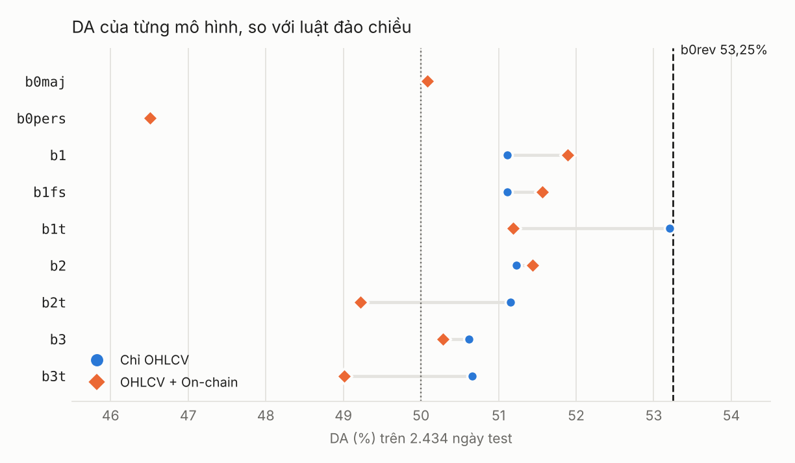
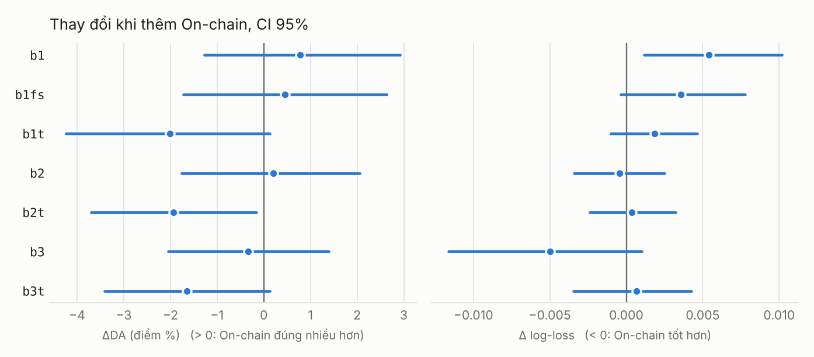

# Chạy lại E1 cho các baseline B0–B3 (19/11/2026)

Chạy lại toàn bộ E1 của 10 mô hình B0–B3 (`b0maj`, `b0pers`, `b0rev`, `b1`, `b1fs`, `b1t`, `b2`, `b2t`, `b3`, `b3t`) trên đủ 82 fold × 2 cấu hình, bằng đúng code hiện có của pipeline. **Không sửa mô hình nào**; kết quả ghi vào thư mục riêng, không đè `pipeline/results/predictions/`.

- **Dữ liệu:** data freeze v1.0, sha256 khớp `MANIFEST.json` cho cả 4 file.
- **Đặc trưng:** 10 đặc trưng OHLCV ban đầu (như mọi dự báo E1 đã có, tương đương cờ `--ohlcv10`) + 33 đặc trưng On-chain v1 (`features_onchain.yaml`, Flows A).
- **Walk-forward:** train 730 ngày, gap 1, test 30, 82 fold; 2.434 ngày test từ 01/01/2020 đến 30/08/2026. Tune mỗi 6 fold bằng inner `TimeSeriesSplit(5, gap 1)`, tiêu chí log-loss.
- **Môi trường:** Python 3.13.18, scikit-learn 1.9.1, pandas 3.0.5, numpy 2.5.3, scipy 1.18.1; 2 nhân CPU.
- **Kiểm định:** `stats.py` của pipeline: CI 95% block bootstrap (khối 15 ngày, 2.000 lần), McNemar chính xác cho ΔDA, Diebold–Mariano cho Δ log-loss, hiệu chỉnh Holm trên 7 mô hình có học.

B4 (XGBoost) và B5 (LSTM) không nằm trong lần chạy này.

## Tóm tắt

1. **Tái lập được.** 16/20 file dự báo khớp bản cũ tới sai số làm tròn (lệch p̂ < 1e-7). Hai mô hình lệch nhỏ: `b2` (lệch p̂ tối đa 0,0017) và `b3` (0,0029). Chỉ 1 ngày đổi quyết định (`b2` +On-chain, DA 51,40% → 51,44%). Các con số E1 trong README vẫn đúng, trừ DA của `b2` +On-chain lệch 0,04 điểm.
2. **Chưa mô hình có học nào vượt luật đảo chiều `b0rev` (53,25%).** Cao nhất là `b1t` OHLCV (53,20%), nhưng mô hình này gần như *chính là* luật đảo chiều: hai bên chỉ bất đồng 99/2.434 ngày (mục 5).
3. **Thêm On-chain không cải thiện mô hình nào một cách có ý nghĩa.** Sau hiệu chỉnh Holm, không Δ nào có p < 0,05 (p Holm nhỏ nhất 0,179). Trước hiệu chỉnh, chỉ hai Δ có CI không chứa 0, và cả hai đều theo chiều **On-chain làm tệ đi**: ΔDA của `b2t` (−1,93 điểm) và Δ log-loss của `b1` (+0,0054).
4. **Xác suất chưa tốt hơn mức sàn.** Chỉ 2/14 tổ hợp mô hình × cấu hình có log-loss thấp hơn `b0maj` (0,6938): `b1fs` OHLCV (0,6933), `b1t` OHLCV (0,6926). Không tổ hợp nào có On-chain làm được điều này.
5. **Thêm On-chain còn làm mô hình thua luật rõ hơn.** So với `b0rev`, 2 tổ hợp thua có ý nghĩa sau Holm, và cả hai đều là cấu hình có On-chain: `b2t` +On-chain (ΔDA −4,03 điểm, p Holm 0,024), `b3t` +On-chain (ΔDA −4,23 điểm, p Holm 0,040).

## 1. Cách chạy lại

Code mới chỉ gồm 3 script bọc quanh code có sẵn, không thay đổi file nào của pipeline:

```bash
python pipeline/src/rerun_e1.py --out pipeline/results/rerun_2026-11-19          # chạy 10 mô hình
python pipeline/src/rerun_tables.py --dir pipeline/results/rerun_2026-11-19 --old pipeline/results
python pipeline/src/rerun_figures.py --dir pipeline/results/rerun_2026-11-19
```

- `rerun_e1.py` gọi `run_all.run_e1` cho 9 mô hình và `b1t_tuning.stage_run` (cấu hình E1, tiêu chí log-loss) cho `b1t`, với bộ đặc trưng `run_all.ohlcv10_sets`. `setup()` của `b1t_tuning.py` hiện trả 11 đặc trưng OHLCV; script thay bằng 10 đặc trưng ban đầu để khớp dự báo cũ.
- Thời gian chạy trên 2 nhân CPU (`b2`, `b2t` chạy song song với các mô hình khác nên chậm hơn khi chạy riêng):

| Mô hình | Thời gian (phút) |
|---|---:|
| `b0maj` | 0,0 |
| `b0pers` | 0,0 |
| `b0rev` | 0,0 |
| `b1` | 0,1 |
| `b1fs` | 22,8 |
| `b3` | 0,6 |
| `b2` | 13,1 |
| `b3t` | 1,8 |
| `b1t` | 5,6 |
| `b2t` | 36,2 |

## 2. Kiểm tra tái lập

So p̂ từng ngày với `pipeline/results/predictions/` (và `results/b1t/e1/` cho `b1t`). "Số ngày đổi quyết định" là số ngày p̂ nằm ở hai phía khác nhau của ngưỡng 0,5.

| Mô hình | Cấu hình | Lệch p̂ lớn nhất | Số ngày đổi quyết định | DA cũ | DA mới |
|---|---:|---:|---:|---:|---:|
| `b0maj` | OHLCV | 0,0e+00 | 0 | 50,08% | 50,08% |
| `b0maj` | +On-chain | 0,0e+00 | 0 | 50,08% | 50,08% |
| `b0pers` | OHLCV | 0,0e+00 | 0 | 46,51% | 46,51% |
| `b0pers` | +On-chain | 0,0e+00 | 0 | 46,51% | 46,51% |
| `b0rev` | OHLCV | 0,0e+00 | 0 | 53,25% | 53,25% |
| `b0rev` | +On-chain | 0,0e+00 | 0 | 53,25% | 53,25% |
| `b1` | OHLCV | 2,2e-16 | 0 | 51,11% | 51,11% |
| `b1` | +On-chain | 2,8e-13 | 0 | 51,89% | 51,89% |
| `b1fs` | OHLCV | 2,2e-16 | 0 | 51,11% | 51,11% |
| `b1fs` | +On-chain | 1,4e-15 | 0 | 51,56% | 51,56% |
| `b1t` | OHLCV | 1,9e-08 | 0 | 53,20% | 53,20% |
| `b1t` | +On-chain | 1,5e-08 | 0 | 51,19% | 51,19% |
| `b2` | OHLCV | 1,2e-03 | 0 | 51,23% | 51,23% |
| `b2` | +On-chain | 1,7e-03 | 1 | 51,40% | 51,44% |
| `b2t` | OHLCV | 2,2e-16 | 0 | 51,15% | 51,15% |
| `b2t` | +On-chain | 2,2e-16 | 0 | 49,22% | 49,22% |
| `b3` | OHLCV | 2,9e-03 | 0 | 50,62% | 50,62% |
| `b3` | +On-chain | 4,3e-05 | 0 | 50,29% | 50,29% |
| `b3t` | OHLCV | 2,0e-13 | 0 | 50,66% | 50,66% |
| `b3t` | +On-chain | 1,7e-13 | 0 | 49,01% | 49,01% |

- B0, B1 và `b3t` khớp tới sai số dấu phẩy động (≤ 3e-13); `b1t` lệch tối đa 2e-8, nhiều khả năng do sai số của solver lặp L-BFGS-B; `b2t` khớp tuyệt đối.
- `b2` và `b3` lệch rải rác ở nhiều fold riêng lẻ, không theo khối 6 fold. Vậy nguyên nhân không phải là chọn siêu tham số khác ở một lần tune, mà nhiều khả năng là khác biệt số học giữa phiên bản thư viện hoặc máy (bản cũ chạy trên máy khác; README ghi `b2` lệch khoảng 1e-15 khi chạy lại trên cùng máy). Mức lệch không đổi kết luận nào.
- Lần chạy này cũng xác nhận `b1t` trong E1 dùng 10 đặc trưng OHLCV: chạy với 10 đặc trưng thì khớp.

## 3. Kết quả tổng

DA: tỷ lệ ngày đoán đúng hướng (ngưỡng p̂ > 0,5), cao hơn là tốt. Log-loss: thấp hơn là tốt; luôn đoán 0,5 cho 0,6931. Luật (`b0pers`, `b0rev`) cho p̂ chỉ 0/1 nên không tính log-loss. `b0maj` cho p̂ không đổi trong mỗi fold nên không tính AUC. Tỷ lệ ngày tăng của cả giai đoạn test là 50,9%.

| Mô hình | DA OHLCV | DA +On-chain | Log-loss OHLCV | Log-loss +On-chain | AUC OHLCV | AUC +On-chain | % đoán tăng OHLCV | % đoán tăng +On-chain |
|---|---:|---:|---:|---:|---:|---:|---:|---:|
| `b0maj` | 50,08% | 50,08% | 0,6938 | 0,6938 | – | – | 63,0% | 63,0% |
| `b0pers` | 46,51% | 46,51% | – | – | 0,465 | 0,465 | 50,9% | 50,9% |
| `b0rev` | 53,25% | 53,25% | – | – | 0,533 | 0,533 | 49,4% | 49,4% |
| `b1` | 51,11% | 51,89% | 0,6953 | 0,7006 | 0,510 | 0,513 | 56,4% | 54,7% |
| `b1fs` | 51,11% | 51,56% | 0,6933 | 0,6968 | 0,521 | 0,517 | 54,8% | 54,0% |
| `b1t` | 53,20% | 51,19% | 0,6926 | 0,6944 | 0,530 | 0,521 | 49,0% | 51,4% |
| `b2` | 51,23% | 51,44% | 0,6961 | 0,6957 | 0,514 | 0,515 | 54,7% | 54,1% |
| `b2t` | 51,15% | 49,22% | 0,6947 | 0,6951 | 0,517 | 0,506 | 54,5% | 49,2% |
| `b3` | 50,62% | 50,29% | 0,7009 | 0,6959 | 0,503 | 0,498 | 72,8% | 64,7% |
| `b3t` | 50,66% | 49,01% | 0,6959 | 0,6966 | 0,507 | 0,494 | 75,4% | 64,0% |



- Mọi mô hình có học nằm trong khoảng 49,01% – 53,20%, tức chỉ hơn tung đồng xu vài điểm %.
- AUC của mọi mô hình có học nằm trong 0,494 – 0,530: khả năng xếp hạng ngày tăng trên ngày giảm gần như bằng đoán ngẫu nhiên.
- `b3` (OHLCV) đoán "tăng" ở 72,8% số ngày, `b3t` ở 75,4%, trong khi chỉ 50,9% số ngày là ngày tăng: SVM lệch hẳn về một phía. `b3` OHLCV cũng có log-loss (0,7009) tệ nhất trong các mô hình có học.

## 4. Δ khi thêm On-chain

Δ = (OHLCV + On-chain) − (chỉ OHLCV), cùng mô hình, cùng 2.434 ngày. ΔDA > 0 và Δ log-loss < 0 nghĩa là On-chain giúp. Hai cột "p Holm" hiệu chỉnh trên 7 mô hình có học (B0 không dùng đặc trưng nên Δ = 0).

| Mô hình | ΔDA (điểm %) | CI 95% | McNemar p | p Holm | Δ log-loss | CI 95% | DM p | p Holm |
|---|---:|---:|---:|---:|---:|---:|---:|---:|
| `b1` | +0,78 | [−1,27; +2,92] | 0,488 | 1,000 | 0,0054 | [0,0012; 0,0102] | 0,026 | 0,179 |
| `b1fs` | +0,45 | [−1,73; +2,63] | 0,684 | 1,000 | 0,0036 | [−0,0004; 0,0078] | 0,097 | 0,584 |
| `b1t` | −2,01 | [−4,23; +0,12] | 0,075 | 0,452 | 0,0019 | [−0,0010; 0,0047] | 0,205 | 0,819 |
| `b2` | +0,21 | [−1,77; +2,05] | 0,872 | 1,000 | −0,0005 | [−0,0034; 0,0025] | 0,777 | 1,000 |
| `b2t` | −1,93 | [−3,70; −0,16] | 0,058 | 0,406 | 0,0004 | [−0,0024; 0,0032] | 0,798 | 1,000 |
| `b3` | −0,33 | [−2,05; +1,40] | 0,755 | 1,000 | −0,0050 | [−0,0116; 0,0010] | 0,099 | 0,584 |
| `b3t` | −1,64 | [−3,41; +0,12] | 0,095 | 0,475 | 0,0007 | [−0,0034; 0,0042] | 0,740 | 1,000 |



- **Không Δ nào có ý nghĩa sau hiệu chỉnh Holm.** Mọi CI của ΔDA đều rộng 3,5–4,4 điểm %, lớn hơn nhiều so với chính các Δ.
- **Chiều của Δ không nhất quán giữa các mô hình:** ΔDA dương ở `b1`, `b1fs`, `b2`; âm ở `b1t`, `b2t`, `b3`, `b3t`. Đáng chú ý là ba bản đã tune lại (`b1t`, `b2t`, `b3t`) đều có ΔDA âm, từ −1,64 đến −2,01 điểm.
- **Log-loss:** On-chain làm log-loss của `b1` tệ đi với CI không chứa 0 ([0,0012; 0,0102]; DM p = 0,026, Holm 0,179). Δ log-loss âm lớn nhất là của `b3` (−0,0050, CI vẫn chứa 0), và chủ yếu là vì `b3` OHLCV quá tự tin (log-loss 0,7009), không phải vì On-chain có tín hiệu.
- **Đọc Δ của `b1t` cần lưu ý thiết kế:** ở cấu hình +On-chain, mọi tập ứng viên của `b1t` đều buộc kèm đủ 33 cột On-chain (`lag1+oc`, `sign+oc`, …). Vì vậy `b1t` không thể chọn bỏ On-chain, và Δ của nó đo "mô hình tốt nhất có buộc thêm 33 cột On-chain" so với "mô hình tốt nhất chỉ OHLCV".

## 5. So với luật đảo chiều `b0rev`

`b0rev`: ngày mai ngược hướng hôm nay, chiều chọn lại trên mỗi cửa sổ train. Cột "Chỉ mô hình đúng" và "Chỉ luật đúng" đếm số ngày hai bên bất đồng. p Holm hiệu chỉnh trên 14 phép so.

| Mô hình | Cấu hình | DA | ΔDA so với b0rev | CI 95% | Chỉ mô hình đúng | Chỉ luật đúng | McNemar p | p Holm | Số năm thắng luật |
|---|---:|---:|---:|---:|---:|---:|---:|---:|---:|
| `b1` | OHLCV | 51,11% | −2,14 | [−4,23; +0,00] | 393 | 445 | 0,078 | 0,738 | 2/7 |
| `b1` | +On-chain | 51,89% | −1,36 | [−3,90; +1,11] | 466 | 499 | 0,303 | 0,738 | 2/7 |
| `b1fs` | OHLCV | 51,11% | −2,14 | [−4,31; +0,08] | 362 | 414 | 0,067 | 0,738 | 2/7 |
| `b1fs` | +On-chain | 51,56% | −1,68 | [−4,19; +0,86] | 449 | 490 | 0,192 | 0,738 | 1/7 |
| `b1t` | OHLCV | 53,20% | −0,04 | [−0,86; +0,78] | 49 | 50 | 1,000 | 1,000 | 1/7 |
| `b1t` | +On-chain | 51,19% | −2,05 | [−4,27; +0,04] | 335 | 385 | 0,068 | 0,738 | 1/7 |
| `b2` | OHLCV | 51,23% | −2,01 | [−4,27; +0,21] | 404 | 453 | 0,101 | 0,738 | 1/7 |
| `b2` | +On-chain | 51,44% | −1,81 | [−4,48; +0,90] | 475 | 519 | 0,173 | 0,738 | 2/7 |
| `b2t` | OHLCV | 51,15% | −2,10 | [−4,19; +0,00] | 364 | 415 | 0,073 | 0,738 | 1/7 |
| `b2t` | +On-chain | 49,22% | −4,03 | [−6,25; −1,64] | 430 | 528 | 0,002 | 0,024 | 1/7 |
| `b3` | OHLCV | 50,62% | −2,63 | [−5,34; +0,21] | 598 | 662 | 0,076 | 0,738 | 2/7 |
| `b3` | +On-chain | 50,29% | −2,96 | [−5,46; −0,45] | 574 | 646 | 0,042 | 0,504 | 1/7 |
| `b3t` | OHLCV | 50,66% | −2,59 | [−5,34; +0,25] | 593 | 656 | 0,079 | 0,738 | 1/7 |
| `b3t` | +On-chain | 49,01% | −4,23 | [−6,78; −1,60] | 542 | 645 | 0,003 | 0,040 | 0/7 |

- Không tổ hợp nào có DA cao hơn luật. Ở cấu hình OHLCV, mọi mô hình thua luật từ 0,04 đến 2,63 điểm.
- **`b1t` OHLCV đã tự học lại luật đảo chiều.** Ở 14 lần tune, `b1t` hầu như chỉ chọn tập `lag1` (return hôm nay), `sign` (dấu return hôm nay) hoặc `lag1+sign`; chỉ 2 lần chọn đủ 10 đặc trưng OHLCV (log chọn tham số: `log/b1t_ohlcv/log/chosen.csv`). Kết quả là `b1t` và `b0rev` chỉ bất đồng 99 ngày, nên DA gần như bằng nhau (53,20% so với 53,25%); từ 2020 đến 2024, DA từng năm của hai bên trùng nhau hoàn toàn (mục 6). Đây là bằng chứng rằng tín hiệu duy nhất mô hình tuyến tính tìm được trong OHLCV là quy luật đảo chiều 1 ngày.
- **Thêm On-chain làm khoảng cách với luật rộng ra** ở `b1t`, `b2t`, `b3`, `b3t`. Với `b2t` và `b3t`, mức thua có ý nghĩa cả sau hiệu chỉnh Holm.
- Không mô hình nào thắng luật quá 2/7 năm.

## 6. Theo năm

| DA theo năm | 2020 | 2021 | 2022 | 2023 | 2024 | 2025 | 2026 |
|---|---:|---:|---:|---:|---:|---:|---:|
| Số ngày | 366 | 365 | 365 | 365 | 366 | 365 | 242 |
| Tỷ lệ ngày tăng | 57,7% | 50,4% | 45,8% | 50,4% | 52,5% | 50,1% | 48,8% |
| `b0rev` | 58,5% | 56,4% | 51,0% | 54,8% | 54,1% | 51,0% | 43,8% |
| `b1` OHLCV | 59,6% | 51,0% | 48,8% | 49,0% | 53,3% | 49,0% | 45,0% |
| `b1` +On-chain | 55,5% | 52,3% | 49,6% | 49,9% | 56,0% | 48,2% | 51,7% |
| `b1fs` OHLCV | 58,2% | 49,9% | 52,3% | 49,9% | 51,6% | 49,0% | 44,6% |
| `b1fs` +On-chain | 56,3% | 51,2% | 48,2% | 49,3% | 52,7% | 51,0% | 52,5% |
| `b1t` OHLCV | 58,5% | 56,4% | 51,0% | 54,8% | 54,1% | 49,3% | 45,9% |
| `b1t` +On-chain | 55,2% | 54,8% | 49,6% | 46,3% | 52,5% | 50,4% | 48,8% |
| `b2` OHLCV | 57,9% | 50,7% | 48,5% | 49,3% | 52,7% | 50,4% | 47,9% |
| `b2` +On-chain | 53,0% | 51,5% | 48,2% | 49,9% | 52,2% | 54,8% | 50,0% |
| `b2t` OHLCV | 61,7% | 52,3% | 48,8% | 47,9% | 52,5% | 48,5% | 43,8% |
| `b2t` +On-chain | 55,5% | 50,4% | 43,6% | 48,8% | 49,7% | 49,0% | 46,7% |
| `b3` OHLCV | 54,6% | 50,4% | 48,5% | 49,9% | 50,0% | 51,2% | 49,2% |
| `b3` +On-chain | 56,6% | 49,6% | 50,1% | 50,4% | 47,5% | 48,8% | 48,3% |
| `b3t` OHLCV | 55,2% | 50,7% | 47,7% | 51,0% | 50,0% | 50,1% | 49,6% |
| `b3t` +On-chain | 54,9% | 50,1% | 50,1% | 48,8% | 44,5% | 49,9% | 42,6% |

- Luật đảo chiều mạnh ở 2020–2024 (58,5%, 56,4%, 51,0%, 54,8%, 54,1%), yếu đi năm 2025 (51,0%) và **thua tung đồng xu năm 2026** (43,8%, 242 ngày). Quy luật này không ổn định theo thời gian; nên nói rõ điều này khi dùng `b0rev` làm mốc.
- Năm 2020 có tỷ lệ ngày tăng 57,7%, nên mô hình nào nghiêng về đoán "tăng" đều có DA cao năm này. DA từng năm nên so với tỷ lệ tăng của chính năm đó.

## 7. Theo regime (sơ bộ)

ΔDA On-chain trong từng regime của HMM (`regime/regime_map.csv`), kèm CI 95% block bootstrap trên các ngày thuộc regime đó. Đây là phân tích sơ bộ; kiểm định chính thức (có placebo xáo regime) nằm ở E3 (`experiments.py --stage e3`).

| ΔDA On-chain theo regime HMM | Bull | Sideways | Bear |
|---|---:|---:|---:|
| Số ngày | 1250 | 902 | 282 |
| Tỷ lệ ngày tăng | 51,6% | 49,7% | 51,8% |
| `b1` | +0,08 [−2,48; +2,64] | +1,66 [−2,00; +4,99] | +1,06 [−4,96; +6,38] |
| `b1fs` | +0,48 [−2,32; +2,96] | −0,78 [−4,32; +3,11] | +4,26 [−1,06; +9,22] |
| `b1t` | −2,88 [−5,68; −0,08] | −1,00 [−4,77; +2,66] | −1,42 [−7,80; +4,61] |
| `b2` | −1,12 [−3,60; +1,44] | +1,66 [−1,66; +4,99] | +1,42 [−3,90; +6,04] |
| `b2t` | −2,40 [−4,40; −0,32] | −2,11 [−5,43; +1,22] | +0,71 [−4,61; +5,67] |
| `b3` | −0,64 [−2,96; +1,68] | −0,89 [−3,55; +1,88] | +2,84 [−0,71; +6,74] |
| `b3t` | −2,72 [−5,44; +0,00] | −1,44 [−3,77; +1,11] | +2,48 [−0,71; +6,38] |

- Ở Bear, ΔDA dương với 6/7 mô hình (trừ `b1t`); ở Bull, ΔDA âm với 5/7 mô hình. Chiều này giống bản nháp E1 và **ngược với H3** (dự kiến On-chain giúp nhiều hơn ở Bull).
- Nhưng Bear chỉ có 282 ngày, nên mọi CI ở Bear đều chứa 0. Hai CI không chứa 0 đều ở Bull và đều theo chiều On-chain làm tệ đi (`b1t`, `b2t`), chưa hiệu chỉnh cho nhiều phép so.
- Tỷ lệ ngày tăng gần như như nhau giữa ba regime (51,6%, 49,7%, 51,8%).

## 8. Giới hạn

- **Hiệu chỉnh xác suất của B3 kém ổn định.** `CalibratedSVC` fit sigmoid trên điểm ngoài mẫu của 3 SVM con rồi áp cho SVM cuối train trên toàn cửa sổ. Khi tín hiệu gần bằng 0, độ dốc sigmoid đổi dấu giữa các lần tune, và khi thang điểm hai bên lệch nhau thì p̂ bị đẩy ra cực trị. Log-loss của `b3`, `b3t` vì vậy cần đọc thận trọng. Lần chạy này giữ nguyên code, không sửa.
- **Dữ liệu On-chain không hoàn toàn là dữ liệu tại thời điểm dự báo.** `shift_days: 1` xử lý độ trễ công bố, nhưng CoinMetrics đã tính lại Flows vào tháng 4/2026; E1 dùng bản đã tính lại (E2 tách riêng hai giai đoạn).
- **Gap 1 ngày** là thêm an toàn, không bắt buộc: với dự báo 1 ngày, nhãn của ngày t₀−1 đã biết khi dự báo cho ngày t₀. Gap không làm sai kết quả, chỉ bỏ 1 ngày train mỗi fold.
- **Nhiều phép so.** Mục 4 hiệu chỉnh Holm trên 7 mô hình, mục 5 trên 14 phép so; mục 6, 7 không hiệu chỉnh.
- B4, B5 không chạy lại trong lần này.

## 9. File trong thư mục này

| Đường dẫn | Nội dung |
|---|---|
| `predictions/{model}_{config}.csv` | Dự báo 2.434 ngày: `date, fold, y_true, p_hat, regime` (20 file) |
| `log/b1t_{config}/log/` | Log tune của `b1t`: tổ hợp được chọn mỗi lần tune (`chosen.csv`) và điểm toàn grid (`grid/`) |
| `tables/metrics.csv` | DA, log-loss, Brier, AUC, % đoán tăng (mục 3) |
| `tables/delta_onchain.csv` | Δ On-chain kèm CI, McNemar, DM, Holm (mục 4) |
| `tables/vs_reversal.csv` | So với `b0rev` (mục 5) |
| `tables/by_year.csv`, `tables/by_regime.csv` | Theo năm, theo regime (mục 6, 7) |
| `tables/reproduce.csv` | So với kết quả cũ (mục 2) |
| `figures/fig_da.png`, `figures/fig_delta.png` | Hai hình trong báo cáo |
| `run_log.csv` | Thời gian chạy mỗi mô hình |
