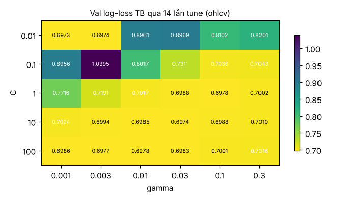
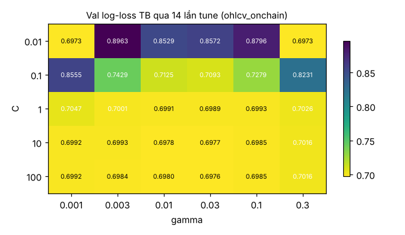
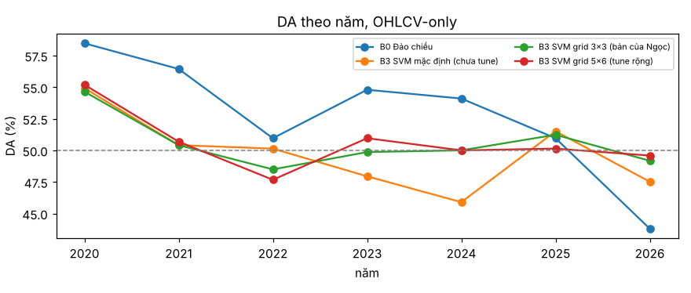

# Chạy và tuning baseline B0 (Majority, Persistence, Buy-and-hold) và B3 (SVM RBF) – Trâm

Tạo bởi `tram_baselines/src/run_baselines.py`. Dữ liệu, đặc trưng, 82 fold walk-forward (train 730 ngày, gap 1, test 30, 2020-01-01 → 2026-08-30), chuẩn hoá và CalibratedSVC lấy nguyên từ `ngoc_pipeline`. 10 đặc trưng OHLCV; 43 đặc trưng khi thêm On-chain (Flows A). Tỷ lệ ngày tăng trong 2434 ngày test: 50,9%.

## Tóm tắt

1. **B0.** Majority đúng 50,08%, Persistence 46,51%, Buy-and-hold (luôn đoán tăng) 50,90%, Đảo chiều 53,25% (p = 0,001). Majority chỉ có một tham số (độ dài cửa sổ L); tune L cho DA 50,74% nhưng log-loss tệ hơn (0,6938 → 0,6967), nên giữ bản 730 ngày.
2. **Tuning SVM có chạy và đã ghi lại đủ.** Grid 5×6 = 30 tổ hợp × 14 lần tune × 2 cấu hình, chọn bằng inner CV trong cửa sổ train. Trên inner validation, tổ hợp được chọn có log-loss thấp hơn mặc định trung bình 0,0038 (0,6986 → 0,6948). Nhưng mức cải thiện này lạc quan sẵn (chọn tổ hợp tốt nhất trong 30 trên chính validation đó), và 14 lần tune chọn ra 14 tổ hợp khác nhau: tuning không ổn định.
3. **Trên test, tuning không giúp.** OHLCV-only: DA mặc định 49,88%, grid 3×3 50,62%, grid 5×6 50,66%; log-loss 0,6951 → 0,7009 → 0,6959, tức bản **chưa tune có log-loss tốt nhất**. Không bản nào khác 50% có ý nghĩa.
4. **Không SVM nào thắng luật đảo chiều.** Grid 5×6 OHLCV-only kém luật 2,59 điểm (p = 0,079).
5. **Vì sao:** p̂ của SVM gần như luôn trong khoảng 0,46–0,62, và % ngày đoán tăng trong mỗi fold đi theo tỷ lệ tăng của cửa sổ train (tương quan 0,69 với grid 3×3). SVM gần như là Majority: không tìm được ranh giới giữa ngày tăng và ngày giảm trong 10 đặc trưng OHLCV.
6. **Thêm On-chain (cùng protocol):** ΔDA của grid 5×6 = -1,64 điểm (p = 0,095), Δlog-loss 0,0007. Vì baseline OHLCV-only chưa vượt luật đảo chiều, Δ này chưa đủ cơ sở để kết luận.
7. **SVM chỉ với 1 đặc trưng (logret_lag1)** đúng 50,29% (grid 5×6), so với 50,66% của bản 10 đặc trưng và 53,25% của luật đảo chiều. Dù chỉ nhìn đúng thông tin mà luật đảo chiều dùng, SVM vẫn đoán tăng 69,6% số ngày và chỉ cùng hướng với luật ở 50,7% số ngày: SVM RBF không khai thác được quy luật đảo chiều.

**Đề xuất cho nhóm:**

- Ghi B3 vào báo cáo với cả ba bản (mặc định, 3×3, 5×6) và bảng tuning ở mục 3, để thầy thấy tuning đã chạy và không cải thiện.
- Không mở rộng grid SVM thêm: tham số tốt nhất đổi mỗi lần tune và bản chưa tune có log-loss tốt nhất trên test.
- Giữ luật đảo chiều làm mốc. Chỉ so On-chain cho mô hình nào đã vượt mốc này trên OHLCV-only; hiện SVM chưa vượt.

## 1. Tuning đã chạy thực tế

| Mô hình | Tham số | Giá trị đã thử | Chọn bằng | Bao lâu chọn lại |
|---|---|---|---|---|
| B0 Majority (730 ngày) | – | không có tham số | – | – |
| B0 Majority, tune cửa sổ L | L = số ngày train cuối dùng để tính tỷ lệ tăng | 30, 90, 180, 365, 730 | log-loss trung bình trên inner TimeSeriesSplit(5, gap 1) trong cửa sổ train | mỗi 6 fold (14 lần) |
| B0 Persistence | – | không có tham số | – | – |
| B0 Đảo chiều | chiều của luật (cùng / ngược hôm nay) | 2 chiều | % đúng của persistence trên cửa sổ train (< 50% thì đảo) | mỗi fold |
| B0 Buy-and-hold | – | không có tham số | – | – |
| B3 SVM mặc định | C = 1, gamma = "scale" (mặc định sklearn) | không tune | – | – |
| B3 SVM grid 3×3 | C, gamma | C ∈ [0.1, 1, 10], gamma ∈ [0.001, 0.01, 0.1] | log-loss trên inner TimeSeriesSplit(5, gap 1) trong cửa sổ train | mỗi 6 fold (14 lần) |
| B3 SVM grid 5×6 | C, gamma | C ∈ [0.01, 0.1, 1, 10, 100], gamma ∈ [0.001, 0.003, 0.01, 0.03, 0.1, 0.3] | như trên | mỗi 6 fold (14 lần) |

Ngày test không bao giờ nằm trong inner CV: các split chỉ cắt trong 730 ngày train của fold. Xác suất của SVM được hiệu chỉnh sigmoid trên điểm ngoài mẫu theo thời gian, cũng trong cửa sổ train. Toàn bộ điểm của mọi tổ hợp ở mọi lần tune: `results/tables/tuning_log.csv`.

**Kiểm tra tái tạo:** `b3g9` dùng đúng grid và code của Ngọc, nên phải ra cùng dự báo với `ngoc_pipeline/results/predictions/b3_*.csv`.
- ohlcv: 0 ngày đổi hướng dự báo, lệch p̂ lớn nhất 2.9e-03.
- ohlcv_onchain: 0 ngày đổi hướng dự báo, lệch p̂ lớn nhất 4.3e-05.

## 2. B0: Majority, Persistence, Buy-and-hold (không dùng đặc trưng)

B0 không dùng đặc trưng nên hai cấu hình cho cùng dự báo. Persistence, đảo chiều, buy-and-hold chỉ cho p̂ = 0 hoặc 1, nên chỉ so được DA (log-loss, Brier, AUC để trống).

| Mô hình | DA (%) | CI 95% | p (DA = 50%) | Log-loss | Brier | AUC | % ngày đoán tăng |
|---|---|---|---|---|---|---|---|
| B0 Majority (730 ngày) | 50,08 | [48,1; 52,1] | 0,952 | 0,6938 | 0,2503 | – | 63,0 |
| B0 Majority, tune cửa sổ L | 50,74 | [48,7; 52,7] | 0,478 | 0,6967 | 0,2518 | – | 48,1 |
| B0 Persistence | 46,51 | [44,5; 48,5] | <0,001 | – | – | – | 50,9 |
| B0 Đảo chiều | 53,25 | [51,2; 55,2] | 0,001 | – | – | – | 49,4 |
| B0 Buy-and-hold (luôn tăng) | 50,90 | [48,9; 52,9] | 0,383 | – | – | – | 100,0 |

### Tuning cửa sổ của Majority

Điểm trung bình qua 14 lần tune (inner validation trong cửa sổ train):

| L (ngày) | Val log-loss TB | Val DA TB (%) | Số lần được chọn |
|---|---|---|---|
| 30 | 0,7006 | 50,6 | 2 |
| 90 | 0,6981 | 50,7 | 2 |
| 180 | 0,6969 | 50,2 | 2 |
| 365 | 0,6952 | 50,9 | 3 |
| 730 | 0,6950 | 50,8 | 5 |

Trước tuning (L = 730): DA 50,08%, log-loss 0,6938. Sau tuning: DA 50,74%, log-loss 0,6967. L = 730 được chọn nhiều nhất (5/14 lần). DA nhích lên nhưng log-loss tệ đi: cửa sổ ngắn bám theo xu hướng vài tháng gần đây, nhưng tỷ lệ tăng gần đây gần như không nói gì về ngày mai.

**Buy-and-hold như một bộ dự báo** đúng 50,90%, đúng bằng tỷ lệ ngày tăng. **Đảo chiều** đúng 53,25% (p = 0,001), là B0 mạnh nhất và là mốc mà B3 phải vượt.

## 3. B3 SVM RBF: tuning

### Cấu hình ohlcv (10 đặc trưng), grid 5×6

Mỗi lần tune: tham số được chọn, và điểm inner validation trước tuning (mặc định C = 1, γ = scale) so với sau tuning (tổ hợp được chọn). Log-loss thấp hơn là tốt hơn; đoán 50/50 cho log-loss 0,6931.

| Lần tune | Cửa sổ train | Tham số chọn | Val log-loss trước | Val log-loss sau | Val DA trước (%) | Val DA sau (%) |
|---|---|---|---|---|---|---|
| 0 | 2017-12-31 → 2019-12-30 | C = 1, γ = 0.1 | 0,6999 | 0,6991 | 50,1 | 49,3 |
| 1 | 2018-06-29 → 2020-06-27 | C = 1, γ = 0.3 | 0,6986 | 0,6961 | 50,1 | 49,9 |
| 2 | 2018-12-26 → 2020-12-24 | C = 10, γ = 0.03 | 0,6980 | 0,6970 | 52,7 | 52,4 |
| 3 | 2019-06-24 → 2021-06-22 | C = 100, γ = 0.003 | 0,7002 | 0,6961 | 51,1 | 51,7 |
| 4 | 2019-12-21 → 2021-12-19 | C = 0.01, γ = 0.001 | 0,6973 | 0,6922 | 53,1 | 54,2 |
| 5 | 2020-06-18 → 2022-06-17 | C = 0.1, γ = 0.01 | 0,7042 | 0,6944 | 52,1 | 52,4 |
| 6 | 2020-12-15 → 2022-12-14 | C = 100, γ = 0.1 | 0,7013 | 0,6931 | 50,6 | 49,8 |
| 7 | 2021-06-13 → 2023-06-12 | C = 100, γ = 0.03 | 0,6925 | 0,6914 | 52,4 | 54,9 |
| 8 | 2021-12-10 → 2023-12-09 | C = 0.1, γ = 0.1 | 0,6955 | 0,6924 | 50,4 | 52,7 |
| 9 | 2022-06-08 → 2024-06-06 | C = 1, γ = 0.001 | 0,6968 | 0,6949 | 47,8 | 49,3 |
| 10 | 2022-12-05 → 2024-12-03 | C = 100, γ = 0.3 | 0,6959 | 0,6936 | 49,9 | 51,1 |
| 11 | 2023-06-03 → 2025-06-01 | C = 1, γ = 0.01 | 0,6995 | 0,6971 | 50,9 | 50,9 |
| 12 | 2023-11-30 → 2025-11-28 | C = 0.01, γ = 0.01 | 0,6998 | 0,6965 | 49,8 | 48,4 |
| 13 | 2024-05-28 → 2026-05-27 | C = 1, γ = 0.003 | 0,7007 | 0,6930 | 51,1 | 53,2 |

14 lần tune chọn ra **14 tổ hợp khác nhau**, C nhảy từ 0.01 đến 100 và γ từ 0.001 đến 0.3. Số lần mỗi tổ hợp được chọn: C = 0.01, γ = 0.001: 1; C = 0.01, γ = 0.01: 1; C = 0.1, γ = 0.01: 1; C = 0.1, γ = 0.1: 1; C = 1, γ = 0.001: 1; C = 1, γ = 0.003: 1; C = 1, γ = 0.01: 1; C = 1, γ = 0.1: 1; C = 1, γ = 0.3: 1; C = 10, γ = 0.03: 1; C = 100, γ = 0.003: 1; C = 100, γ = 0.03: 1; C = 100, γ = 0.1: 1; C = 100, γ = 0.3: 1. Tham số tốt nhất đổi gần như mỗi lần tune, nghĩa là các tổ hợp cho điểm validation gần bằng nhau và lựa chọn chủ yếu do nhiễu.

8/30 tổ hợp có val log-loss trung bình trên 0,75 (tệ hơn hẳn đoán 50/50), đều ở C nhỏ (C ≤ 1). Với C nhỏ, SVM gần như cho cùng một điểm quyết định cho mọi ngày, nên bước hiệu chỉnh sigmoid nhiều lần bị dốc quá mức và cho xác suất cực đoan. Dù trung bình kém, các tổ hợp này vẫn được chọn 3/14 lần tune, vì ở những cửa sổ đó chúng tình cờ tốt nhất: khi điểm SVM gần như hằng số và hiệu chỉnh không gãy, p̂ gần bằng tỷ lệ ngày tăng của train, tức SVM trở thành Majority.

### Cấu hình ohlcv_onchain (43 đặc trưng), grid 5×6

Mỗi lần tune: tham số được chọn, và điểm inner validation trước tuning (mặc định C = 1, γ = scale) so với sau tuning (tổ hợp được chọn). Log-loss thấp hơn là tốt hơn; đoán 50/50 cho log-loss 0,6931.

| Lần tune | Cửa sổ train | Tham số chọn | Val log-loss trước | Val log-loss sau | Val DA trước (%) | Val DA sau (%) |
|---|---|---|---|---|---|---|
| 0 | 2017-12-31 → 2019-12-30 | C = 100, γ = 0.01 | 0,7020 | 0,6976 | 47,8 | 48,1 |
| 1 | 2018-06-29 → 2020-06-27 | C = 10, γ = 0.001 | 0,6998 | 0,6962 | 51,1 | 50,9 |
| 2 | 2018-12-26 → 2020-12-24 | C = 1, γ = 0.3 | 0,6982 | 0,6982 | 51,7 | 53,9 |
| 3 | 2019-06-24 → 2021-06-22 | C = 10, γ = 0.1 | 0,7001 | 0,6948 | 51,2 | 51,7 |
| 4 | 2019-12-21 → 2021-12-19 | C = 0.01, γ = 0.001 | 0,6961 | 0,6922 | 53,6 | 54,2 |
| 5 | 2020-06-18 → 2022-06-17 | C = 1, γ = 0.01 | 0,6958 | 0,6954 | 51,7 | 51,2 |
| 6 | 2020-12-15 → 2022-12-14 | C = 100, γ = 0.001 | 0,7009 | 0,6865 | 50,9 | 57,0 |
| 7 | 2021-06-13 → 2023-06-12 | C = 1, γ = 0.3 | 0,7097 | 0,6942 | 50,9 | 52,6 |
| 8 | 2021-12-10 → 2023-12-09 | C = 0.1, γ = 0.1 | 0,6931 | 0,6913 | 51,6 | 53,4 |
| 9 | 2022-06-08 → 2024-06-06 | C = 10, γ = 0.3 | 0,6985 | 0,6939 | 47,6 | 51,4 |
| 10 | 2022-12-05 → 2024-12-03 | C = 100, γ = 0.01 | 0,6988 | 0,6945 | 47,4 | 50,2 |
| 11 | 2023-06-03 → 2025-06-01 | C = 1, γ = 0.01 | 0,6951 | 0,6949 | 49,1 | 48,8 |
| 12 | 2023-11-30 → 2025-11-28 | C = 100, γ = 0.03 | 0,6985 | 0,6963 | 51,9 | 51,7 |
| 13 | 2024-05-28 → 2026-05-27 | C = 100, γ = 0.001 | 0,6990 | 0,6929 | 46,8 | 52,9 |

14 lần tune chọn ra **10 tổ hợp khác nhau**, C nhảy từ 0.01 đến 100 và γ từ 0.001 đến 0.3. Số lần mỗi tổ hợp được chọn: C = 0.01, γ = 0.001: 1; C = 0.1, γ = 0.1: 1; C = 1, γ = 0.01: 2; C = 1, γ = 0.3: 2; C = 10, γ = 0.001: 1; C = 10, γ = 0.1: 1; C = 10, γ = 0.3: 1; C = 100, γ = 0.001: 2; C = 100, γ = 0.01: 2; C = 100, γ = 0.03: 1. Tham số tốt nhất đổi gần như mỗi lần tune, nghĩa là các tổ hợp cho điểm validation gần bằng nhau và lựa chọn chủ yếu do nhiễu.

6/30 tổ hợp có val log-loss trung bình trên 0,75 (tệ hơn hẳn đoán 50/50), đều ở C nhỏ (C ≤ 0.1). Với C nhỏ, SVM gần như cho cùng một điểm quyết định cho mọi ngày, nên bước hiệu chỉnh sigmoid nhiều lần bị dốc quá mức và cho xác suất cực đoan. Không lần tune nào chọn các tổ hợp này.

## 4. Kết quả trên 2.434 ngày test

### 4.1 OHLCV-only (làm trước)

| Mô hình | DA (%) | CI 95% | p (DA = 50%) | Log-loss | Brier | AUC | % ngày đoán tăng |
|---|---|---|---|---|---|---|---|
| B0 Majority (730 ngày) | 50,08 | [48,1; 52,1] | 0,952 | 0,6938 | 0,2503 | – | 63,0 |
| B0 Đảo chiều | 53,25 | [51,2; 55,2] | 0,001 | – | – | – | 49,4 |
| B3 SVM mặc định (chưa tune) | 49,88 | [47,9; 51,9] | 0,919 | 0,6951 | 0,2510 | 0,501 | 64,9 |
| B3 SVM grid 3×3 (bản của Ngọc) | 50,62 | [48,6; 52,6] | 0,557 | 0,7009 | 0,2533 | 0,503 | 72,8 |
| B3 SVM grid 5×6 (tune rộng) | 50,66 | [48,7; 52,7] | 0,530 | 0,6959 | 0,2512 | 0,507 | 75,4 |

### 4.2 OHLCV + On-chain (cùng mô hình, cùng protocol, cùng grid)

| Mô hình | DA (%) | CI 95% | p (DA = 50%) | Log-loss | Brier | AUC | % ngày đoán tăng |
|---|---|---|---|---|---|---|---|
| B0 Majority (730 ngày) | 50,08 | [48,1; 52,1] | 0,952 | 0,6938 | 0,2503 | – | 63,0 |
| B0 Đảo chiều | 53,25 | [51,2; 55,2] | 0,001 | – | – | – | 49,4 |
| B3 SVM mặc định (chưa tune) | 49,47 | [47,5; 51,5] | 0,612 | 0,6959 | 0,2514 | 0,495 | 61,4 |
| B3 SVM grid 3×3 (bản của Ngọc) | 50,29 | [48,3; 52,3] | 0,792 | 0,6959 | 0,2514 | 0,498 | 64,7 |
| B3 SVM grid 5×6 (tune rộng) | 49,01 | [47,0; 51,0] | 0,341 | 0,6966 | 0,2517 | 0,494 | 64,0 |

### 4.3 SVM so với luật đảo chiều (cùng ngày test, McNemar chính xác)

| SVM | Cấu hình | DA SVM (%) | DA đảo chiều (%) | ΔDA (điểm) | Ngày chỉ SVM đúng | Ngày chỉ luật đúng | p |
|---|---|---|---|---|---|---|---|
| B3 SVM mặc định (chưa tune) | ohlcv | 49,88 | 53,25 | -3,37 | 592 | 674 | 0,023 |
| B3 SVM grid 3×3 (bản của Ngọc) | ohlcv | 50,62 | 53,25 | -2,63 | 598 | 662 | 0,076 |
| B3 SVM grid 5×6 (tune rộng) | ohlcv | 50,66 | 53,25 | -2,59 | 593 | 656 | 0,079 |
| B3 SVM mặc định (chưa tune) | ohlcv_onchain | 49,47 | 53,25 | -3,78 | 546 | 638 | 0,008 |
| B3 SVM grid 3×3 (bản của Ngọc) | ohlcv_onchain | 50,29 | 53,25 | -2,96 | 574 | 646 | 0,042 |
| B3 SVM grid 5×6 (tune rộng) | ohlcv_onchain | 49,01 | 53,25 | -4,23 | 542 | 645 | 0,003 |

### 4.4 Δ khi thêm On-chain (OHLCV + On-chain − OHLCV-only)

| SVM | DA OHLCV (%) | DA + On-chain (%) | ΔDA (điểm) | p McNemar | Log-loss OHLCV | Log-loss + On-chain | ΔLog-loss |
|---|---|---|---|---|---|---|---|
| B3 SVM mặc định (chưa tune) | 49,88 | 49,47 | -0,41 | 0,674 | 0,6951 | 0,6959 | 0,0008 |
| B3 SVM grid 3×3 (bản của Ngọc) | 50,62 | 50,29 | -0,33 | 0,755 | 0,7009 | 0,6959 | -0,0050 |
| B3 SVM grid 5×6 (tune rộng) | 50,66 | 49,01 | -1,64 | 0,095 | 0,6959 | 0,6966 | 0,0007 |

ΔLog-loss âm nghĩa là On-chain làm xác suất tốt hơn.

## 5. DA theo năm (OHLCV-only)

| Năm | Tỷ lệ ngày tăng | Đảo chiều | SVM mặc định | SVM 3×3 | SVM 5×6 |
|---|---|---|---|---|---|
| 2020 | 57,7 | 58,5 | 54,9 | 54,6 | 55,2 |
| 2021 | 50,4 | 56,4 | 50,4 | 50,4 | 50,7 |
| 2022 | 45,8 | 51,0 | 50,1 | 48,5 | 47,7 |
| 2023 | 50,4 | 54,8 | 47,9 | 49,9 | 51,0 |
| 2024 | 52,5 | 54,1 | 45,9 | 50,0 | 50,0 |
| 2025 | 50,1 | 51,0 | 51,5 | 51,2 | 50,1 |
| 2026 | 48,8 | 43,8 | 47,5 | 49,2 | 49,6 |

Số năm SVM thắng luật đảo chiều: B3 SVM mặc định (chưa tune) 2/7; B3 SVM grid 3×3 (bản của Ngọc) 2/7; B3 SVM grid 5×6 (tune rộng) 1/7.

## 6. Chẩn đoán: SVM đang dự báo gì?

| SVM | Cấu hình | p̂ 5% | p̂ trung vị | p̂ 95% | % ngày đoán tăng | Số fold (/82) đoán cùng một hướng cả 30 ngày | Tương quan: tỷ lệ tăng của train ↔ % đoán tăng trong fold |
|---|---|---|---|---|---|---|---|
| B3 SVM mặc định (chưa tune) | ohlcv | 0,457 | 0,512 | 0,551 | 64,9 | 36 | 0,73 |
| B3 SVM mặc định (chưa tune) | ohlcv_onchain | 0,454 | 0,511 | 0,558 | 61,4 | 40 | 0,73 |
| B3 SVM grid 3×3 (bản của Ngọc) | ohlcv | 0,462 | 0,515 | 0,619 | 72,8 | 53 | 0,69 |
| B3 SVM grid 3×3 (bản của Ngọc) | ohlcv_onchain | 0,446 | 0,510 | 0,557 | 64,7 | 38 | 0,74 |
| B3 SVM grid 5×6 (tune rộng) | ohlcv | 0,466 | 0,517 | 0,567 | 75,4 | 54 | 0,68 |
| B3 SVM grid 5×6 (tune rộng) | ohlcv_onchain | 0,447 | 0,513 | 0,567 | 64,0 | 44 | 0,71 |

Đọc bảng: p̂ của SVM gần như luôn nằm sát 0,5; ở nhiều fold SVM đoán cùng một hướng cho cả 30 ngày; và % ngày đoán tăng trong fold đi theo tỷ lệ tăng của cửa sổ train. Nghĩa là SVM chủ yếu lặp lại tỷ lệ ngày tăng của train (giống Majority), chứ không phân biệt được ngày tăng với ngày giảm. Đây cũng là lý do SVM "lệch về tăng" mà báo cáo giữa kỳ ghi nhận: các cửa sổ train phần lớn có hơn 50% ngày tăng.

## 7. Backtest long/flat (phí 0,1%/lượt, code `tram_features_backtest/src/backtest.py`)

| Mô hình | Cấu hình | Lợi nhuận tích luỹ | Sharpe | MDD | Số lần giao dịch | % ngày giữ BTC |
|---|---|---|---|---|---|---|
| B0 Majority (730 ngày) | – | 72% | 0,43 | -82% | 7 | 63% |
| B0 Persistence | – | -71% | -0,22 | -79% | 1302 | 51% |
| B0 Đảo chiều | – | 211% | 0,61 | -71% | 1302 | 49% |
| B0 Buy-and-hold (luôn tăng) | – | 990% | 0,90 | -77% | 1 | 100% |
| B3 SVM mặc định (chưa tune) | ohlcv | 57% | 0,38 | -86% | 422 | 65% |
| B3 SVM grid 3×3 (bản của Ngọc) | ohlcv | 286% | 0,65 | -72% | 264 | 73% |
| B3 SVM grid 5×6 (tune rộng) | ohlcv | 478% | 0,76 | -72% | 236 | 75% |
| B3 SVM mặc định (chưa tune) | ohlcv_onchain | 10% | 0,30 | -78% | 312 | 61% |
| B3 SVM grid 3×3 (bản của Ngọc) | ohlcv_onchain | 63% | 0,41 | -80% | 327 | 65% |
| B3 SVM grid 5×6 (tune rộng) | ohlcv_onchain | 10% | 0,30 | -84% | 263 | 64% |

Buy-and-hold thật (mua ngày đầu, trả phí một lần): 990%, Sharpe 0,90, MDD -77%. SVM grid 5×6 OHLCV-only lời nhiều nhất trong các SVM dù DA chỉ 50,66%, vì nó giữ BTC 75% số ngày nên hưởng phần lớn đà tăng dài hạn, gần giống buy-and-hold. Như báo cáo giữa kỳ, lợi nhuận phụ thuộc vài ngày biến động mạnh; chỉ dùng tham khảo.

## 8. Thử thêm: SVM chỉ với 1 đặc trưng (logret_lag1)

Cùng protocol, cùng 82 fold, chỉ khác bộ đặc trưng. Mục đích: xem SVM có học được quy luật đảo chiều khi bỏ 9 đặc trưng còn lại không.

| SVM 1 đặc trưng | DA (%) | CI 95% | Log-loss | % ngày đoán tăng | So với đảo chiều: ΔDA (điểm), p | % ngày cùng hướng với luật đảo chiều |
|---|---|---|---|---|---|---|
| SVM mặc định (chưa tune) | 50,53 | [48,5; 52,5] | 0,6949 | 66,4 | -2,71, p = 0,035 | 60,9 |
| SVM grid 5×6 (tune rộng) | 50,29 | [48,3; 52,3] | 0,7619 | 69,6 | -2,96, p = 0,040 | 50,7 |
