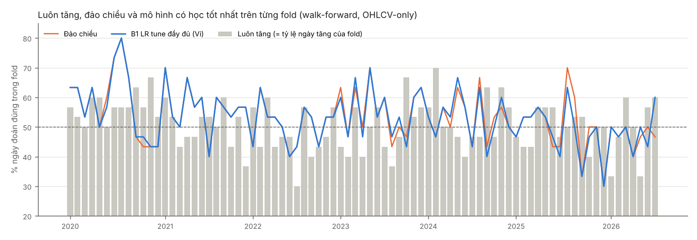
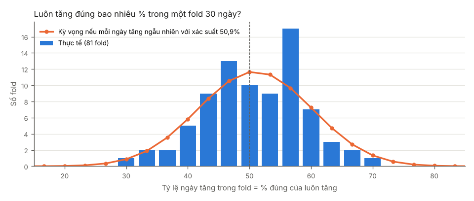
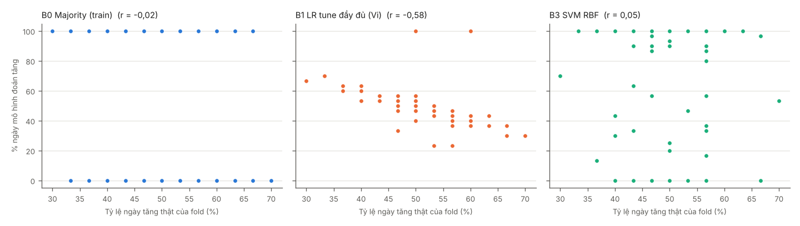

# Baseline ngây thơ: luôn tăng / luôn giảm trên từng fold – Trâm

Tạo bởi `tram_naive_folds/src/naive_folds.py`. Chỉ đọc các file dự báo đã có trong repo, không chạy lại mô hình. "Luôn tăng" đoán tăng mọi ngày (p̂ = 1), "luôn giảm" đoán giảm mọi ngày (p̂ = 0); hai luật này không học gì, nên % đúng của luôn tăng **chính bằng tỷ lệ ngày tăng** của đoạn đang xét.

## Tóm tắt

1. **Toàn kỳ 2020 – 08/2026 (2.434 ngày):** luôn tăng đúng **50,90%**, luôn giảm **49,10%**. Tỷ lệ ngày tăng của BTC chỉ hơn 50% một chút, nên luôn tăng không phải mốc cao.
2. **Nhưng trên từng fold 30 ngày, luôn tăng dao động từ 30% đến 70%.** Có 13/81 fold luôn tăng đúng ≥ 60% (ví dụ fold 50, 2024-02-09 → 2024-03-09: 70%) và 10 fold chỉ ≤ 40% (fold 31, 2022-07-19 → 2022-08-17: 30%). Một con số "60%" trên một đoạn ngắn **không chứng minh mô hình giỏi**: nó có thể chỉ do đoạn đó rơi vào thị trường tăng.
3. **Mức dao động này gần đúng như kỳ vọng nếu mỗi ngày tăng/giảm ngẫu nhiên** (kiểm định χ²: p = 0,917; kỳ vọng 16,9 fold ≥ 60%, thực tế 13). Tức là các fold "tăng nhiều" phần lớn là may rủi của 30 ngày, không phải xu hướng mà một mô hình có thể bám theo.
4. **Mô hình đã tuning so với luôn tăng (toàn kỳ, OHLCV-only):** tốt nhất là B1 LR tune đầy đủ (Vi) với 53,20% (+2,30 điểm, p = 0,119). Luật đảo chiều 53,25% (+2,34 điểm, p = 0,110). Các mô hình còn lại chênh luôn tăng từ -0,45 đến 2,30 điểm.
5. **Theo fold:** mô hình có học thắng luôn tăng ở 17–45/82 fold; luật đảo chiều thắng ở 45/82. Thắng **cả** luôn tăng lẫn luôn giảm (tức hơn cả luật ngây thơ đoán đúng hướng đa số của fold khi đã biết trước) chỉ ở 5–26 fold.
6. **Không mô hình nào "bám" được xu hướng của fold, vì xu hướng đó không kéo dài:** tỷ lệ tăng của một fold gần như không liên quan tới fold trước (tự tương quan 0,07). Majority, vốn học tỷ lệ tăng của 730 ngày trước, chỉ thắng luôn tăng ở 13/82 fold. B3 SVM giống luôn tăng nhất: đoán tăng 73% số ngày, DA của nó cao lên ở fold tăng nhiều (r = 0,37) và chỉ thắng luôn tăng ở 17/82 fold. Hai mô hình tốt nhất (B1 tune đầy đủ, luật đảo chiều) lại đoán tăng *ít* hơn ở fold tăng nhiều (r = -0,58 và -0,91), vì chúng dựa vào quy luật đảo chiều: fold có nhiều ngày tăng thì có nhiều ngày "hôm nay tăng", nên luật đoán "mai giảm" nhiều hơn.
7. **simple_split (test 2024 – 08/2026, 973 ngày, 33 khối 30 ngày):** luôn tăng 50,67%, luôn giảm 49,33%; khối 30 ngày dao động 37–70%. Không mô hình đã tuning nào hơn luôn tăng có ý nghĩa thống kê (bảng ở mục 4).

**Cách đọc cho nhóm:** mốc so sánh đúng của một mô hình là **luôn tăng trên cùng đoạn dữ liệu**, không phải 50%. Một mô hình chỉ có giá trị khi hơn luôn tăng (và luôn giảm) trên cùng các ngày, kiểm định bằng McNemar, và hơn ở nhiều fold chứ không chỉ một vài fold may mắn.

## 1. Toàn kỳ walk-forward (82 fold, 2.434 ngày), OHLCV-only

| Mô hình | DA toàn kỳ (%) | CI 95% | So với luôn tăng (điểm) | p (McNemar, so với luôn tăng) | Fold thắng luôn tăng (/82) | Fold thắng luôn giảm | Fold thắng cả hai | % ngày đoán tăng |
|---|---|---|---|---|---|---|---|---|
| Luôn tăng | 50,90 | [48,9; 52,9] | 0,00 | – | – | – | – | 100,0 |
| Luôn giảm | 49,10 | [47,1; 51,1] | -1,81 | – | – | – | – | 0,0 |
| B0 Majority (train) | 50,08 | [48,1; 52,1] | -0,82 | 0,527 | 13 | 26 | 0 | 63,0 |
| B0 Persistence | 46,51 | [44,5; 48,5] | -4,40 | 0,002 | 28 | 28 | 8 | 50,9 |
| B0 Đảo chiều | 53,25 | [51,2; 55,2] | 2,34 | 0,110 | 45 | 46 | 26 | 49,4 |
| B1 LR (E1) | 51,11 | [49,1; 53,1] | 0,21 | 0,902 | 41 | 46 | 22 | 56,4 |
| B1 LR tune đầy đủ (Vi) | 53,20 | [51,2; 55,2] | 2,30 | 0,119 | 45 | 48 | 26 | 49,0 |
| B2 RF tuned (b2t) | 51,15 | [49,1; 53,2] | 0,25 | 0,881 | 37 | 39 | 19 | 54,5 |
| B3 SVM RBF | 50,62 | [48,6; 52,6] | -0,29 | 0,815 | 17 | 36 | 5 | 72,8 |
| B4 XGBoost | 50,45 | [48,4; 52,5] | -0,45 | 0,740 | 24 | 37 | 10 | 62,7 |
| B5 LSTM | 50,74 | [48,7; 52,7] | -0,16 | 0,926 | 34 | 35 | 14 | 57,5 |

"Fold thắng" = DA của mô hình trong fold cao hơn hẳn luật ngây thơ (bằng nhau không tính). "Thắng cả hai" = cao hơn max(luôn tăng, luôn giảm) của fold đó; max này là luật biết trước hướng đa số của fold, không dùng được trong thực tế, chỉ là mốc trên.

Hình chỉ vẽ 81 fold đủ 30 ngày. Cột xám là luôn tăng ở từng fold, tức tỷ lệ ngày tăng của fold. Các đường dao động quanh 50% và không bám sát cột xám: mô hình không nắm được fold nào sẽ tăng nhiều.

## 2. Luôn tăng đúng bao nhiêu trong một fold?

Tỷ lệ ngày tăng trên 81 fold đủ 30 ngày: thấp nhất 30,0%, cao nhất 70,0%. Nếu mỗi ngày tăng ngẫu nhiên với xác suất 50,9% thì 30 ngày có độ lệch chuẩn khoảng 9,1 điểm, nên một fold 60% hay 40% là bình thường.

| | Thực tế | Kỳ vọng nếu ngẫu nhiên |
|---|---|---|
| Số fold luôn tăng đúng ≥ 60% | 13 | 16,9 |
| Số fold luôn tăng đúng ≤ 40% | 10 | 12,6 |
| Độ phân tán so với nhị thức (χ²/bậc tự do) | 0,79 | 1,00 |
| p (χ², 81 bậc tự do) | 0,917 | |

## 3. Theo năm (OHLCV-only)

| Năm | Luôn tăng | Luôn giảm | B0 Majority (train) | B0 Persistence | B0 Đảo chiều | B1 LR (E1) | B1 LR tune đầy đủ (Vi) | B2 RF tuned (b2t) | B3 SVM RBF | B4 XGBoost | B5 LSTM |
|---|---|---|---|---|---|---|---|---|---|---|---|
| 2020 | 57,7 | 42,3 | 57,7 | 41,5 | 58,5 | 59,6 | 58,5 | 61,7 | 54,6 | 54,6 | 57,9 |
| 2021 | 50,4 | 49,6 | 50,4 | 43,6 | 56,4 | 51,0 | 56,4 | 52,3 | 50,4 | 48,5 | 49,0 |
| 2022 | 45,8 | 54,2 | 47,4 | 49,0 | 51,0 | 48,8 | 51,0 | 48,8 | 48,5 | 47,1 | 49,3 |
| 2023 | 50,4 | 49,6 | 49,6 | 45,2 | 54,8 | 49,0 | 54,8 | 47,9 | 49,9 | 51,0 | 49,9 |
| 2024 | 52,5 | 47,5 | 47,3 | 45,9 | 54,1 | 53,3 | 54,1 | 52,5 | 50,0 | 51,1 | 53,3 |
| 2025 | 50,1 | 49,9 | 50,1 | 49,0 | 51,0 | 49,0 | 49,3 | 48,5 | 51,2 | 51,5 | 48,2 |
| 2026 | 48,8 | 51,2 | 47,1 | 53,7 | 43,8 | 45,0 | 45,9 | 43,8 | 49,2 | 48,8 | 45,9 |

Năm 2020 thị trường tăng mạnh nên luôn tăng đúng 57,7%, năm 2022 giảm mạnh nên luôn giảm đúng 54,2%. Mô hình nào lệch về đoán tăng sẽ trông tốt ở 2020 và tệ ở 2022, dù không dự báo được gì.

## 4. Mô hình có "đi theo" xu hướng của fold không?

| Mô hình | Tương quan: % đoán tăng ↔ tỷ lệ tăng thật của fold | Tương quan: DA ↔ tỷ lệ tăng thật của fold |
|---|---|---|
| B0 Majority (train) | -0,02 | 0,10 |
| B0 Persistence | 0,96 | -0,07 |
| B0 Đảo chiều | -0,91 | 0,07 |
| B1 LR (E1) | -0,15 | 0,17 |
| B1 LR tune đầy đủ (Vi) | -0,58 | 0,09 |
| B2 RF tuned (b2t) | -0,31 | 0,12 |
| B3 SVM RBF | 0,05 | 0,37 |
| B4 XGBoost | -0,14 | 0,05 |
| B5 LSTM | -0,17 | 0,13 |

Tự tương quan của tỷ lệ tăng giữa hai fold liền nhau: 0,07, gần 0. Biết fold trước tăng nhiều gần như không cho biết fold sau sẽ thế nào, nên một mô hình không thể thắng luôn tăng bằng cách bám theo xu hướng gần đây.

- Tương quan đầu **dương** (SVM, Persistence) nghĩa là mô hình đoán tăng nhiều hơn ở fold thật sự tăng nhiều. Với SVM điều này đến từ việc nó gần như luôn đoán tăng, nên DA của nó lên xuống theo tỷ lệ tăng của fold, giống hệt luôn tăng.
- Tương quan đầu **âm** (đảo chiều, B1 tune đầy đủ, RF) nghĩa là mô hình đoán tăng ít hơn ở fold tăng nhiều. Đây là dấu hiệu mô hình dùng quy luật đảo chiều: nhiều ngày "hôm nay tăng" thì nhiều lần đoán "mai giảm".
- Cột thứ hai gần 0 với hầu hết mô hình: DA của mô hình không phụ thuộc nhiều vào việc fold tăng hay giảm, trừ SVM.

## 5. Cùng phép so sánh khi thêm On-chain

| Mô hình | DA toàn kỳ (%) | CI 95% | So với luôn tăng (điểm) | p (McNemar, so với luôn tăng) | Fold thắng luôn tăng (/82) | Fold thắng luôn giảm | Fold thắng cả hai | % ngày đoán tăng |
|---|---|---|---|---|---|---|---|---|
| Luôn tăng | 50,90 | [48,9; 52,9] | 0,00 | – | – | – | – | 100,0 |
| Luôn giảm | 49,10 | [47,1; 51,1] | -1,81 | – | – | – | – | 0,0 |
| B1 LR (E1) | 51,89 | [49,9; 53,9] | 0,99 | 0,488 | 44 | 49 | 26 | 54,7 |
| B1 LR tune đầy đủ (Vi) | 51,19 | [49,2; 53,2] | 0,29 | 0,862 | 33 | 41 | 19 | 51,4 |
| B2 RF tuned (b2t) | 49,22 | [47,2; 51,2] | -1,68 | 0,255 | 30 | 29 | 10 | 49,2 |
| B3 SVM RBF | 50,29 | [48,3; 52,3] | -0,62 | 0,633 | 23 | 36 | 9 | 64,7 |
| B4 XGBoost | 48,97 | [47,0; 51,0] | -1,93 | 0,150 | 23 | 34 | 10 | 58,0 |
| B5 LSTM | 50,58 | [48,6; 52,6] | -0,33 | 0,862 | 35 | 30 | 14 | 33,4 |

## 6. simple_split: test 2024 – 08/2026 chia thành khối 30 ngày

Dự báo lấy từ `simple_split/reports/predictions_test.csv` (mô hình học trên 2018–2023, tune trên validation 2022–2023, chạy test một lần). Test 973 ngày được chia thành 33 khối 30 ngày liên tiếp (khối cuối 13 ngày).

| Mô hình | DA toàn kỳ (%) | CI 95% | So với luôn tăng (điểm) | p (McNemar, so với luôn tăng) | Fold thắng luôn tăng (/33) | Fold thắng luôn giảm | Fold thắng cả hai | % ngày đoán tăng |
|---|---|---|---|---|---|---|---|---|
| Luôn tăng | 50,67 | [47,5; 53,9] | 0,00 | – | – | – | – | 100,0 |
| Luôn giảm | 49,33 | [46,1; 52,5] | -1,34 | – | – | – | – | 0,0 |
| Majority | 50,67 | [47,5; 53,9] | 0,00 | 1,000 | 0 | 15 | 0 | 100,0 |
| Persistence | 49,02 | [45,8; 52,2] | -1,64 | 0,494 | 13 | 15 | 7 | 50,7 |
| Đảo chiều | 50,98 | [47,8; 54,2] | 0,31 | 0,928 | 17 | 17 | 10 | 49,3 |
| LR sau tune | 52,11 | [48,9; 55,3] | 1,44 | 0,605 | 17 | 19 | 13 | 35,0 |
| SVM RBF sau tune | 51,08 | [47,9; 54,3] | 0,41 | 0,912 | 13 | 18 | 9 | 23,9 |
| RF sau tune | 50,67 | [47,5; 53,9] | 0,00 | 1,000 | 14 | 21 | 9 | 57,7 |
| LSTM sau tune | 49,13 | [45,9; 52,3] | -1,54 | 0,452 | 12 | 16 | 6 | 64,3 |

Luôn tăng trên từng khối dao động 37–70%. Majority của simple_split đoán tăng mọi ngày (tỷ lệ tăng của 2018–2023 là hơn 50%), nên trùng với luôn tăng.

## Ghi chú

- DA của mỗi mô hình lấy từ file dự báo hiện có trong repo; con số khớp với các bảng E1, `lr_tuning_summary.csv`, `b2_tuning` và `simple_split` của nhóm.
- B1 tune đầy đủ: file `lr_tuned_logloss.csv` và bảng `ngoc_pipeline/results/lr_tuning/tables/lr_tuning_summary.csv` đều cho 53,20%, trong khi `feedback_review/report.md` còn ghi 52,59% (bản chạy cũ hơn). Nên cập nhật report đó cho khớp.
- p so với luôn tăng: McNemar chính xác trên các ngày mô hình và luôn tăng khác nhau (tức các ngày mô hình đoán giảm).
- Fold cuối của walk-forward chỉ có 4 ngày; nó có trong bảng đếm fold nhưng không có trong thống kê fold đủ 30 ngày.
